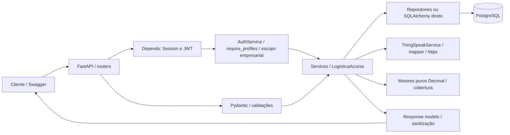
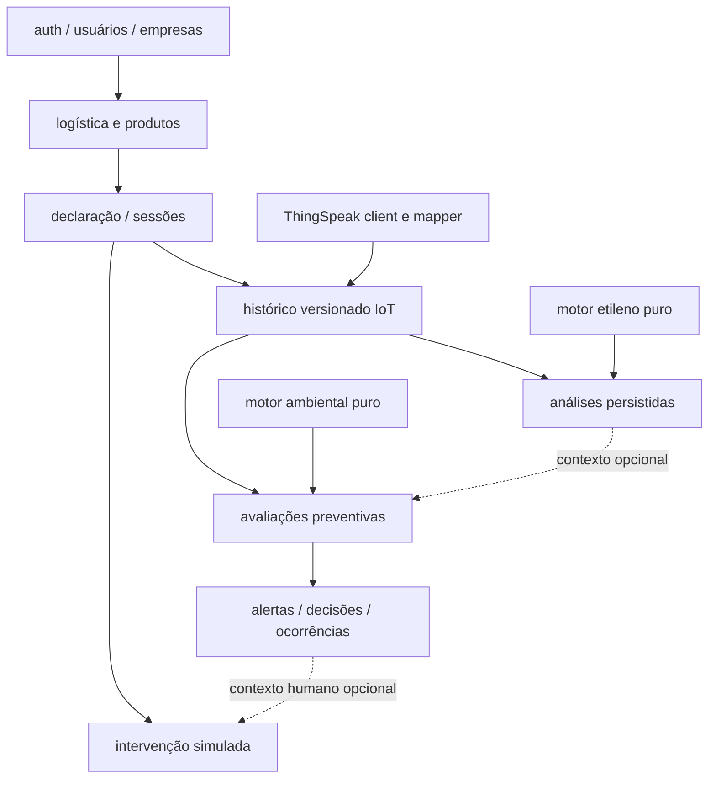

# Arquitetura técnica

Auditoria de 23/11/2026 · `main` · `c9785fa6b4656c73e3e35ac5db310c48e65d2fe5`.

[Índice](00-INDICE-GERAL.md) · [Pendências](09-PENDENCIAS-E-INCONSISTENCIAS.md)

## Runtime e dependências

Python observado: 3.13.7. Não existe faixa de versões Python declarada em pyproject; 3.13.7 é o ambiente auditado, não garantia de compatibilidade universal. Pins e versões instaladas:

| Pacote | Instalado |
| --- | --- |
| fastapi | 0.115.0 |
| pydantic | 2.9.2 |
| SQLAlchemy | 2.0.35 |
| alembic | 1.13.2 |
| pytest | 8.3.3 |
| httpx | 0.27.2 |
| psycopg | 3.2.2 |
| PyJWT | 2.10.1 |

[requirements.txt](../../requirements.txt) contém os pins (uvicorn, pwdlib[argon2], python-dotenv, email-validator e pydantic-settings também).

## Organização e caminhos de execução

`app/main.py:create_app` cria FastAPI, CORS e tratamento de 422. `app/api/routes/__init__.py` compõe routers. `app/api/deps.py` injeta sessão e usuário; `require_profiles` valida papéis. O grafo FastAPI resolve dependências e valida entrada antes do handler; autenticação, autorização e validação não são etapas estritamente sequenciais iguais em todas as rotas. FastAPI pode resolver a dependência de banco mesmo ao rejeitar um JWT.

Routers logísticos usam LogisticaAccess; empresas/usuários/produtos chamam services diretamente; o monitoramento combina serviços, SQLAlchemy direto e MonitoramentoRepository/HistoricoIoTRepository. Não há camada repository exclusiva para toda operação. Os motores puros recebem dados/snapshots e não fazem HTTP/SQL. Services de análise/preventivo/exaustão herdam suporte de histórico; esse acoplamento deve ser conhecido antes de refatorar.

## Erros e transações

HTTPException propaga `{"detail":"mensagem"}` e headers quando presentes. O handler de RequestValidationError remove `input` e `ctx`, retornando `detail:[{type,loc,msg}]`. Commit genérico (`app/services/persistence.py`) e transações de monitoramento fazem rollback; novos serviços convertem falhas SQL em 503 sem ecoar SQL. Conflitos IntegrityError de sessão geram 409. Erros não tratados não possuem DTO uniforme e podem virar 500. `DEBUG` deve permanecer false no ambiente de homologação.

JWT HS256 exige sub/iat/exp/iss/aud/type; consulta usuário ativo a cada request. Hash Argon2 via pwdlib, chave de assinatura mínima 32 bytes e rejeição do placeholder. Não há refresh, logout/revogação individual ou identidade de máquina. Nenhum segredo foi copiado para os documentos.

## Configuração e integrações

`Settings` lê variáveis e `.env` por pydantic-settings; a auditoria não alterou esse arquivo. DATABASE_URL controla o destino; uma URL HTTP local não prova que o banco é local. ThingSpeak é a única integração externa ativa de aquisição. Exaustão não transmite comandos. CORS permite apenas localhost/127.0.0.1:5173; origens adicionais exigem decisão futura, não bypass de JWT.

## Inventário de componentes

Lista integral dos arquivos Python de aplicação, scripts, migrations e testes; símbolos identificam responsáveis concretos. Pastas `inteligencia` e `iot` sem routers de CRUD não comprovam funcionalidade HTTP. Modelos legados podem existir sem endpoint.

### app/api/

| Arquivo | Classes / funções |
| --- | --- |
| [app/api/__init__.py](../../app/api/__init__.py) | Registro / pacote |
| [app/api/deps.py](../../app/api/deps.py) | `get_database_session` (L14), `get_current_user` (L18), `require_profiles` (L27), `dependency` (L28) |
| [app/api/routes/__init__.py](../../app/api/routes/__init__.py) | Registro / pacote |
| [app/api/routes/health.py](../../app/api/routes/health.py) | `health_check` (L9) |
| [app/api/routes/root.py](../../app/api/routes/root.py) | `read_root` (L9) |
| [app/api/routes/usuarios.py](../../app/api/routes/usuarios.py) | `profiles` (L14), `create` (L19), `users` (L24), `detail` (L29), `update` (L34) |

### app/core/

| Arquivo | Classes / funções |
| --- | --- |
| [app/core/__init__.py](../../app/core/__init__.py) | Registro / pacote |
| [app/core/config.py](../../app/core/config.py) | `Settings` (L7), `get_settings` (L32) |
| [app/core/database.py](../../app/core/database.py) | `Base` (L9), `get_db` (L17) |
| [app/core/exceptions.py](../../app/core/exceptions.py) | `ChicoSenseException` (L1) |
| [app/core/security.py](../../app/core/security.py) | `hash_password` (L14), `verify_password` (L21), `_signing_key` (L28), `create_access_token` (L34), `decode_access_token` (L44) |

### app/modules/

| Arquivo | Classes / funções |
| --- | --- |
| [app/modules/__init__.py](../../app/modules/__init__.py) | Registro / pacote |
| [app/modules/auth/__init__.py](../../app/modules/auth/__init__.py) | Registro / pacote |
| [app/modules/auth/routes.py](../../app/modules/auth/routes.py) | `login` (L13), `me` (L18) |
| [app/modules/auth/schemas.py](../../app/modules/auth/schemas.py) | `LoginRequest` (L7), `TokenResponse` (L12), `CurrentUserResponse` (L18) |
| [app/modules/auth/service.py](../../app/modules/auth/service.py) | `unauthorized` (L13), `AuthService` (L17), `__init__` (L18), `login` (L22), `current_user` (L33), `describe` (L45) |
| [app/modules/empresas/__init__.py](../../app/modules/empresas/__init__.py) | Registro / pacote |
| [app/modules/empresas/routes.py](../../app/modules/empresas/routes.py) | `create` (L17), `companies` (L22), `detail` (L27), `update` (L32), `link` (L37), `users` (L42) |
| [app/modules/empresas/service.py](../../app/modules/empresas/service.py) | `is_admin` (L14), `EmpresaService` (L18), `__init__` (L19), `get` (L24), `authorize` (L30), `list` (L40), `create` (L43), `update` (L50), `link` (L63), `users` (L77) |
| [app/modules/integracoes/__init__.py](../../app/modules/integracoes/__init__.py) | Registro / pacote |
| [app/modules/integracoes/thingspeak/__init__.py](../../app/modules/integracoes/thingspeak/__init__.py) | Registro / pacote |
| [app/modules/integracoes/thingspeak/client.py](../../app/modules/integracoes/thingspeak/client.py) | `_ThingSpeakRequestLogFilter` (L24), `ThingSpeakClient` (L35), `filter` (L26), `__init__` (L36), `get_channel_info` (L48), `get_feeds` (L56), `get_feeds_historicos` (L72), `get_latest_feed` (L95), `_get_json` (L104) |
| [app/modules/integracoes/thingspeak/exceptions.py](../../app/modules/integracoes/thingspeak/exceptions.py) | `ThingSpeakError` (L1), `ThingSpeakConfigurationError` (L5), `ThingSpeakConnectionError` (L9), `ThingSpeakTimeoutError` (L13), `ThingSpeakHTTPError` (L17), `ThingSpeakInvalidResponseError` (L25), `__init__` (L20) |
| [app/modules/integracoes/thingspeak/http_security.py](../../app/modules/integracoes/thingspeak/http_security.py) | `validate_http_config` (L15), `safe_response` (L25), `safe_latest` (L43), `clean` (L28) |
| [app/modules/integracoes/thingspeak/mapper.py](../../app/modules/integracoes/thingspeak/mapper.py) | `ThingSpeakFieldMapper` (L12), `__init__` (L13), `map_feed` (L16), `map_feeds` (L53), `_to_decimal` (L60) |
| [app/modules/integracoes/thingspeak/routes.py](../../app/modules/integracoes/thingspeak/routes.py) | `http_service` (L24), `get_status` (L35), `get_feeds` (L41), `get_latest_feed` (L51), `sincronizar_feeds` (L61), `_raise_http_error` (L73) |
| [app/modules/integracoes/thingspeak/schemas.py](../../app/modules/integracoes/thingspeak/schemas.py) | `ThingSpeakChannelConfig` (L11), `ThingSpeakChannelMetadata` (L18), `ThingSpeakFeed` (L26), `ThingSpeakFeedsResponse` (L47), `ThingSpeakFieldMapping` (L52), `ThingSpeakMappingConfig` (L62), `NormalizedThingSpeakReading` (L72), `ThingSpeakMappingResult` (L101), `ThingSpeakSyncError` (L108), `ThingSpeakSyncSummary` (L114), `ThingSpeakStatusResponse` (L123), `from_api_payload` (L33), `from_raw_mapping` (L66), `parse_decimal` (L92) |
| [app/modules/integracoes/thingspeak/service.py](../../app/modules/integracoes/thingspeak/service.py) | `ThingSpeakService` (L32), `_load_mapping` (L232), `__init__` (L33), `from_settings` (L44), `get_status` (L64), `get_feeds` (L73), `get_latest_feed` (L80), `get_mapped_feeds` (L87), `sincronizar_feeds` (L106), `_require_channel_id` (L197), `_validate_reading` (L203), `_ignore_reading` (L217) |
| [app/modules/inteligencia/__init__.py](../../app/modules/inteligencia/__init__.py) | Registro / pacote |
| [app/modules/iot/__init__.py](../../app/modules/iot/__init__.py) | Registro / pacote |
| [app/modules/logistica/__init__.py](../../app/modules/logistica/__init__.py) | Registro / pacote |
| [app/modules/logistica/access.py](../../app/modules/logistica/access.py) | `LogisticaAccess` (L17), `__init__` (L18), `perfil` (L21), `company` (L26), `resource` (L32), `trip_references` (L41), `create` (L47), `update` (L62), `list_owned` (L67), `list_cargas` (L82), `list_caixas` (L86) |
| [app/modules/logistica/routes.py](../../app/modules/logistica/routes.py) | `authorized` (L20), `create_veiculos` (L25), `list_veiculos` (L30), `get_veiculos` (L40), `update_veiculos` (L45), `create_motoristas` (L50), `list_motoristas` (L55), `get_motoristas` (L65), `update_motoristas` (L70), `create_viagens` (L75), `list_viagens` (L80), `get_viagens` (L92), `update_viagens` (L97), `create_carga` (L102), `list_cargas` (L107), `get_carga` (L114), `update_carga` (L119), `create_caixa` (L124), `list_caixas` (L129), `get_caixa` (L135), `update_caixa` (L140) |
| [app/modules/logistica/schemas.py](../../app/modules/logistica/schemas.py) | `VeiculoCreate` (L12), `VeiculoUpdate` (L21), `VeiculoResponse` (L30), `MotoristaCreate` (L34), `MotoristaUpdate` (L42), `MotoristaResponse` (L50), `ViagemCreate` (L54), `ViagemUpdate` (L65), `ViagemResponse` (L79), `CargaCreate` (L93), `CargaUpdate` (L105), `CargaResponse` (L116), `CaixaCreate` (L121), `CaixaUpdate` (L128), `CaixaResponse` (L137) |
| [app/modules/logistica/service.py](../../app/modules/logistica/service.py) | `company` (L14), `transition` (L23), `utc` (L28), `VeiculoService` (L34), `MotoristaService` (L41), `ViagemService` (L48), `CargaService` (L95), `CaixaService` (L128), `validate` (L37), `validate` (L44), `validate` (L55), `validate` (L102), `list_for_trip` (L123), `validate` (L135), `list_for_cargo` (L154) |
| [app/modules/monitoramento/__init__.py](../../app/modules/monitoramento/__init__.py) | Registro / pacote |
| [app/modules/monitoramento/analises_adapter.py](../../app/modules/monitoramento/analises_adapter.py) | `serializar` (L14), `hash_documento` (L26), `montar_entrada` (L31), `restaurar_entrada` (L78) |
| [app/modules/monitoramento/analises_routes.py](../../app/modules/monitoramento/analises_routes.py) | `servico` (L14), `executar` (L21), `listar` (L32), `consultar` (L38) |
| [app/modules/monitoramento/analises_schemas.py](../../app/modules/monitoramento/analises_schemas.py) | `AnaliseCreate` (L12), `IntervaloResponse` (L25), `ResultadoResponse` (L37), `AnaliseResponse` (L76), `AnaliseLista` (L103), `horarios_utc` (L99) |
| [app/modules/monitoramento/analises_service.py](../../app/modules/monitoramento/analises_service.py) | `AnalisesEtilenoService` (L15), `executar` (L16), `consultar` (L90), `listar` (L96) |
| [app/modules/monitoramento/cobertura_iot.py](../../app/modules/monitoramento/cobertura_iot.py) | `cobertura_temporal` (L6), `segundos` (L8), `adicionar` (L13) |
| [app/modules/monitoramento/etileno/__init__.py](../../app/modules/monitoramento/etileno/__init__.py) | Registro / pacote |
| [app/modules/monitoramento/etileno/motor.py](../../app/modules/monitoramento/etileno/motor.py) | `_decimal` (L17), `converter_massa` (L29), `converter_temperatura` (L38), `_utc` (L51), `_segundos` (L57), `_taxas` (L62), `_assinatura` (L79), `_normalizar` (L86), `_motivos_par` (L172), `_intervalos` (L184), `_arredondar` (L216), `estimar_etileno` (L222), `_estimar` (L232) |
| [app/modules/monitoramento/etileno/parametros.py](../../app/modules/monitoramento/etileno/parametros.py) | `PontoReferencia` (L7) |
| [app/modules/monitoramento/etileno/tipos.py](../../app/modules/monitoramento/etileno/tipos.py) | `ModoCalculo` (L12), `EstagioMaturacao` (L17), `StatusCalculo` (L25), `Motivo` (L33), `LeituraTemperatura` (L59), `EntradaEstimativa` (L70), `ObservacaoNormalizada` (L89), `IntervaloEstimativa` (L97), `ResultadoEstimativa` (L114), `__post_init__` (L83), `coberto` (L109) |
| [app/modules/monitoramento/exaustao_routes.py](../../app/modules/monitoramento/exaustao_routes.py) | `servico` (L15), `solicitar` (L20), `listar` (L30), `consultar` (L35), `agir` (L44), `historico` (L54) |
| [app/modules/monitoramento/exaustao_schemas.py](../../app/modules/monitoramento/exaustao_schemas.py) | `IntervencaoCreate` (L14), `AcaoCreate` (L24), `UTCResponse` (L30), `IntervencaoResponse` (L36), `AcaoResponse` (L80), `ListaIntervencoes` (L98), `ListaAcoes` (L105), `normalizar` (L33), `datas_utc` (L77), `data_utc` (L95) |
| [app/modules/monitoramento/exaustao_service.py](../../app/modules/monitoramento/exaustao_service.py) | `agora_utc` (L35), `validar_texto` (L38), `segundos` (L43), `ExaustaoSimuladaService` (L48), `transacao` (L50), `_escritor` (L57), `_sessao_administrativa` (L61), `_contexto` (L74), `_referencias` (L77), `_referencias_atuais` (L110), `_mudou` (L120), `_contexto_liberado` (L123), `_replay` (L131), `solicitar` (L135), `_papel_permite` (L161), `_ocupado` (L167), `agir` (L171), `_registrar` (L211), `_obter` (L224), `_dto_acao` (L231), `_dto` (L236), `consultar` (L254), `listar` (L258), `historico` (L266) |
| [app/modules/monitoramento/historico_consulta.py](../../app/modules/monitoramento/historico_consulta.py) | `HistoricoConsultaService` (L14), `_visao` (L15), `historico` (L50), `qualidade` (L72) |
| [app/modules/monitoramento/historico_routes.py](../../app/modules/monitoramento/historico_routes.py) | `thingspeak_service` (L20), `consultas` (L28), `sincronizar` (L35), `estado` (L50), `leituras` (L56), `qualidade` (L69) |
| [app/modules/monitoramento/historico_schemas.py](../../app/modules/monitoramento/historico_schemas.py) | `SincronizacaoCreate` (L10), `SincronizacaoResponse` (L29), `LeituraHistoricoResponse` (L46), `HistoricoResponse` (L70), `EstadoSincronizacaoResponse` (L87), `QualidadeResponse` (L94), `complemento_auditado` (L21) |
| [app/modules/monitoramento/historico_service.py](../../app/modules/monitoramento/historico_service.py) | `HistoricoIoTService` (L23), `__init__` (L24), `_sessao` (L29), `_permitir` (L34), `_fontes` (L43), `_reservar` (L73), `_buscar` (L124), `sincronizar` (L147), `estado` (L197) |
| [app/modules/monitoramento/incorporacao_iot.py](../../app/modules/monitoramento/incorporacao_iot.py) | `timestamp_origem` (L20), `IncorporadorIoT` (L29), `__init__` (L30), `ocorrencia` (L37), `_valor` (L42), `incorporar` (L60), `_gravar` (L116) |
| [app/modules/monitoramento/preventivo_motor.py](../../app/modules/monitoramento/preventivo_motor.py) | `avaliar_ambiente` (L19), `_avaliar` (L24), `adicionar` (L26) |
| [app/modules/monitoramento/preventivo_routes.py](../../app/modules/monitoramento/preventivo_routes.py) | `servico` (L16), `configurar` (L21), `configuracoes` (L27), `avaliar` (L32), `avaliacoes` (L43), `avaliacao` (L48), `alertas` (L53), `alerta` (L59), `decidir` (L64), `decisoes` (L74), `evidencias` (L79) |
| [app/modules/monitoramento/preventivo_schemas.py](../../app/modules/monitoramento/preventivo_schemas.py) | `ConfiguracaoCreate` (L12), `AvaliacaoCreate` (L37), `DecisaoCreate` (L47), `UTCResponse` (L53), `ConfiguracaoResponse` (L59), `AvaliacaoResponse` (L71), `DecisaoResponse` (L93), `AlertaResponse` (L108), `ListaConfiguracoes` (L123), `ListaAvaliacoes` (L129), `ListaAlertas` (L135), `ListaDecisoes` (L141), `ListaEvidencias` (L147), `coerencia` (L29), `data_utc` (L56), `registro_utc` (L68), `janela_utc` (L90), `registro_utc` (L105) |
| [app/modules/monitoramento/preventivo_service.py](../../app/modules/monitoramento/preventivo_service.py) | `PreventivoService` (L19), `transacao` (L21), `configurar` (L28), `_replay` (L48), `_janela` (L52), `_snapshot` (L75), `avaliar` (L110), `_dto_avaliacao` (L164), `_alerta` (L171), `_registrar_decisao` (L177), `decidir` (L186), `_dto_decisao` (L207), `consultar_alerta` (L213), `consultar_avaliacao` (L220), `_pagina` (L226), `listar` (L230), `historico` (L247) |
| [app/modules/monitoramento/routes.py](../../app/modules/monitoramento/routes.py) | `service` (L24), `configurar` (L30), `configuracao` (L41), `iniciar` (L48), `listar_carga` (L62), `listar_viagem` (L69), `consultar` (L76), `encerrar` (L82), `cancelar` (L89) |
| [app/modules/monitoramento/schemas.py](../../app/modules/monitoramento/schemas.py) | `CargaMonitoramentoPut` (L14), `CargaMonitoramentoResponse` (L23), `SessaoCreate` (L35), `SessaoFinalizar` (L44), `SessaoResponse` (L49) |
| [app/modules/monitoramento/service.py](../../app/modules/monitoramento/service.py) | `utc` (L26), `MonitoramentoService` (L31), `__init__` (L32), `transacao` (L37), `obter` (L49), `autorizar_viagem` (L58), `carga` (L68), `evento` (L78), `snapshot` (L85), `configurar` (L89), `consultar_configuracao` (L115), `sensores` (L122), `criar_sessao` (L165), `consultar_sessao` (L203), `listar_carga` (L208), `listar_viagem` (L212), `finalizar` (L216) |
| [app/modules/produtos/__init__.py](../../app/modules/produtos/__init__.py) | Registro / pacote |
| [app/modules/produtos/routes.py](../../app/modules/produtos/routes.py) | `create` (L19), `products` (L24), `get` (L30), `update` (L35), `create_parameter` (L40), `parameters` (L45), `update_parameter` (L51) |
| [app/modules/produtos/schemas.py](../../app/modules/produtos/schemas.py) | `ProdutoCreate` (L10), `ProdutoUpdate` (L16), `ProdutoResponse` (L23), `ParametroCreate` (L29), `ParametroUpdate` (L37), `ParametroResponse` (L46) |
| [app/modules/produtos/service.py](../../app/modules/produtos/service.py) | `ProdutoService` (L7), `ParametroProdutoService` (L11), `validate` (L14), `get_for_product` (L20), `list_for_product` (L27), `update_for_product` (L31) |

### app/models/

| Arquivo | Classes / funções |
| --- | --- |
| [app/models/__init__.py](../../app/models/__init__.py) | Registro / pacote |
| [app/models/analises_etileno.py](../../app/models/analises_etileno.py) | `AnaliseEtileno` (L12) |
| [app/models/base.py](../../app/models/base.py) | `UUIDPrimaryKeyMixin` (L9), `TimestampMixin` (L17), `ModelBase` (L31) |
| [app/models/empresa.py](../../app/models/empresa.py) | `Empresa` (L17) |
| [app/models/enums.py](../../app/models/enums.py) | `TipoEmpresa` (L4), `StatusViagem` (L10), `StatusCarga` (L17), `StatusCaixa` (L24), `StatusDispositivo` (L31), `TipoSensor` (L37), `ContextoMedicao` (L42), `StatusSensor` (L49), `NivelAlerta` (L55), `StatusAlerta` (L61) |
| [app/models/exaustao_simulada.py](../../app/models/exaustao_simulada.py) | `IntervencaoSimulada` (L12), `AcaoIntervencao` (L59) |
| [app/models/historico_iot.py](../../app/models/historico_iot.py) | `FonteSessaoIoT` (L12), `SincronizacaoIoT` (L30), `RegistroSessaoIoT` (L57), `OcorrenciaIoT` (L85) |
| [app/models/integracoes.py](../../app/models/integracoes.py) | `DadoExterno` (L19), `LeituraExterna` (L35) |
| [app/models/inteligencia.py](../../app/models/inteligencia.py) | `RecomendacaoIA` (L18) |
| [app/models/iot.py](../../app/models/iot.py) | `Dispositivo` (L22), `Sensor` (L51), `Medicao` (L79) |
| [app/models/logistica.py](../../app/models/logistica.py) | `Veiculo` (L25), `Motorista` (L45), `Viagem` (L62), `Carga` (L108), `Caixa` (L165) |
| [app/models/monitoramento.py](../../app/models/monitoramento.py) | `Alerta` (L21), `Ocorrencia` (L58) |
| [app/models/preventivo.py](../../app/models/preventivo.py) | `ConfiguracaoAmbiental` (L11), `AvaliacaoPreventiva` (L26), `AlertaSessao` (L52), `EvidenciaPreventiva` (L63), `DecisaoAlerta` (L76) |
| [app/models/produto.py](../../app/models/produto.py) | `Produto` (L18), `ParametroProduto` (L29) |
| [app/models/sessoes_monitoramento.py](../../app/models/sessoes_monitoramento.py) | `MaturacaoCarga` (L18), `StatusSessao` (L26), `CargaMonitoramento` (L35), `SessaoMonitoramento` (L56), `EventoMonitoramento` (L100) |
| [app/models/usuario.py](../../app/models/usuario.py) | `Perfil` (L17), `Usuario` (L26), `EmpresaUsuario` (L47) |

### app/schemas/

| Arquivo | Classes / funções |
| --- | --- |
| [app/schemas/__init__.py](../../app/schemas/__init__.py) | Registro / pacote |
| [app/schemas/empresas.py](../../app/schemas/empresas.py) | `EmpresaCreate` (L9), `EmpresaUpdate` (L16), `EmpresaResponse` (L29), `VinculoResponse` (L40), `reject_null` (L23) |
| [app/schemas/operacional.py](../../app/schemas/operacional.py) | `Input` (L7), `Update` (L11), `Response` (L20), `reject_required_null` (L13) |
| [app/schemas/usuarios.py](../../app/schemas/usuarios.py) | `EmailInput` (L7), `UsuarioCreate` (L14), `UsuarioUpdate` (L22), `UsuarioResponse` (L36), `PerfilResponse` (L47), `normalize_email` (L10), `reject_null` (L30) |

### app/services/

| Arquivo | Classes / funções |
| --- | --- |
| [app/services/__init__.py](../../app/services/__init__.py) | Registro / pacote |
| [app/services/operacional.py](../../app/services/operacional.py) | `invalid` (L4), `CrudService` (L8), `__init__` (L11), `get` (L15), `list` (L21), `validate` (L24), `create` (L27), `update` (L33) |
| [app/services/persistence.py](../../app/services/persistence.py) | `commit` (L6) |
| [app/services/usuarios.py](../../app/services/usuarios.py) | `UsuarioService` (L13), `__init__` (L14), `get` (L19), `create` (L25), `update` (L38), `list` (L56), `profiles_list` (L59) |

### app/repositories/

| Arquivo | Classes / funções |
| --- | --- |
| [app/repositories/__init__.py](../../app/repositories/__init__.py) | Registro / pacote |
| [app/repositories/empresas.py](../../app/repositories/empresas.py) | `EmpresaRepository` (L12), `EmpresaUsuarioRepository` (L41), `__init__` (L13), `get` (L16), `has_incompatible_logistics_links` (L19), `list` (L34), `__init__` (L42), `get` (L45), `companies` (L48), `users` (L51) |
| [app/repositories/historico_iot.py](../../app/repositories/historico_iot.py) | `HistoricoIoTRepository` (L10), `__init__` (L11), `fontes` (L14), `ultima_revisao` (L17), `registro` (L20), `externa` (L23), `registros` (L28), `ocorrencias` (L38), `locais` (L43) |
| [app/repositories/integracoes.py](../../app/repositories/integracoes.py) | `LeituraExternaRepository` (L10), `__init__` (L11), `exists` (L14), `create` (L27) |
| [app/repositories/logistica.py](../../app/repositories/logistica.py) | `EmpresaOperacionalRepository` (L6), `VeiculoRepository` (L10), `MotoristaRepository` (L14), `ViagemRepository` (L18), `CargaRepository` (L22), `CaixaRepository` (L26) |
| [app/repositories/medicoes.py](../../app/repositories/medicoes.py) | `MedicaoRepository` (L13), `__init__` (L14), `create` (L17) |
| [app/repositories/monitoramento.py](../../app/repositories/monitoramento.py) | `MonitoramentoRepository` (L10), `__init__` (L11), `configuracao` (L14), `repeticao` (L17), `conflito` (L23), `ativa` (L34), `listar` (L39) |
| [app/repositories/operacional.py](../../app/repositories/operacional.py) | `Repository` (L9), `__init__` (L12), `get` (L15), `list` (L21), `values` (L28), `save` (L31) |
| [app/repositories/produtos.py](../../app/repositories/produtos.py) | `ProdutoRepository` (L5), `ParametroProdutoRepository` (L9) |
| [app/repositories/sensores.py](../../app/repositories/sensores.py) | `SensorRepository` (L10), `__init__` (L11), `get_with_dispositivo` (L14) |
| [app/repositories/usuarios.py](../../app/repositories/usuarios.py) | `UsuarioRepository` (L9), `PerfilRepository` (L26), `__init__` (L10), `get` (L13), `by_email` (L16), `list` (L19), `add` (L22), `__init__` (L27), `get` (L30), `by_name` (L33), `list` (L36) |

### scripts/

| Arquivo | Classes / funções |
| --- | --- |
| [scripts/pg_test_safety.py](../../scripts/pg_test_safety.py) | `UnsafeTestDatabase` (L14), `Target` (L19), `validate_target` (L25), `validate_identity` (L50), `verify_connection` (L61), `open_verified` (L75) |
| [scripts/setup_admin.py](../../scripts/setup_admin.py) | `setup_admin` (L20), `main` (L40) |
| [scripts/setup_prototipo.py](../../scripts/setup_prototipo.py) | `SetupItemResult` (L26), `get_or_create_dispositivo` (L35), `get_or_create_sensor` (L54), `build_thingspeak_mapping` (L86), `setup_prototipo` (L103), `print_setup_result` (L130), `main` (L149), `status` (L31) |

### alembic/

| Arquivo | Classes / funções |
| --- | --- |
| [alembic/env.py](../../alembic/env.py) | `run_migrations_offline` (L19), `run_migrations_online` (L32) |
| [alembic/versions/20260930_0001_create_initial_domain_tables.py](../../alembic/versions/20260930_0001_create_initial_domain_tables.py) | `enum_type` (L34), `id_column` (L38), `timestamp_columns` (L42), `create_enum_types` (L49), `drop_enum_types` (L55), `upgrade` (L61), `downgrade` (L341) |
| [alembic/versions/20261002_0002_create_leituras_externas.py](../../alembic/versions/20261002_0002_create_leituras_externas.py) | `upgrade` (L20), `downgrade` (L50) |
| [alembic/versions/20261002_0003_add_prototipo_context.py](../../alembic/versions/20261002_0003_add_prototipo_context.py) | `upgrade` (L18), `downgrade` (L24) |
| [alembic/versions/20261005_0004_auth_email_identity.py](../../alembic/versions/20261005_0004_auth_email_identity.py) | `upgrade` (L15), `downgrade` (L21) |
| [alembic/versions/20261007_0005_logistica_operacional.py](../../alembic/versions/20261007_0005_logistica_operacional.py) | `added_columns` (L15), `upgrade` (L47), `downgrade` (L56) |
| [alembic/versions/20261028_0006_sessoes_monitoramento.py](../../alembic/versions/20261028_0006_sessoes_monitoramento.py) | `base_columns` (L17), `cargo_columns` (L25), `upgrade` (L39), `downgrade` (L100) |
| [alembic/versions/20261028_0007_historico_iot.py](../../alembic/versions/20261028_0007_historico_iot.py) | `upgrade` (L12), `downgrade` (L106) |
| [alembic/versions/20261028_0008_analises_etileno.py](../../alembic/versions/20261028_0008_analises_etileno.py) | `upgrade` (L12), `downgrade` (L48) |
| [alembic/versions/20261028_0009_preventivo.py](../../alembic/versions/20261028_0009_preventivo.py) | `upgrade` (L10), `downgrade` (L112) |
| [alembic/versions/20261028_0010_exaustao_virtual.py](../../alembic/versions/20261028_0010_exaustao_virtual.py) | `upgrade` (L10), `downgrade` (L93) |

### tests/

| Arquivo | Classes / funções |
| --- | --- |
| [tests/__init__.py](../../tests/__init__.py) | Registro / pacote |
| [tests/pg_support.py](../../tests/pg_support.py) | `Database` (L19), `isolated_database` (L52), `race` (L80), `pg_world` (L103), `attach_iot` (L192), `__init__` (L20), `verify` (L24), `migrate` (L28), `clear_fixtures` (L38), `worker` (L83), `request_db` (L160), `Client` (L171), `factory` (L204), `service` (L212), `__getattr__` (L172), `invoke` (L176) |
| [tests/test_analises_etileno.py](../../tests/test_analises_etileno.py) | `analyses` (L19), `path` (L25), `body` (L28), `execute` (L33), `acquired` (L37), `result` (L42), `test_real_engine_end_to_end_700_9000_and_persistence` (L47), `test_snapshot_replays_actual_public_engine_without_live_queries` (L65), `test_get_and_paginated_stable_history` (L72), `test_restricted_and_exploratory_delegate_rates_to_engine` (L84), `test_gaps_are_partial_subtotal_never_window_total` (L95), `test_invalid_or_out_of_domain_is_not_zero` (L104), `test_no_measurements_and_no_acquisition_revision` (L112), `test_g_not_supplied_is_persisted_configuration_incomplete` (L119), `test_invalid_gap_rejected_at_api` (L127), `test_unknown_maturity_is_not_corrected_and_snapshot_mass_used` (L132), `test_adapter_preserves_invalid_snapshot_mass_for_engine` (L143), `test_mass_constraint_rejects_corrupt_session` (L152), `test_precision_tiny_mass_no_binary_float_in_snapshot` (L158), `test_active_requires_explicit_cutoff_and_freezes_window` (L172), `test_invalid_window_cutoff_and_mode_rejected` (L187), `test_cancelled_preserves_old_analyses_and_exact_replay` (L192), `test_duplicate_request_is_stable_after_new_revision` (L200), `test_future_conflict_revision_does_not_mutate_old_analysis` (L209), `test_late_complement_requires_new_analysis_not_mutation` (L224), `test_historical_cut_excludes_later_consolidated_revision` (L234), `test_invalid_interior_sample_is_a_barrier` (L244), `test_unlocatable_temperature_timestamp_prevents_false_complete` (L251), `test_humidity_invalidity_cannot_change_temperature_calculation` (L259), `test_same_timestamp_equal_temperature_does_not_duplicate_exposure` (L268), `test_out_of_order_input_is_sorted_by_existing_engine` (L273), `test_authentication_required` (L279), `test_write_role_denied` (L286), `test_reader_can_read_but_other_company_cannot` (L290), `test_missing_session_and_analysis_or_wrong_session` (L300), `test_transaction_failure_rolls_back_analysis_and_audit` (L314), `test_openapi_documents_three_authenticated_operations` (L325), `test_active_without_explicit_end_uses_exact_frozen_cutoff` (L334), `test_unsealed_revision_cannot_leak_into_analysis` (L344), `test_humidity_conflict_is_context_only` (L353), `test_all_readings_are_used_beyond_history_default_page` (L363), `test_missing_configuration_is_explicit_conflict` (L374), `test_locatable_persistence_error_is_a_temperature_barrier` (L384), `test_database_checks_reject_inconsistent_analysis` (L402), `test_real_engine_called_once_and_get_never_recalculates` (L410), `check` (L163), `fail` (L317), `missing` (L376), `traced` (L413) |
| [tests/test_analises_etileno_migration.py](../../tests/test_analises_etileno_migration.py) | `migrated` (L21), `test_single_head_and_stable_parent_chain` (L27), `test_upgrade_columns_types_and_constraints_match_model` (L35), `test_no_backfill_and_downgrade_preserves_previous_data` (L48), `test_postgresql_offline_upgrade_and_downgrade` (L59) |
| [tests/test_auth_usuarios_empresas.py](../../tests/test_auth_usuarios_empresas.py) | `db` (L26), `client` (L36), `admin` (L47), `headers` (L51), `company` (L55), `new_user` (L61), `test_password_hash` (L66), `test_invalid_hash` (L74), `test_create_user` (L78), `test_email_unique` (L89), `test_database_email_identity` (L95), `test_valid_login` (L103), `test_invalid_login` (L111), `test_inactive_login` (L117), `test_jwt_creation` (L124), `test_invalid_jwt` (L129), `test_me_without_token` (L148), `test_me_multi_company` (L152), `test_company_types` (L168), `test_invalid_company_type` (L172), `test_link_idempotent` (L176), `test_lists_and_detail` (L186), `test_logical_deactivation` (L195), `test_non_admin_forbidden` (L204), `test_company_isolation` (L211), `test_inactive_membership` (L222), `test_setup_admin_idempotent` (L233), `test_setup_does_not_promote_existing_user` (L244), `test_placeholder_key_rejected` (L250), `test_patch_company` (L255), `test_missing_records` (L263), `test_patch_user_password_email` (L268), `test_patch_explicit_null_rejected` (L277), `test_validation_does_not_expose_password` (L281), `test_inactive_company_excluded` (L291), `test_missing_profile` (L301), `test_duplicate_email_update` (L308), `override` (L39) |
| [tests/test_etileno_motor.py](../../tests/test_etileno_motor.py) | `reading` (L21), `request` (L28), `assert_partition` (L37), `test_documented_complete_examples` (L51), `test_e04_long_gap_is_excluded_in_full` (L61), `test_e05_empty_or_single_reading_never_returns_zero` (L74), `test_e06_out_of_domain_blocks_both_adjacent_intervals` (L84), `test_e07_maturity_does_not_invent_corrections` (L95), `test_e08_invalid_mass_is_unavailable` (L109), `test_e09_interpolation_requires_exploratory_mode` (L117), `test_e10_source_duplicates_and_input_permutations` (L132), `test_e10_conflicting_temperature_is_a_barrier` (L144), `test_e11_borders_are_not_extrapolated` (L153), `test_gap_boundary_is_exact` (L164), `test_e12_engine_has_no_humidity_or_fan_input` (L170), `test_reference_points_are_identical_in_both_modes` (L180), `test_no_extrapolation` (L188), `test_gap_is_required_and_validated` (L195), `test_invalid_temperature_is_preserved_without_bridging` (L203), `test_explicit_mass_conversions` (L214), `test_explicit_temperature_conversions` (L222), `test_fahrenheit_conversion_does_not_snap_to_point` (L228), `test_unknown_mass_units_are_not_guessed` (L235), `test_unknown_temperature_units_create_an_invalid_marker` (L243), `test_invalid_request_metadata` (L259), `test_explicit_none_mode_is_not_a_silent_default` (L266), `test_invalid_input_precedes_incomplete_configuration` (L272), `test_invalid_timestamp_cannot_be_silently_dropped` (L279), `test_future_reading_against_explicit_cutoff_invalidates_analysis` (L286), `test_source_id_with_different_timestamps_invalidates_identity` (L292), `test_source_id_payload_conflict_at_same_time_is_a_barrier` (L299), `test_distinct_ids_with_equal_normalized_temperature_are_one_point` (L307), `test_invalid_and_valid_same_timestamp_are_conflicting` (L315), `test_multiple_exclusion_causes_do_not_double_count_time` (L321), `test_sensor_session_and_window_are_selected_before_integration` (L328), `test_timezone_offsets_represent_elapsed_absolute_time` (L336), `test_fractional_seconds_are_not_truncated` (L345), `test_only_final_sum_is_rounded` (L352), `test_positive_below_display_resolution_is_explicit` (L359), `test_global_decimal_context_does_not_change_results` (L367), `test_inputs_results_and_reference_parameters_are_immutable` (L377), `test_import_is_independent_of_framework_database_and_network` (L393) |
| [tests/test_exaustao_simulada.py](../../tests/test_exaustao_simulada.py) | `simulation` (L25), `root` (L33), `request_body` (L36), `request` (L40), `requested` (L44), `act` (L48), `view` (L53), `history` (L57), `started` (L61), `with_alert` (L68), `test_request_without_alert_is_pending_and_audited` (L73), `test_authorization_is_separate_from_start_and_explicit_end` (L86), `test_refusal_never_resolves_original_alert` (L106), `test_operator_cannot_make_privileged_decisions` (L116), `test_start_without_authorization_and_terminal_reopening_rejected` (L122), `test_manager_cancels_each_nonterminal_state` (L133), `test_failure_is_explicit_simulated_and_terminal` (L143), `test_invalid_request_or_hardware_fields_rejected` (L160), `test_sensitive_justification_not_persisted` (L170), `test_action_secret_validation_and_justification` (L177), `test_idempotent_request_and_actions_return_existing_records` (L186), `test_terminal_session_blocks_new_actions_but_allows_administrative_stop` (L201), `test_closed_session_after_authorization_prevents_start` (L213), `test_terminal_alert_blocks_request_authorization_and_start` (L222), `test_recognized_alert_is_context_not_automatic_authorization` (L232), `test_logical_conflict_and_partial_unique_index` (L239), `test_precision_and_deadline_are_not_a_scientific_effect` (L253), `test_clock_regression_rejects_transition_without_partial_state` (L263), `test_inactive_company_allows_cleanup_but_not_start` (L269), `test_vehicle_change_does_not_move_execution_or_allow_new_start` (L279), `test_reader_pagination_and_ownership_rules` (L289), `test_all_routes_require_authentication` (L307), `test_transport_scope_applies_to_reads_writes_and_cleanup` (L317), `test_transaction_failure_request_and_action_rollback` (L327), `test_commit_failure_rolls_back_request` (L342), `test_scientific_records_and_alerts_are_unchanged_and_no_io` (L349), `test_openapi_is_virtual_authenticated_and_minimal` (L369), `other_session` (L378), `test_one_vehicle_excludes_simultaneous_runs_from_different_sessions` (L394), `test_foreign_session_alert_evaluation_analysis_and_intervention_are_denied` (L405), `test_evaluation_must_sustain_selected_alert` (L419), `test_inconsistent_references_do_not_prevent_administrative_stop` (L428), `test_no_automatic_actions_or_data_changes_when_time_passes` (L439), `test_approval_by_admin_and_self_approval_policy_is_explicit` (L453), `test_database_checks_reject_inconsistent_intervention` (L465), `test_start_failure_rolls_back_all_execution_fields` (L471), `test_request_replay_after_session_close_keeps_same_history` (L483), `test_exemplo_executavel_solicitar_autorizar_iniciar_encerrar` (L490), `test_decisions_pin_evidence_set_as_it_existed_at_each_action` (L509), `fail` (L330), `fail` (L343), `forbidden` (L357), `fail` (L475) |
| [tests/test_exaustao_simulada_migration.py](../../tests/test_exaustao_simulada_migration.py) | `migrated` (L25), `test_single_head_and_previous_revisions_unchanged` (L32), `test_migration_matches_model_constraints_and_precision` (L40), `test_upgrade_and_downgrade_preserve_previous_tables_and_data` (L57), `test_postgresql_offline_ddl_has_exclusion_and_no_hardware_or_legacy_mutation` (L68) |
| [tests/test_health.py](../../tests/test_health.py) | `test_health_check` (L9), `test_root` (L19) |
| [tests/test_historico_iot.py](../../tests/test_historico_iot.py) | `feed` (L22), `iot` (L27), `sync` (L52), `history` (L58), `quality` (L62), `test_acquires_mapped_fields_and_reuses_existing_measurement_tables` (L67), `test_original_measurement_receipt_and_processing_are_distinct` (L85), `test_repeat_sync_and_same_request_do_not_duplicate_readings` (L99), `test_idempotency_rejects_different_payload` (L109), `test_wrong_sensor_mapping_is_rejected_before_network` (L115), `test_binding_snapshot_does_not_follow_later_config_changes` (L122), `test_session_window_filters_before_and_after_and_keeps_endpoint_sample` (L131), `test_closed_session_requires_explicit_elevated_audited_complement` (L142), `test_cancelled_session_is_readable_but_not_synchronizable` (L158), `test_out_of_order_readings_are_sorted_without_changing_their_times` (L166), `test_missing_or_bad_numeric_field_preserves_a_barrier_and_valid_sibling` (L175), `test_source_payload_conflict_creates_new_revision_not_a_value_overwrite` (L187), `test_empty_history_and_no_operational_gap_default` (L199), `test_temporal_gaps_are_not_filled` (L210), `test_communication_failure_is_persisted_without_secrets` (L220), `test_history_pagination_and_type_filter` (L232), `test_reuses_legacy_external_history_without_fabricating_receipt_time` (L240), `test_existing_source_identity_of_other_sensor_is_not_reassigned` (L255), `test_late_complement_adds_revision_without_changing_previous_history` (L267), `test_operational_lateness_limit_is_explicit_and_not_scientific` (L280), `test_invalid_acquisition_parameters_are_rejected` (L288), `test_invalid_values_are_markers_not_zero` (L294), `test_invalid_timestamp_is_audited_and_prevents_false_complete_coverage` (L302), `test_same_timestamp_conflicting_values_block_coverage_without_overwriting` (L311), `test_unrelated_channel_fields_are_not_imported` (L319), `test_split_historical_requests_recover_more_than_one_page` (L326), `test_request_budget_reports_partial_instead_of_silent_truncation` (L345), `test_partial_network_failure_preserves_already_received_pages` (L355), `test_partial_persistence_failure_keeps_the_other_fields` (L368), `test_http_provider_errors_are_auditable_failures` (L383), `test_expired_execution_is_recoverable_and_old_key_is_not_reexecuted` (L388), `test_running_request_replay_returns_202_and_second_key_is_blocked` (L399), `test_new_endpoints_require_authentication` (L413), `test_unauthorized_roles_cannot_sync` (L421), `test_other_company_cannot_read_acquisition` (L427), `test_consulta_can_read_history_but_not_incorporate` (L436), `test_httpx_info_logging_does_not_disclose_read_key` (L442), `test_math_engine_is_not_called` (L450), `test_quality_requires_positive_operational_gap` (L459), `test_same_timestamp_same_value_is_not_double_exposure` (L464), `test_queries_cannot_extend_session_window` (L471), `test_closed_replay_is_not_a_new_complementation` (L478), `test_old_thingSpeak_endpoints_and_routes_are_still_registered` (L487), `test_midflight_end_requires_a_new_explicit_complement_request` (L497), `test_global_deduplication_is_backed_by_existing_unique_identity` (L513), `test_late_local_incorporation_does_not_fabricate_late_receipt` (L523), `handle` (L34), `page` (L331), `page` (L359), `fail` (L371), `forbidden` (L452), `page` (L499) |
| [tests/test_historico_iot_migration.py](../../tests/test_historico_iot_migration.py) | `iot_migrated` (L23), `test_current_head_and_complete_revision_chain` (L31), `test_no_backfill_or_rewrite_of_legacy_cargo_or_sessions` (L39), `test_new_tables_match_models` (L47), `test_downgrade_keeps_previous_tables_and_rows` (L58), `test_postgresql_offline_ddl_has_expected_constraints_and_no_destructive_updates` (L68) |
| [tests/test_integracao_etapa8.py](../../tests/test_integracao_etapa8.py) | `test_shared_thingspeak_client_masks_httpx_api_key_for_every_operation` (L32), `integrated` (L52), `test_fluxo_integrado_ponta_a_ponta_etapa8` (L85), `test_entire_migration_chain_compiles_postgresql_offline` (L164), `test_all_new_monitoring_routes_declare_and_enforce_bearer_auth` (L183), `test_validation_errors_and_cors_do_not_expose_request_secrets` (L198), `test_concurrent_mock_http_requests_keep_log_redaction_and_cleanup` (L210), `test_request_log_filter_is_removed_after_http_failure` (L228), `handle` (L34), `scenario` (L39), `handle` (L67), `call` (L87), `scenario` (L212), `scenario` (L231), `handle` (L214), `handle` (L232) |
| [tests/test_logistica_operacional.py](../../tests/test_logistica_operacional.py) | `db` (L21), `client` (L34), `post` (L45), `world` (L52), `test_creation_and_detail` (L74), `test_missing_record` (L82), `test_lists` (L87), `test_updates` (L99), `test_parameter_has_no_default_scientific_values` (L110), `test_parameter_merged_range_validation` (L120), `test_parameter_wrong_product` (L126), `test_nonexistent_company` (L133), `test_company_filter` (L139), `test_missing_trip_reference` (L145), `test_trip_status_transitions` (L152), `test_trip_cancellation` (L163), `test_skipping_trip_status_rejected` (L169), `test_trip_company_mismatch` (L173), `test_inactive_vehicle_trip_start` (L181), `test_missing_cargo_reference` (L187), `test_list_cargos_filters` (L194), `test_missing_box_parent` (L200), `test_list_boxes` (L204), `test_relationships` (L208), `test_scoped_duplicates` (L219), `test_same_identifier_different_scope` (L233), `test_cargo_and_box_status_coherence` (L239), `test_no_reparenting_or_physical_delete` (L253), `test_invalid_box_input` (L260), `test_quantity_requires_unit` (L264), `test_trip_time_order` (L268), `test_pagination` (L272), `test_prototype_measurement_nullable_unchanged` (L279), `test_legacy_trip_can_receive_notes` (L286), `test_new_cargo_in_closed_trip_rejected` (L297), `test_vehicle_requires_transportadora` (L305), `admin_headers` (L311), `test_company_type_change_preserves_logistics` (L332), `test_company_type_change_with_only_one_inactive_link` (L348), `test_company_same_type_update_allowed` (L360), `test_company_without_logistics_can_change_type` (L367), `test_new_box_in_cancelled_trip_rejected_without_changing_children` (L376), `test_quantity_boxes_schema_boundaries` (L398), `test_quantity_boxes_overflow_rejected_before_service` (L414), `enforce_foreign_keys` (L24), `override` (L36), `must_not_run` (L417) |
| [tests/test_models_metadata.py](../../tests/test_models_metadata.py) | `test_models_are_importable` (L10), `test_main_tables_exist_in_metadata` (L16), `test_medicoes_indexes_are_declared` (L42), `test_core_relationships_are_mapped` (L53) |
| [tests/test_monitoramento_migration.py](../../tests/test_monitoramento_migration.py) | `migrated_database` (L25), `test_revision_has_single_expected_parent_and_head` (L47), `test_sqlite_upgrade_preserves_legacy_rows_without_backfill` (L56), `test_migration_columns_checks_and_indexes_match_models` (L67), `test_local_downgrade_preserves_existing_cargo` (L82), `test_postgresql_ddl_compiles_offline_without_loading_database_settings` (L91), `enforce` (L28) |
| [tests/test_monitoramento_sessoes.py](../../tests/test_monitoramento_sessoes.py) | `stamp` (L29), `world` (L34), `headers` (L85), `config_body` (L89), `config` (L95), `start_body` (L100), `start` (L106), `opened` (L111), `finish` (L118), `count` (L123), `test_configure_preserves_legacy_cargo_and_product` (L127), `test_invalid_mass_rejected_without_persistence` (L143), `test_valid_mass_limits` (L150), `test_all_maturity_stages` (L157), `test_unknown_stage_when_not_informed` (L161), `test_declaration_validation` (L170), `test_legacy_cargo_still_works_without_monitoring_configuration` (L174), `test_config_put_is_idempotent_and_versioned` (L184), `test_start_records_real_window_cargo_trip_and_source_snapshot` (L196), `test_start_requires_configuration` (L208), `test_start_requires_in_progress_trip` (L213), `test_start_requires_in_transit_cargo` (L220), `test_start_rejects_bad_times` (L227), `test_same_creation_key_is_idempotent_even_after_end` (L232), `test_idempotency_key_different_content_conflicts` (L244), `test_second_active_session_of_same_cargo_conflicts` (L251), `test_same_source_cannot_monitor_two_cargos_simultaneously` (L257), `test_finish_is_audited_and_idempotent` (L267), `test_bad_final_times_do_not_change_session` (L280), `test_historical_overlap_rejected_and_next_adjacent_window_allowed` (L287), `test_active_configuration_frozen_but_terminal_snapshot_survives_later_edit` (L295), `test_every_new_endpoint_requires_authentication` (L316), `test_allowed_roles_can_configure_and_start` (L326), `test_consulta_can_read_but_not_write` (L332), `test_unknown_profile_is_denied` (L341), `test_inactive_identity_membership_or_company_denied` (L348), `test_other_company_cannot_access_objects_or_lists` (L362), `test_lists_are_scoped_paginated_and_stably_ordered` (L379), `test_source_validation` (L392), `test_unbound_sensor_requires_admin_and_laboratory` (L412), `test_humidity_sensor_is_optional` (L420), `test_session_end_must_not_exceed_real_trip_arrival` (L427), `test_cancelled_sessions_reserve_their_historical_window` (L434), `test_database_rejects_wrong_trip_even_with_existing_foreign_keys` (L440), `test_database_partial_uniqueness_rejects_duplicate_active_session` (L451), `test_database_lifecycle_check_rejects_terminal_session_without_end` (L462), `test_terminal_session_has_no_implicit_measurement_association_endpoint` (L472), `test_openapi_documents_authentication_schemas_and_status_codes` (L480), `fks` (L37), `override` (L75) |
| [tests/test_pg_test_safety.py](../../tests/test_pg_test_safety.py) | `environment` (L9), `identity` (L13), `test_no_opt_in_ignores_even_production_database_url` (L19), `test_unsafe_urls_rejected_before_connection` (L34), `test_partial_configuration_is_error` (L40), `test_allowed_target_and_identity` (L45), `test_wrong_server_or_database_identity_blocks_destruction` (L57), `test_invalid_markers_rejected` (L63), `test_alembic_uses_supplied_connection_without_opening_default_engine` (L67) |
| [tests/test_postgresql_real.py](../../tests/test_postgresql_real.py) | `pg_database` (L29), `pg` (L35), `acquired` (L40), `total` (L48), `ok` (L56), `test_pg_01_complete_migration_downgrade_upgrade` (L61), `index_expression_signature` (L76), `test_pg_02_catalog_columns_foreign_keys_checks_indexes_types` (L85), `test_pg_03_real_check_fk_and_transaction_rollback` (L145), `test_pg_04_conflicting_session_creation` (L165), `test_pg_05_simultaneous_same_session_end` (L174), `test_pg_06_simultaneous_acquisition_same_key` (L185), `test_pg_07_deduplication_across_transactions` (L195), `test_pg_08_analysis_simultaneous_idempotency_and_snapshot` (L207), `test_pg_09_late_concurrent_complement_and_old_snapshot` (L222), `test_pg_10_equivalent_alerts_and_concurrent_decisions` (L239), `second_session` (L266), `authorized` (L285), `test_pg_11_two_sessions_start_same_vehicle` (L290), `test_pg_12_stop_while_another_session_starts` (L299) |
| [tests/test_preventivo.py](../../tests/test_preventivo.py) | `preventive` (L20), `root` (L28), `config_body` (L31), `configure` (L39), `setup` (L43), `eval_body` (L48), `evaluate` (L52), `evaluation` (L56), `get` (L60), `decide` (L64), `rules` (L69), `test_in_range_has_no_alert_and_reproduces_without_io` (L72), `test_observed_outside_range_has_explainable_evidence` (L86), `test_range_boundaries_are_inclusive` (L98), `test_isolated_outlier_does_not_prove_prolonged_exposure` (L104), `test_gaps_are_not_bridged_and_coverage_is_inconclusive` (L110), `test_no_readings_never_means_safe` (L120), `test_maturity_requires_explicit_applicability` (L127), `test_missing_configuration_is_informational_not_scientific_guess` (L135), `test_invalid_configuration_rejected` (L150), `test_config_versions_immutable_and_old_evaluation_frozen` (L155), `test_config_idempotency_and_role` (L165), `test_evaluation_idempotency_and_alert_dedup_across_duplicate_revision` (L173), `test_revision_conflict_creates_new_evidence_preserves_previous` (L187), `test_return_to_range_never_auto_resolves_alerts` (L197), `test_unknown_timestamp_disables_duration_and_coverage_claims` (L205), `test_decision_lifecycle_reuses_existing_alert_occurrence_models` (L215), `test_discard_requires_justification_and_terminal_evidence_stays` (L235), `test_cancelled_keeps_decisions_and_rejects_new_eval_config` (L246), `test_environment_never_invokes_ethylene_calculation` (L256), `test_persisted_ethylen_analysis_context_preserved` (L266), `test_read_auth_required` (L277), `test_writes_require_operational_role` (L282), `test_reader_scope_and_pagination` (L288), `test_active_cutoff_revision_window_and_session_scoping` (L306), `test_evaluation_atomic_on_failure` (L319), `test_decision_failure_rolls_back_status_and_history` (L331), `test_openapi_and_no_gas_detection_labels` (L341), `test_active_extension_attaches_evidence_to_existing_open_cases` (L354), `test_real_new_condition_after_resolution_creates_new_case` (L365), `test_closed_late_complement_adds_evidence_without_rewriting_old` (L376), `test_historical_cut_and_running_revision_exclude_future_data` (L386), `test_cross_session_api_and_composite_evidence_fk` (L397), `test_invalid_sensor_data_is_not_treated_as_normal` (L411), `test_out_of_order_and_duplicates_do_not_extend_exposure` (L418), `test_tolerance_threshold_is_configured_and_not_physiological` (L427), `test_configuration_can_disable_duration_rule_explicitly` (L436), `test_exemplo_executavel_alerta_reconhecimento_historico` (L443), `forbidden` (L258), `fail` (L323), `fail` (L334) |
| [tests/test_preventivo_migration.py](../../tests/test_preventivo_migration.py) | `migrated` (L24), `test_single_incremental_head` (L32), `test_model_and_migration_constraints_agree` (L40), `test_upgrade_downgrade_preserves_old_rows_and_tables` (L53), `test_postgresql_offline_ddl_has_composite_guards_without_legacy_changes` (L63) |
| [tests/test_seguranca_logistica.py](../../tests/test_seguranca_logistica.py) | `secured` (L17), `call` (L38), `protected_operations` (L42), `test_all_27_routes_reject_missing_invalid_or_expired_jwt` (L49), `test_detail_isolation_by_stored_ancestry` (L66), `test_unfiltered_and_explicit_lists_scope_before_pagination` (L76), `test_nested_lists_cannot_use_foreign_parent_ids` (L89), `test_foreign_update_is_denied_and_preserves_record` (L97), `test_fleet_management_requires_gestor_and_own_carrier` (L107), `trip_body` (L119), `test_trip_creation_does_not_trust_client_company_or_foreign_fleet` (L124), `test_cargo_and_box_writes_follow_parent_not_request_payload` (L136), `test_global_product_catalog_is_read_only_for_non_admin` (L151), `test_inactive_membership_company_and_multiple_carrier_links` (L166), `test_unknown_profile_inactive_user_and_missing_profile_are_denied` (L181), `test_secured_logistics_preserves_monitoring_snapshot_and_scope` (L191), `test_openapi_documents_bearer_for_every_logistics_and_product_operation` (L205) |
| [tests/test_seguranca_thingspeak.py](../../tests/test_seguranca_thingspeak.py) | `global_channel` (L26), `call` (L53), `test_all_global_operations_require_valid_active_jwt_before_factory` (L58), `test_global_channel_denies_non_admin_even_if_sensor_belongs_to_user` (L74), `test_scoped_reader_can_see_own_session_history_but_not_global_channel` (L83), `test_admin_queries_preserve_dtos_and_sanitize_last_feed_without_mutation` (L94), `test_admin_sync_uses_real_deduplication_and_internal_services_need_no_http_token` (L109), `test_unsafe_base_url_rejected_without_network_or_value_in_response` (L123), `test_configured_channel_cannot_inject_path_or_parameters` (L132), `test_missing_channel_remains_private_diagnostic_and_queries_fail_generically` (L138), `test_upstream_error_messages_are_not_echoed` (L153), `test_configuration_parse_failure_never_exposes_values` (L161), `test_known_secret_in_original_field_is_sanitized_on_copy` (L167), `test_private_global_endpoints_preserve_shared_http_log_protection` (L175), `test_openapi_and_runtime_router_inventory` (L183), `test_internal_http_logging_masks_sensitive_urls_even_without_http_boundary` (L203), `test_admin_last_reading_still_returns_null_when_no_feed` (L214), `test_sync_persistence_failure_rolls_back_without_connection_details` (L221), `handler` (L34), `factory` (L46), `failed` (L155), `factory` (L162), `scenario` (L204), `empty` (L215), `fail` (L226) |
| [tests/test_setup_prototipo.py](../../tests/test_setup_prototipo.py) | `FakeQuery` (L16), `_matches_filter` (L40), `FakeDB` (L50), `test_contexto_medicao_has_prototipo` (L73), `test_setup_creates_device_and_two_sensors` (L77), `test_setup_second_execution_reuses_records_without_duplication` (L91), `test_mapping_uses_only_field1_and_field2` (L105), `test_build_mapping_has_expected_sensor_ids` (L119), `__init__` (L17), `filter` (L22), `one_or_none` (L26), `_find_one` (L33), `__init__` (L51), `query` (L56), `add` (L59), `flush` (L66), `commit` (L69) |
| [tests/test_thingspeak_integration.py](../../tests/test_thingspeak_integration.py) | `MockAsyncClient` (L26), `make_response` (L42), `test_valid_feed_reading_is_parsed` (L49), `test_channel_with_empty_feeds_returns_empty_list` (L68), `test_mapper_handles_null_field_without_failing` (L77), `test_timeout_is_mapped_to_domain_exception` (L95), `test_http_404_is_mapped_to_domain_exception` (L103), `test_invalid_json_response_is_rejected` (L113), `test_configurable_field_mapping_converts_values` (L121), `test_missing_channel_id_does_not_crash_status_and_blocks_queries` (L141), `test_api_key_is_not_exposed_in_status_response_or_logs` (L156), `test_external_deduplication_key_is_preserved_for_future_persistence` (L178), `__init__` (L27), `get` (L33) |
| [tests/test_thingspeak_sync.py](../../tests/test_thingspeak_sync.py) | `FakeDispositivo` (L23), `FakeSensor` (L29), `FakeDB` (L35), `FakeSensorRepository` (L46), `FakeMedicao` (L56), `FakeMedicaoRepository` (L61), `FakeLeituraExternaRepository` (L75), `reset_fakes` (L92), `build_service` (L100), `patch_repositories` (L118), `test_sync_valid_feed_creates_medicao_and_external_tracking` (L127), `test_sync_same_reading_twice_does_not_duplicate` (L152), `test_sync_ignores_null_empty_and_non_numeric_values` (L173), `test_sync_ignores_missing_sensor_and_unconfigured_field` (L205), `test_sync_multiple_fields_partial_error_keeps_valid_records` (L224), `test_sync_endpoint_returns_summary_and_does_not_expose_api_key` (L248), `__init__` (L24), `__init__` (L30), `__init__` (L36), `begin_nested` (L39), `commit` (L42), `__init__` (L49), `get_with_dispositivo` (L52), `__init__` (L57), `__init__` (L65), `create` (L68), `__init__` (L79), `exists` (L82), `create` (L85), `fake_sync` (L249) |

## Dependências internas por arquivo

Importações locais extraídas estaticamente; imports dinâmicos dentro de funções também aparecem. Isso é um grafo de dependência de código, não frequência de chamadas.

| Arquivo | Imports internos |
| --- | --- |
| [app/__init__.py](../../app/__init__.py) |  |
| [app/api/__init__.py](../../app/api/__init__.py) |  |
| [app/api/deps.py](../../app/api/deps.py) | from app.core.database import get_db from app.modules.auth.service import AuthService, unauthorized from app.models.usuario import Usuario |
| [app/api/routes/__init__.py](../../app/api/routes/__init__.py) | from app.api.routes.health import router as health_router from app.api.routes.root import router as root_router from app.modules.integracoes.thingspeak.routes import router as thingspeak_router from app.modules.auth.routes import router as auth_router from app.api.routes.usuarios import router as usuarios_router from app.modules.empresas.routes import router as empresas_router from app.modules.produtos.routes import router as produtos_router from app.modules.logistica.routes import router as logistica_router from app.modules.monitoramento.routes import router as monitoramento_router from app.modules.monitoramento.historico_routes import router as historico_iot_router from app.modules.monitoramento.analises_routes import router as analises_etileno_router from app.modules.monitoramento.preventivo_routes import router as preventivo_router from app.modules.monitoramento.exaustao_routes import router as exaustao_simulada_router |
| [app/api/routes/health.py](../../app/api/routes/health.py) | from app.core.config import settings |
| [app/api/routes/root.py](../../app/api/routes/root.py) | from app.core.config import settings |
| [app/api/routes/usuarios.py](../../app/api/routes/usuarios.py) | from app.api.deps import get_database_session, require_profiles from app.schemas.usuarios import UsuarioCreate, UsuarioUpdate, UsuarioResponse, PerfilResponse from app.services.usuarios import UsuarioService |
| [app/core/__init__.py](../../app/core/__init__.py) |  |
| [app/core/config.py](../../app/core/config.py) |  |
| [app/core/database.py](../../app/core/database.py) | from app.core.config import settings |
| [app/core/exceptions.py](../../app/core/exceptions.py) |  |
| [app/core/security.py](../../app/core/security.py) | from app.core.config import settings |
| [app/main.py](../../app/main.py) | from app.api.routes import api_router from app.core.config import settings |
| [app/models/__init__.py](../../app/models/__init__.py) | from app.models.empresa import Empresa from app.models.integracoes import DadoExterno, LeituraExterna from app.models.inteligencia import RecomendacaoIA from app.models.iot import Dispositivo, Medicao, Sensor from app.models.logistica import Caixa, Carga, Motorista, Veiculo, Viagem from app.models.monitoramento import Alerta, Ocorrencia from app.models.produto import ParametroProduto, Produto from app.models.usuario import EmpresaUsuario, Perfil, Usuario from app.models.sessoes_monitoramento import CargaMonitoramento, SessaoMonitoramento, EventoMonitoramento from app.models.historico_iot import FonteSessaoIoT, SincronizacaoIoT, RegistroSessaoIoT, OcorrenciaIoT from app.models.analises_etileno import AnaliseEtileno from app.models.preventivo import ConfiguracaoAmbiental, AvaliacaoPreventiva, AlertaSessao, EvidenciaPreventiva, DecisaoAlerta from app.models.exaustao_simulada import IntervencaoSimulada, AcaoIntervencao |
| [app/models/analises_etileno.py](../../app/models/analises_etileno.py) | from app.core.database import Base from app.models.base import ModelBase |
| [app/models/base.py](../../app/models/base.py) |  |
| [app/models/empresa.py](../../app/models/empresa.py) | from app.core.database import Base from app.models.base import ModelBase from app.models.enums import TipoEmpresa from app.models.logistica import Carga, Motorista, Veiculo, Viagem from app.models.usuario import EmpresaUsuario |
| [app/models/enums.py](../../app/models/enums.py) |  |
| [app/models/exaustao_simulada.py](../../app/models/exaustao_simulada.py) | from app.core.database import Base from app.models.base import ModelBase |
| [app/models/historico_iot.py](../../app/models/historico_iot.py) | from app.core.database import Base from app.models.base import ModelBase |
| [app/models/integracoes.py](../../app/models/integracoes.py) | from app.core.database import Base from app.models.base import ModelBase from app.models.iot import Medicao from app.models.logistica import Caixa, Carga, Viagem |
| [app/models/inteligencia.py](../../app/models/inteligencia.py) | from app.core.database import Base from app.models.base import ModelBase from app.models.logistica import Caixa, Carga, Viagem |
| [app/models/iot.py](../../app/models/iot.py) | from app.core.database import Base from app.models.base import ModelBase from app.models.enums import ContextoMedicao, StatusDispositivo, StatusSensor, TipoSensor from app.models.integracoes import LeituraExterna from app.models.logistica import Caixa, Carga, Veiculo, Viagem from app.models.monitoramento import Alerta |
| [app/models/logistica.py](../../app/models/logistica.py) | from app.core.database import Base from app.models.base import ModelBase from app.models.enums import StatusCarga, StatusCaixa, StatusViagem from app.models.empresa import Empresa from app.models.integracoes import DadoExterno from app.models.inteligencia import RecomendacaoIA from app.models.iot import Dispositivo, Medicao from app.models.monitoramento import Alerta, Ocorrencia from app.models.produto import Produto |
| [app/models/monitoramento.py](../../app/models/monitoramento.py) | from app.core.database import Base from app.models.base import ModelBase from app.models.enums import NivelAlerta, StatusAlerta from app.models.iot import Medicao from app.models.logistica import Caixa, Carga, Viagem |
| [app/models/preventivo.py](../../app/models/preventivo.py) | from app.core.database import Base from app.models.base import ModelBase |
| [app/models/produto.py](../../app/models/produto.py) | from app.core.database import Base from app.models.base import ModelBase from app.models.logistica import Carga |
| [app/models/sessoes_monitoramento.py](../../app/models/sessoes_monitoramento.py) | from app.core.database import Base from app.models.base import ModelBase |
| [app/models/usuario.py](../../app/models/usuario.py) | from app.core.database import Base from app.models.base import ModelBase from app.models.empresa import Empresa |
| [app/modules/__init__.py](../../app/modules/__init__.py) |  |
| [app/modules/auth/__init__.py](../../app/modules/auth/__init__.py) |  |
| [app/modules/auth/routes.py](../../app/modules/auth/routes.py) | from app.api.deps import get_database_session, get_current_user from app.models.usuario import Usuario from app.modules.auth.schemas import LoginRequest, TokenResponse, CurrentUserResponse from app.modules.auth.service import AuthService |
| [app/modules/auth/schemas.py](../../app/modules/auth/schemas.py) | from app.schemas.usuarios import EmailInput, UsuarioResponse from app.schemas.empresas import EmpresaResponse |
| [app/modules/auth/service.py](../../app/modules/auth/service.py) | from app.core.config import settings from app.core.security import DUMMY_HASH, create_access_token, decode_access_token, verify_password from app.repositories.usuarios import UsuarioRepository from app.repositories.empresas import EmpresaUsuarioRepository from app.modules.auth.schemas import LoginRequest, TokenResponse, CurrentUserResponse from app.schemas.usuarios import UsuarioResponse |
| [app/modules/empresas/__init__.py](../../app/modules/empresas/__init__.py) |  |
| [app/modules/empresas/routes.py](../../app/modules/empresas/routes.py) | from app.api.deps import get_database_session, get_current_user, require_profiles from app.models.usuario import Usuario from app.modules.empresas.service import EmpresaService from app.schemas.empresas import EmpresaCreate, EmpresaUpdate, EmpresaResponse, VinculoResponse from app.schemas.usuarios import UsuarioResponse |
| [app/modules/empresas/service.py](../../app/modules/empresas/service.py) | from app.models.empresa import Empresa from app.models.usuario import EmpresaUsuario, Usuario from app.repositories.empresas import EmpresaRepository, EmpresaUsuarioRepository from app.repositories.usuarios import UsuarioRepository from app.schemas.empresas import EmpresaCreate, EmpresaUpdate from app.services.persistence import commit |
| [app/modules/integracoes/__init__.py](../../app/modules/integracoes/__init__.py) |  |
| [app/modules/integracoes/thingspeak/__init__.py](../../app/modules/integracoes/thingspeak/__init__.py) |  |
| [app/modules/integracoes/thingspeak/client.py](../../app/modules/integracoes/thingspeak/client.py) | from app.modules.integracoes.thingspeak.exceptions import ThingSpeakConnectionError, ThingSpeakHTTPError, ThingSpeakInvalidResponseError, ThingSpeakTimeoutError from app.modules.integracoes.thingspeak.schemas import ThingSpeakChannelMetadata, ThingSpeakFeed, ThingSpeakFeedsResponse |
| [app/modules/integracoes/thingspeak/exceptions.py](../../app/modules/integracoes/thingspeak/exceptions.py) |  |
| [app/modules/integracoes/thingspeak/http_security.py](../../app/modules/integracoes/thingspeak/http_security.py) |  |
| [app/modules/integracoes/thingspeak/mapper.py](../../app/modules/integracoes/thingspeak/mapper.py) | from app.modules.integracoes.thingspeak.schemas import NormalizedThingSpeakReading, ThingSpeakFeed, ThingSpeakMappingConfig |
| [app/modules/integracoes/thingspeak/routes.py](../../app/modules/integracoes/thingspeak/routes.py) | from app.api.deps import get_database_session, require_profiles from app.modules.integracoes.thingspeak.exceptions import ThingSpeakConfigurationError, ThingSpeakConnectionError, ThingSpeakError, ThingSpeakHTTPError, ThingSpeakInvalidResponseError, ThingSpeakTimeoutError from app.modules.integracoes.thingspeak.schemas import ThingSpeakFeed, ThingSpeakMappingResult, ThingSpeakSyncSummary, ThingSpeakStatusResponse from app.modules.integracoes.thingspeak.service import ThingSpeakService from app.modules.integracoes.thingspeak.http_security import validate_http_config, safe_response, safe_latest |
| [app/modules/integracoes/thingspeak/schemas.py](../../app/modules/integracoes/thingspeak/schemas.py) |  |
| [app/modules/integracoes/thingspeak/service.py](../../app/modules/integracoes/thingspeak/service.py) | from app.core.config import settings from app.models.enums import ContextoMedicao from app.modules.integracoes.thingspeak.client import ThingSpeakClient from app.modules.integracoes.thingspeak.exceptions import ThingSpeakConfigurationError from app.modules.integracoes.thingspeak.mapper import ThingSpeakFieldMapper from app.modules.integracoes.thingspeak.schemas import NormalizedThingSpeakReading, ThingSpeakChannelConfig, ThingSpeakFeed, ThingSpeakMappingConfig, ThingSpeakMappingResult, ThingSpeakSyncError, ThingSpeakSyncSummary, ThingSpeakStatusResponse from app.repositories.integracoes import LeituraExternaRepository from app.repositories.medicoes import MedicaoRepository from app.repositories.sensores import SensorRepository |
| [app/modules/inteligencia/__init__.py](../../app/modules/inteligencia/__init__.py) |  |
| [app/modules/iot/__init__.py](../../app/modules/iot/__init__.py) |  |
| [app/modules/logistica/__init__.py](../../app/modules/logistica/__init__.py) |  |
| [app/modules/logistica/access.py](../../app/modules/logistica/access.py) | from app.models.empresa import Empresa from app.models.usuario import EmpresaUsuario from app.models.logistica import Veiculo, Motorista, Viagem, Carga, Caixa from app.models.enums import TipoEmpresa from app.modules.empresas.service import EmpresaService from app.modules.logistica.service import VeiculoService, MotoristaService, ViagemService, CargaService, CaixaService |
| [app/modules/logistica/routes.py](../../app/modules/logistica/routes.py) | from app.api.deps import get_database_session, get_current_user from app.models.usuario import Usuario from app.models.logistica import Veiculo, Motorista, Viagem, Carga, Caixa from app.modules.logistica.access import LogisticaAccess, ERROS_ACESSO from app.modules.logistica.schemas import VeiculoCreate, VeiculoUpdate, VeiculoResponse, MotoristaCreate, MotoristaUpdate, MotoristaResponse, ViagemCreate, ViagemUpdate, ViagemResponse, CargaCreate, CargaUpdate, CargaResponse, CaixaCreate, CaixaUpdate, CaixaResponse from app.models.enums import StatusViagem, StatusCarga |
| [app/modules/logistica/schemas.py](../../app/modules/logistica/schemas.py) | from app.models.enums import StatusViagem, StatusCarga, StatusCaixa from app.schemas.operacional import Input, Update, Response |
| [app/modules/logistica/service.py](../../app/modules/logistica/service.py) | from app.models.enums import TipoEmpresa, StatusViagem, StatusCarga, StatusCaixa from app.repositories.logistica import EmpresaOperacionalRepository, VeiculoRepository, MotoristaRepository, ViagemRepository, CargaRepository, CaixaRepository from app.modules.produtos.service import ProdutoService from app.services.operacional import CrudService, invalid |
| [app/modules/monitoramento/__init__.py](../../app/modules/monitoramento/__init__.py) |  |
| [app/modules/monitoramento/analises_adapter.py](../../app/modules/monitoramento/analises_adapter.py) | from app.modules.monitoramento.etileno import EntradaEstimativa, LeituraTemperatura from app.modules.monitoramento.service import utc from app.modules.monitoramento.incorporacao_iot import timestamp_origem |
| [app/modules/monitoramento/analises_routes.py](../../app/modules/monitoramento/analises_routes.py) | from app.api.deps import get_current_user, get_database_session from app.models.usuario import Usuario from app.modules.monitoramento.routes import ERROS from app.modules.monitoramento.analises_service import AnalisesEtilenoService from app.modules.monitoramento.analises_schemas import AnaliseCreate, AnaliseResponse, AnaliseLista |
| [app/modules/monitoramento/analises_schemas.py](../../app/modules/monitoramento/analises_schemas.py) | from app.schemas.operacional import Input, Response from app.modules.monitoramento.service import utc from app.modules.monitoramento.etileno import ModoCalculo, StatusCalculo |
| [app/modules/monitoramento/analises_service.py](../../app/modules/monitoramento/analises_service.py) | from app.models.analises_etileno import AnaliseEtileno from app.models.historico_iot import SincronizacaoIoT from app.models.sessoes_monitoramento import CargaMonitoramento from app.modules.monitoramento.etileno import estimar_etileno from app.modules.monitoramento.historico_service import HistoricoIoTService from app.modules.monitoramento.analises_adapter import montar_entrada, serializar, hash_documento from app.modules.monitoramento.service import utc |
| [app/modules/monitoramento/cobertura_iot.py](../../app/modules/monitoramento/cobertura_iot.py) |  |
| [app/modules/monitoramento/etileno/__init__.py](../../app/modules/monitoramento/etileno/__init__.py) |  |
| [app/modules/monitoramento/etileno/motor.py](../../app/modules/monitoramento/etileno/motor.py) |  |
| [app/modules/monitoramento/etileno/parametros.py](../../app/modules/monitoramento/etileno/parametros.py) |  |
| [app/modules/monitoramento/etileno/tipos.py](../../app/modules/monitoramento/etileno/tipos.py) |  |
| [app/modules/monitoramento/exaustao_routes.py](../../app/modules/monitoramento/exaustao_routes.py) | from app.api.deps import get_current_user, get_database_session from app.models.usuario import Usuario from app.modules.monitoramento.routes import ERROS from app.modules.monitoramento.exaustao_service import ExaustaoSimuladaService from app.modules.monitoramento.exaustao_schemas import IntervencaoCreate, AcaoCreate, IntervencaoResponse, AcaoResponse, ListaIntervencoes, ListaAcoes, EstadoIntervencao |
| [app/modules/monitoramento/exaustao_schemas.py](../../app/modules/monitoramento/exaustao_schemas.py) | from app.schemas.operacional import Input, Response from app.modules.monitoramento.service import utc |
| [app/modules/monitoramento/exaustao_service.py](../../app/modules/monitoramento/exaustao_service.py) | from app.models.exaustao_simulada import IntervencaoSimulada, AcaoIntervencao from app.models.preventivo import AlertaSessao, AvaliacaoPreventiva, EvidenciaPreventiva from app.models.analises_etileno import AnaliseEtileno from app.models.monitoramento import Alerta, Ocorrencia from app.models.logistica import Carga, Viagem, Veiculo from app.models.empresa import Empresa from app.models.enums import StatusViagem, StatusCarga from app.models.sessoes_monitoramento import SessaoMonitoramento from app.modules.monitoramento.historico_service import HistoricoIoTService from app.modules.monitoramento.analises_adapter import serializar, hash_documento from app.modules.monitoramento.service import utc |
| [app/modules/monitoramento/historico_consulta.py](../../app/modules/monitoramento/historico_consulta.py) | from app.models.historico_iot import SincronizacaoIoT from app.modules.monitoramento.service import utc from app.modules.monitoramento.incorporacao_iot import timestamp_origem from app.modules.monitoramento.historico_service import HistoricoIoTService from app.modules.monitoramento.cobertura_iot import cobertura_temporal |
| [app/modules/monitoramento/historico_routes.py](../../app/modules/monitoramento/historico_routes.py) | from app.api.deps import get_current_user, get_database_session from app.models.usuario import Usuario from app.modules.integracoes.thingspeak.service import ThingSpeakService from app.modules.monitoramento.routes import ERROS from app.modules.monitoramento.historico_service import HistoricoIoTService from app.modules.monitoramento.historico_consulta import HistoricoConsultaService from app.modules.monitoramento.historico_schemas import SincronizacaoCreate, SincronizacaoResponse, HistoricoResponse, EstadoSincronizacaoResponse, QualidadeResponse |
| [app/modules/monitoramento/historico_schemas.py](../../app/modules/monitoramento/historico_schemas.py) | from app.schemas.operacional import Input, Response |
| [app/modules/monitoramento/historico_service.py](../../app/modules/monitoramento/historico_service.py) | from app.models.historico_iot import FonteSessaoIoT, SincronizacaoIoT from app.models.sessoes_monitoramento import SessaoMonitoramento from app.modules.integracoes.thingspeak.exceptions import ThingSpeakError from app.modules.monitoramento.service import MonitoramentoService, utc from app.modules.monitoramento.historico_schemas import SincronizacaoCreate from app.modules.monitoramento.incorporacao_iot import IncorporadorIoT from app.repositories.historico_iot import HistoricoIoTRepository |
| [app/modules/monitoramento/incorporacao_iot.py](../../app/modules/monitoramento/incorporacao_iot.py) | from app.models.enums import ContextoMedicao from app.models.iot import Medicao from app.models.historico_iot import RegistroSessaoIoT, OcorrenciaIoT from app.modules.integracoes.thingspeak.mapper import ThingSpeakFieldMapper from app.modules.integracoes.thingspeak.schemas import ThingSpeakFeed, ThingSpeakMappingConfig, ThingSpeakFieldMapping from app.repositories.integracoes import LeituraExternaRepository from app.repositories.medicoes import MedicaoRepository from app.repositories.historico_iot import HistoricoIoTRepository from app.modules.monitoramento.service import utc |
| [app/modules/monitoramento/preventivo_motor.py](../../app/modules/monitoramento/preventivo_motor.py) | from app.modules.monitoramento.cobertura_iot import cobertura_temporal from app.modules.monitoramento.etileno import converter_temperatura from app.modules.monitoramento.analises_adapter import serializar |
| [app/modules/monitoramento/preventivo_routes.py](../../app/modules/monitoramento/preventivo_routes.py) | from app.api.deps import get_current_user, get_database_session from app.models.usuario import Usuario from app.modules.monitoramento.routes import ERROS from app.modules.monitoramento.preventivo_service import PreventivoService from app.modules.monitoramento.preventivo_schemas import ConfiguracaoCreate, ConfiguracaoResponse, AvaliacaoCreate, AvaliacaoResponse, DecisaoCreate, DecisaoResponse, AlertaResponse, ListaConfiguracoes, ListaAvaliacoes, ListaAlertas, ListaDecisoes, ListaEvidencias |
| [app/modules/monitoramento/preventivo_schemas.py](../../app/modules/monitoramento/preventivo_schemas.py) | from app.schemas.operacional import Input, Response from app.modules.monitoramento.etileno import EstagioMaturacao from app.modules.monitoramento.service import utc |
| [app/modules/monitoramento/preventivo_service.py](../../app/modules/monitoramento/preventivo_service.py) | from app.models.monitoramento import Alerta, Ocorrencia from app.models.enums import NivelAlerta, StatusAlerta from app.models.historico_iot import SincronizacaoIoT from app.models.analises_etileno import AnaliseEtileno from app.models.preventivo import ConfiguracaoAmbiental, AvaliacaoPreventiva, AlertaSessao, EvidenciaPreventiva, DecisaoAlerta from app.modules.monitoramento.historico_service import HistoricoIoTService from app.modules.monitoramento.analises_adapter import serializar, hash_documento from app.modules.monitoramento.preventivo_motor import avaliar_ambiente, VERSAO from app.modules.monitoramento.service import utc |
| [app/modules/monitoramento/routes.py](../../app/modules/monitoramento/routes.py) | from app.api.deps import get_current_user, get_database_session from app.models.usuario import Usuario from app.modules.monitoramento.schemas import CargaMonitoramentoPut, CargaMonitoramentoResponse, SessaoCreate, SessaoFinalizar, SessaoResponse from app.modules.monitoramento.service import MonitoramentoService |
| [app/modules/monitoramento/schemas.py](../../app/modules/monitoramento/schemas.py) | from app.schemas.operacional import Input, Response from app.models.sessoes_monitoramento import MaturacaoCarga, StatusSessao |
| [app/modules/monitoramento/service.py](../../app/modules/monitoramento/service.py) | from app.models.enums import StatusCarga, StatusViagem, StatusSensor, StatusDispositivo, TipoSensor, ContextoMedicao from app.models.iot import Sensor, Dispositivo from app.models.logistica import Carga, Viagem from app.models.produto import Produto from app.models.usuario import Usuario from app.models.sessoes_monitoramento import CargaMonitoramento, EventoMonitoramento, SessaoMonitoramento from app.modules.empresas.service import EmpresaService, is_admin from app.modules.monitoramento.schemas import CargaMonitoramentoPut, SessaoCreate, SessaoFinalizar from app.repositories.monitoramento import MonitoramentoRepository |
| [app/modules/produtos/__init__.py](../../app/modules/produtos/__init__.py) |  |
| [app/modules/produtos/routes.py](../../app/modules/produtos/routes.py) | from app.api.deps import get_database_session, require_profiles from app.modules.logistica.access import ERROS_ACESSO from app.modules.produtos.schemas import ProdutoCreate, ProdutoUpdate, ProdutoResponse, ParametroCreate, ParametroUpdate, ParametroResponse from app.modules.produtos.service import ProdutoService, ParametroProdutoService |
| [app/modules/produtos/schemas.py](../../app/modules/produtos/schemas.py) | from app.schemas.operacional import Input, Update, Response |
| [app/modules/produtos/service.py](../../app/modules/produtos/service.py) | from app.repositories.produtos import ProdutoRepository, ParametroProdutoRepository from app.services.operacional import CrudService, invalid |
| [app/repositories/__init__.py](../../app/repositories/__init__.py) |  |
| [app/repositories/empresas.py](../../app/repositories/empresas.py) | from app.models.empresa import Empresa from app.models.enums import TipoEmpresa from app.models.logistica import Veiculo, Motorista, Viagem, Carga from app.models.usuario import EmpresaUsuario, Usuario |
| [app/repositories/historico_iot.py](../../app/repositories/historico_iot.py) | from app.models.historico_iot import FonteSessaoIoT, SincronizacaoIoT, RegistroSessaoIoT, OcorrenciaIoT from app.models.iot import Medicao from app.models.integracoes import LeituraExterna |
| [app/repositories/integracoes.py](../../app/repositories/integracoes.py) | from app.models.integracoes import LeituraExterna |
| [app/repositories/logistica.py](../../app/repositories/logistica.py) | from app.models.empresa import Empresa from app.models.logistica import Veiculo, Motorista, Viagem, Carga, Caixa from app.repositories.operacional import Repository |
| [app/repositories/medicoes.py](../../app/repositories/medicoes.py) | from app.models.enums import ContextoMedicao from app.models.iot import Medicao |
| [app/repositories/monitoramento.py](../../app/repositories/monitoramento.py) | from app.models.sessoes_monitoramento import CargaMonitoramento, SessaoMonitoramento |
| [app/repositories/operacional.py](../../app/repositories/operacional.py) |  |
| [app/repositories/produtos.py](../../app/repositories/produtos.py) | from app.models.produto import Produto, ParametroProduto from app.repositories.operacional import Repository |
| [app/repositories/sensores.py](../../app/repositories/sensores.py) | from app.models.iot import Sensor |
| [app/repositories/usuarios.py](../../app/repositories/usuarios.py) | from app.models.usuario import Usuario, Perfil |
| [app/schemas/__init__.py](../../app/schemas/__init__.py) |  |
| [app/schemas/empresas.py](../../app/schemas/empresas.py) | from app.models.enums import TipoEmpresa |
| [app/schemas/operacional.py](../../app/schemas/operacional.py) |  |
| [app/schemas/usuarios.py](../../app/schemas/usuarios.py) |  |
| [app/services/__init__.py](../../app/services/__init__.py) |  |
| [app/services/operacional.py](../../app/services/operacional.py) |  |
| [app/services/persistence.py](../../app/services/persistence.py) |  |
| [app/services/usuarios.py](../../app/services/usuarios.py) | from app.core.security import hash_password from app.models.usuario import Usuario from app.repositories.usuarios import UsuarioRepository, PerfilRepository from app.schemas.usuarios import UsuarioCreate, UsuarioUpdate from app.services.persistence import commit |
| [app/utils/__init__.py](../../app/utils/__init__.py) |  |
