# Banco de dados e persistência

Auditoria de 23/11/2026 · `main` · `c9785fa6b4656c73e3e35ac5db310c48e65d2fe5`.

[Índice](00-INDICE-GERAL.md) · [Pendências](09-PENDENCIAS-E-INCONSISTENCIAS.md)

## Esquema previsto e validação disponível

[app/core/database.py](../../app/core/database.py) define SQLAlchemy, `pool_pre_ping=True` e SessionLocal (autoflush=False; expiração padrão no commit). O destino é configurável; esta auditoria não inspecionou banco remoto nem presumiu migrations aplicadas. O inventário abaixo vem de Base.metadata da main. A execução atual usa SQLite/fixtures; PostgreSQL real e catálogo completo pertencem à qualificação histórica descrita em [docs/chicosense/validacao.md](../../docs/chicosense/validacao.md).


| Tabela | Colunas | FKs | CHECKs | Índices |
| --- | --- | --- | --- | --- |
| empresas | 7 | 0 | 0 | 1 |
| perfis | 5 | 0 | 0 | 0 |
| produtos | 6 | 0 | 0 | 0 |
| motoristas | 8 | 1 | 0 | 0 |
| parametros_produto | 9 | 1 | 0 | 0 |
| usuarios | 8 | 1 | 0 | 2 |
| veiculos | 9 | 1 | 0 | 0 |
| empresas_usuarios | 7 | 2 | 0 | 0 |
| viagens | 14 | 3 | 0 | 0 |
| cargas | 14 | 4 | 0 | 2 |
| caixas | 9 | 1 | 0 | 1 |
| cargas_monitoramento | 12 | 2 | 4 | 0 |
| dispositivos | 9 | 3 | 0 | 0 |
| dados_externos | 10 | 3 | 0 | 0 |
| ocorrencias | 11 | 3 | 0 | 0 |
| recomendacoes_ia | 11 | 3 | 0 | 0 |
| sensores | 9 | 1 | 0 | 0 |
| medicoes | 11 | 4 | 0 | 6 |
| sessoes_monitoramento | 26 | 9 | 6 | 5 |
| alertas | 16 | 4 | 0 | 0 |
| analises_etileno | 23 | 2 | 4 | 1 |
| configuracoes_ambientais | 10 | 2 | 1 | 0 |
| eventos_monitoramento | 9 | 3 | 0 | 2 |
| fontes_sessao_iot | 12 | 2 | 0 | 0 |
| leituras_externas | 8 | 1 | 0 | 2 |
| sincronizacoes_iot | 18 | 2 | 2 | 1 |
| alertas_sessao | 7 | 2 | 0 | 0 |
| avaliacoes_preventivas | 19 | 7 | 1 | 1 |
| ocorrencias_iot | 10 | 2 | 0 | 1 |
| registros_sessao_iot | 19 | 6 | 2 | 1 |
| decisoes_alerta | 13 | 5 | 1 | 1 |
| evidencias_preventivas | 8 | 5 | 0 | 1 |
| intervencoes_simuladas | 29 | 14 | 8 | 2 |
| acoes_intervencao | 15 | 5 | 2 | 1 |


## Relações entre entidades

Transportadora possui frota/motoristas/viagens; carga referencia viagem, produto, produtor e cliente opcional. CargaMonitoramento declara massa/maturação; SessaoMonitoramento preserva snapshot e vínculo da viagem. Fontes fixam canal/campo/sensor. Registro/associação por revisão permitem consultar aquisição histórica. AnaliseEtileno e AvaliacaoPreventiva guardam entradas/resultados e hashes; evidências conectam avaliação e alerta. Decisões e ações referenciam ocorrências e usuário. Intervenção fixa veículo e contexto; sensor de gás físico e dispositivo de exaustão real não fazem parte desse fluxo.

```mermaid
erDiagram
    empresas ||--o{ motoristas : "empresa_id"
    produtos ||--o{ parametros_produto : "produto_id"
    perfis ||--o{ usuarios : "perfil_id"
    empresas ||--o{ veiculos : "empresa_id"
    empresas ||--o{ empresas_usuarios : "empresa_id"
    usuarios ||--o{ empresas_usuarios : "usuario_id"
    empresas ||--o{ viagens : "transportadora_id"
    veiculos ||--o{ viagens : "veiculo_id"
    motoristas ||--o{ viagens : "motorista_id"
    viagens ||--o{ cargas : "viagem_id"
    produtos ||--o{ cargas : "produto_id"
    empresas ||--o{ cargas : "produtor_id"
    empresas ||--o{ cargas : "cliente_id"
    cargas ||--o{ caixas : "carga_id"
    cargas ||--o{ cargas_monitoramento : "carga_id"
    usuarios ||--o{ cargas_monitoramento : "atualizado_por_id"
    veiculos ||--o{ dispositivos : "veiculo_id"
    viagens ||--o{ dispositivos : "viagem_id"
    cargas ||--o{ dispositivos : "carga_id"
    viagens ||--o{ dados_externos : "viagem_id"
    cargas ||--o{ dados_externos : "carga_id"
    caixas ||--o{ dados_externos : "caixa_id"
    viagens ||--o{ ocorrencias : "viagem_id"
    cargas ||--o{ ocorrencias : "carga_id"
    caixas ||--o{ ocorrencias : "caixa_id"
    viagens ||--o{ recomendacoes_ia : "viagem_id"
    cargas ||--o{ recomendacoes_ia : "carga_id"
    caixas ||--o{ recomendacoes_ia : "caixa_id"
    dispositivos ||--o{ sensores : "dispositivo_id"
    sensores ||--o{ medicoes : "sensor_id"
    viagens ||--o{ medicoes : "viagem_id"
    cargas ||--o{ medicoes : "carga_id"
    caixas ||--o{ medicoes : "caixa_id"
    cargas ||--o{ sessoes_monitoramento : "carga_id"
    cargas_monitoramento ||--o{ sessoes_monitoramento : "carga_id"
    cargas ||--o{ sessoes_monitoramento : "viagem_id"
    viagens ||--o{ sessoes_monitoramento : "viagem_id"
    cargas_monitoramento ||--o{ sessoes_monitoramento : "configuracao_id"
    sensores ||--o{ sessoes_monitoramento : "sensor_temperatura_id"
    sensores ||--o{ sessoes_monitoramento : "sensor_umidade_id"
    usuarios ||--o{ sessoes_monitoramento : "criada_por_id"
    usuarios ||--o{ sessoes_monitoramento : "finalizada_por_id"
    viagens ||--o{ alertas : "viagem_id"
    cargas ||--o{ alertas : "carga_id"
    caixas ||--o{ alertas : "caixa_id"
    medicoes ||--o{ alertas : "medicao_id"
    sessoes_monitoramento ||--o{ analises_etileno : "sessao_id"
    usuarios ||--o{ analises_etileno : "usuario_id"
    sessoes_monitoramento ||--o{ configuracoes_ambientais : "sessao_id"
    usuarios ||--o{ configuracoes_ambientais : "usuario_id"
    cargas_monitoramento ||--o{ eventos_monitoramento : "configuracao_id"
    sessoes_monitoramento ||--o{ eventos_monitoramento : "sessao_id"
    usuarios ||--o{ eventos_monitoramento : "usuario_id"
    sessoes_monitoramento ||--o{ fontes_sessao_iot : "sessao_id"
    sensores ||--o{ fontes_sessao_iot : "sensor_id"
    medicoes ||--o{ leituras_externas : "medicao_id"
    sessoes_monitoramento ||--o{ sincronizacoes_iot : "sessao_id"
    usuarios ||--o{ sincronizacoes_iot : "usuario_id"
    alertas ||--o{ alertas_sessao : "alerta_id"
    sessoes_monitoramento ||--o{ alertas_sessao : "sessao_id"
    configuracoes_ambientais ||--o{ avaliacoes_preventivas : "sessao_id"
    avaliacoes_preventivas ||--o{ avaliacoes_preventivas : "sessao_id"
    sessoes_monitoramento ||--o{ avaliacoes_preventivas : "sessao_id"
    usuarios ||--o{ avaliacoes_preventivas : "usuario_id"
    configuracoes_ambientais ||--o{ avaliacoes_preventivas : "configuracao_id"
    avaliacoes_preventivas ||--o{ avaliacoes_preventivas : "anterior_id"
    analises_etileno ||--o{ avaliacoes_preventivas : "analise_etileno_id"
    sincronizacoes_iot ||--o{ ocorrencias_iot : "sincronizacao_id"
    fontes_sessao_iot ||--o{ ocorrencias_iot : "fonte_id"
    sincronizacoes_iot ||--o{ registros_sessao_iot : "sessao_id"
    fontes_sessao_iot ||--o{ registros_sessao_iot : "sessao_id"
    sessoes_monitoramento ||--o{ registros_sessao_iot : "sessao_id"
    fontes_sessao_iot ||--o{ registros_sessao_iot : "fonte_id"
    sincronizacoes_iot ||--o{ registros_sessao_iot : "sincronizacao_id"
    medicoes ||--o{ registros_sessao_iot : "medicao_id"
    sessoes_monitoramento ||--o{ decisoes_alerta : "sessao_id"
    alertas_sessao ||--o{ decisoes_alerta : "sessao_id"
    alertas_sessao ||--o{ decisoes_alerta : "alerta_id"
    ocorrencias ||--o{ decisoes_alerta : "ocorrencia_id"
    usuarios ||--o{ decisoes_alerta : "usuario_id"
    avaliacoes_preventivas ||--o{ evidencias_preventivas : "sessao_id"
    sessoes_monitoramento ||--o{ evidencias_preventivas : "sessao_id"
    alertas_sessao ||--o{ evidencias_preventivas : "sessao_id"
    avaliacoes_preventivas ||--o{ evidencias_preventivas : "avaliacao_id"
    alertas_sessao ||--o{ evidencias_preventivas : "alerta_id"
    sessoes_monitoramento ||--o{ intervencoes_simuladas : "sessao_id"
    alertas_sessao ||--o{ intervencoes_simuladas : "sessao_id"
    avaliacoes_preventivas ||--o{ intervencoes_simuladas : "sessao_id"
    cargas ||--o{ intervencoes_simuladas : "viagem_id"
    viagens ||--o{ intervencoes_simuladas : "viagem_id"
    cargas ||--o{ intervencoes_simuladas : "carga_id"
    veiculos ||--o{ intervencoes_simuladas : "veiculo_id"
    alertas_sessao ||--o{ intervencoes_simuladas : "alerta_id"
    avaliacoes_preventivas ||--o{ intervencoes_simuladas : "avaliacao_id"
    analises_etileno ||--o{ intervencoes_simuladas : "analise_etileno_id"
    usuarios ||--o{ intervencoes_simuladas : "solicitante_id"
    usuarios ||--o{ intervencoes_simuladas : "decidida_por_id"
    usuarios ||--o{ intervencoes_simuladas : "iniciada_por_id"
    usuarios ||--o{ intervencoes_simuladas : "finalizada_por_id"
    sessoes_monitoramento ||--o{ acoes_intervencao : "sessao_id"
    intervencoes_simuladas ||--o{ acoes_intervencao : "sessao_id"
    intervencoes_simuladas ||--o{ acoes_intervencao : "intervencao_id"
    ocorrencias ||--o{ acoes_intervencao : "ocorrencia_id"
    usuarios ||--o{ acoes_intervencao : "usuario_id"
```



## Campos, constraints e índices por tabela

Default Python é executado pelo ORM; server_default é executado pelo banco. `nullable=false` não elimina validações da API. FK sem ondelete declarado não implica CASCADE. Não há DELETE público; desativação lógica e estados terminais preservam o histórico.

### empresas

Model: [app/models/empresa.py](../../app/models/empresa.py)

| Campo | Tipo | Obrigatório no DB | PK | Default Python | Default SQL | FK / delete / update | Enum |
| --- | --- | --- | --- | --- | --- | --- | --- |
| nome | VARCHAR(180) | True | False | None | None |  |  |
| documento | VARCHAR(40) | False | False | None | None |  |  |
| tipo | VARCHAR(14) | True | False | None | None |  | ['PRODUTOR', 'TRANSPORTADORA', 'CLIENTE'] |
| ativo | BOOLEAN | True | False | True | None |  |  |
| id | UUID | True | True | <function uuid4 at 0x000001A302D97C40> | None |  |  |
| created_at | DATETIME | True | False | None | now() |  |  |
| updated_at | DATETIME | True | False | None | now() |  |  |


Constraints:

```json
[
  {
    "name": null,
    "type": "UniqueConstraint",
    "sql": "",
    "columns": [
      "documento"
    ]
  },
  {
    "name": null,
    "type": "PrimaryKeyConstraint",
    "sql": "",
    "columns": [
      "id"
    ]
  }
]
```

Índices (incluindo parciais/funcionais):

```json
[
  {
    "name": "ix_empresas_nome",
    "unique": false,
    "expressions": [
      "empresas.nome"
    ],
    "where": "None"
  }
]
```

### perfis

Model: [app/models/usuario.py](../../app/models/usuario.py)

| Campo | Tipo | Obrigatório no DB | PK | Default Python | Default SQL | FK / delete / update | Enum |
| --- | --- | --- | --- | --- | --- | --- | --- |
| nome | VARCHAR(80) | True | False | None | None |  |  |
| descricao | TEXT | False | False | None | None |  |  |
| id | UUID | True | True | <function uuid4 at 0x000001A302D97C40> | None |  |  |
| created_at | DATETIME | True | False | None | now() |  |  |
| updated_at | DATETIME | True | False | None | now() |  |  |


Constraints:

```json
[
  {
    "name": null,
    "type": "UniqueConstraint",
    "sql": "",
    "columns": [
      "nome"
    ]
  },
  {
    "name": null,
    "type": "PrimaryKeyConstraint",
    "sql": "",
    "columns": [
      "id"
    ]
  }
]
```

Índices (incluindo parciais/funcionais):

```json
[]
```

### produtos

Model: [app/models/produto.py](../../app/models/produto.py)

| Campo | Tipo | Obrigatório no DB | PK | Default Python | Default SQL | FK / delete / update | Enum |
| --- | --- | --- | --- | --- | --- | --- | --- |
| nome | VARCHAR(120) | True | False | None | None |  |  |
| descricao | TEXT | False | False | None | None |  |  |
| ativo | BOOLEAN | True | False | True | None |  |  |
| id | UUID | True | True | <function uuid4 at 0x000001A302D97C40> | None |  |  |
| created_at | DATETIME | True | False | None | now() |  |  |
| updated_at | DATETIME | True | False | None | now() |  |  |


Constraints:

```json
[
  {
    "name": null,
    "type": "PrimaryKeyConstraint",
    "sql": "",
    "columns": [
      "id"
    ]
  },
  {
    "name": null,
    "type": "UniqueConstraint",
    "sql": "",
    "columns": [
      "nome"
    ]
  }
]
```

Índices (incluindo parciais/funcionais):

```json
[]
```

### motoristas

Model: [app/models/logistica.py](../../app/models/logistica.py)

| Campo | Tipo | Obrigatório no DB | PK | Default Python | Default SQL | FK / delete / update | Enum |
| --- | --- | --- | --- | --- | --- | --- | --- |
| empresa_id | UUID | True | False | None | None | empresas.id; ondelete=None; onupdate=None |  |
| nome | VARCHAR(150) | True | False | None | None |  |  |
| documento | VARCHAR(40) | False | False | None | None |  |  |
| telefone | VARCHAR(40) | False | False | None | None |  |  |
| ativo | BOOLEAN | True | False | True | true |  |  |
| id | UUID | True | True | <function uuid4 at 0x000001A302D97C40> | None |  |  |
| created_at | DATETIME | True | False | None | now() |  |  |
| updated_at | DATETIME | True | False | None | now() |  |  |


Constraints:

```json
[
  {
    "name": null,
    "type": "PrimaryKeyConstraint",
    "sql": "",
    "columns": [
      "id"
    ]
  },
  {
    "name": null,
    "type": "ForeignKeyConstraint",
    "sql": "",
    "columns": [
      "empresa_id"
    ]
  },
  {
    "name": null,
    "type": "UniqueConstraint",
    "sql": "",
    "columns": [
      "documento"
    ]
  }
]
```

Índices (incluindo parciais/funcionais):

```json
[]
```

### parametros_produto

Model: [app/models/produto.py](../../app/models/produto.py)

| Campo | Tipo | Obrigatório no DB | PK | Default Python | Default SQL | FK / delete / update | Enum |
| --- | --- | --- | --- | --- | --- | --- | --- |
| produto_id | UUID | True | False | None | None | produtos.id; ondelete=None; onupdate=None |  |
| nome_parametro | VARCHAR(120) | True | False | None | None |  |  |
| unidade | VARCHAR(30) | False | False | None | None |  |  |
| valor_minimo | NUMERIC(12, 4) | False | False | None | None |  |  |
| valor_maximo | NUMERIC(12, 4) | False | False | None | None |  |  |
| observacao | TEXT | False | False | None | None |  |  |
| id | UUID | True | True | <function uuid4 at 0x000001A302D97C40> | None |  |  |
| created_at | DATETIME | True | False | None | now() |  |  |
| updated_at | DATETIME | True | False | None | now() |  |  |


Constraints:

```json
[
  {
    "name": null,
    "type": "ForeignKeyConstraint",
    "sql": "",
    "columns": [
      "produto_id"
    ]
  },
  {
    "name": null,
    "type": "PrimaryKeyConstraint",
    "sql": "",
    "columns": [
      "id"
    ]
  },
  {
    "name": "uq_parametro_produto_nome",
    "type": "UniqueConstraint",
    "sql": "",
    "columns": [
      "produto_id",
      "nome_parametro"
    ]
  }
]
```

Índices (incluindo parciais/funcionais):

```json
[]
```

### usuarios

Model: [app/models/usuario.py](../../app/models/usuario.py)

| Campo | Tipo | Obrigatório no DB | PK | Default Python | Default SQL | FK / delete / update | Enum |
| --- | --- | --- | --- | --- | --- | --- | --- |
| nome | VARCHAR(150) | True | False | None | None |  |  |
| email | VARCHAR(255) | True | False | None | None |  |  |
| senha_hash | VARCHAR(255) | False | False | None | None |  |  |
| ativo | BOOLEAN | True | False | True | None |  |  |
| perfil_id | UUID | False | False | None | None | perfis.id; ondelete=None; onupdate=None |  |
| id | UUID | True | True | <function uuid4 at 0x000001A302D97C40> | None |  |  |
| created_at | DATETIME | True | False | None | now() |  |  |
| updated_at | DATETIME | True | False | None | now() |  |  |


Constraints:

```json
[
  {
    "name": null,
    "type": "ForeignKeyConstraint",
    "sql": "",
    "columns": [
      "perfil_id"
    ]
  },
  {
    "name": null,
    "type": "UniqueConstraint",
    "sql": "",
    "columns": [
      "email"
    ]
  },
  {
    "name": null,
    "type": "PrimaryKeyConstraint",
    "sql": "",
    "columns": [
      "id"
    ]
  }
]
```

Índices (incluindo parciais/funcionais):

```json
[
  {
    "name": "ix_usuarios_email",
    "unique": false,
    "expressions": [
      "usuarios.email"
    ],
    "where": "None"
  },
  {
    "name": "uq_usuarios_email_normalizado",
    "unique": true,
    "expressions": [
      "lower(trim(usuarios.email))"
    ],
    "where": "None"
  }
]
```

### veiculos

Model: [app/models/logistica.py](../../app/models/logistica.py)

| Campo | Tipo | Obrigatório no DB | PK | Default Python | Default SQL | FK / delete / update | Enum |
| --- | --- | --- | --- | --- | --- | --- | --- |
| empresa_id | UUID | True | False | None | None | empresas.id; ondelete=None; onupdate=None |  |
| identificador | VARCHAR(80) | True | False | None | None |  |  |
| placa | VARCHAR(20) | False | False | None | None |  |  |
| modelo | VARCHAR(120) | False | False | None | None |  |  |
| descricao | TEXT | False | False | None | None |  |  |
| ativo | BOOLEAN | True | False | True | true |  |  |
| id | UUID | True | True | <function uuid4 at 0x000001A302D97C40> | None |  |  |
| created_at | DATETIME | True | False | None | now() |  |  |
| updated_at | DATETIME | True | False | None | now() |  |  |


Constraints:

```json
[
  {
    "name": "uq_veiculo_empresa_identificador",
    "type": "UniqueConstraint",
    "sql": "",
    "columns": [
      "empresa_id",
      "identificador"
    ]
  },
  {
    "name": null,
    "type": "PrimaryKeyConstraint",
    "sql": "",
    "columns": [
      "id"
    ]
  },
  {
    "name": null,
    "type": "UniqueConstraint",
    "sql": "",
    "columns": [
      "placa"
    ]
  },
  {
    "name": null,
    "type": "ForeignKeyConstraint",
    "sql": "",
    "columns": [
      "empresa_id"
    ]
  }
]
```

Índices (incluindo parciais/funcionais):

```json
[]
```

### empresas_usuarios

Model: [app/models/usuario.py](../../app/models/usuario.py)

| Campo | Tipo | Obrigatório no DB | PK | Default Python | Default SQL | FK / delete / update | Enum |
| --- | --- | --- | --- | --- | --- | --- | --- |
| empresa_id | UUID | True | False | None | None | empresas.id; ondelete=None; onupdate=None |  |
| usuario_id | UUID | True | False | None | None | usuarios.id; ondelete=None; onupdate=None |  |
| cargo | VARCHAR(120) | False | False | None | None |  |  |
| ativo | BOOLEAN | True | False | True | None |  |  |
| id | UUID | True | True | <function uuid4 at 0x000001A302D97C40> | None |  |  |
| created_at | DATETIME | True | False | None | now() |  |  |
| updated_at | DATETIME | True | False | None | now() |  |  |


Constraints:

```json
[
  {
    "name": null,
    "type": "ForeignKeyConstraint",
    "sql": "",
    "columns": [
      "empresa_id"
    ]
  },
  {
    "name": "uq_empresa_usuario",
    "type": "UniqueConstraint",
    "sql": "",
    "columns": [
      "empresa_id",
      "usuario_id"
    ]
  },
  {
    "name": null,
    "type": "PrimaryKeyConstraint",
    "sql": "",
    "columns": [
      "id"
    ]
  },
  {
    "name": null,
    "type": "ForeignKeyConstraint",
    "sql": "",
    "columns": [
      "usuario_id"
    ]
  }
]
```

Índices (incluindo parciais/funcionais):

```json
[]
```

### viagens

Model: [app/models/logistica.py](../../app/models/logistica.py)

| Campo | Tipo | Obrigatório no DB | PK | Default Python | Default SQL | FK / delete / update | Enum |
| --- | --- | --- | --- | --- | --- | --- | --- |
| transportadora_id | UUID | True | False | None | None | empresas.id; ondelete=None; onupdate=None |  |
| veiculo_id | UUID | True | False | None | None | veiculos.id; ondelete=None; onupdate=None |  |
| motorista_id | UUID | True | False | None | None | motoristas.id; ondelete=None; onupdate=None |  |
| origem | VARCHAR(255) | True | False | None | None |  |  |
| destino | VARCHAR(255) | True | False | None | None |  |  |
| saida_em | DATETIME | True | False | None | None |  |  |
| previsao_chegada_em | DATETIME | False | False | None | None |  |  |
| chegada_em | DATETIME | False | False | None | None |  |  |
| inicio_real | DATETIME | False | False | None | None |  |  |
| observacoes | TEXT | False | False | None | None |  |  |
| status | VARCHAR(12) | True | False | StatusViagem.PLANEJADA | None |  | ['PLANEJADA', 'EM_ANDAMENTO', 'CONCLUIDA', 'CANCELADA'] |
| id | UUID | True | True | <function uuid4 at 0x000001A302D97C40> | None |  |  |
| created_at | DATETIME | True | False | None | now() |  |  |
| updated_at | DATETIME | True | False | None | now() |  |  |


Constraints:

```json
[
  {
    "name": null,
    "type": "ForeignKeyConstraint",
    "sql": "",
    "columns": [
      "motorista_id"
    ]
  },
  {
    "name": null,
    "type": "ForeignKeyConstraint",
    "sql": "",
    "columns": [
      "veiculo_id"
    ]
  },
  {
    "name": null,
    "type": "ForeignKeyConstraint",
    "sql": "",
    "columns": [
      "transportadora_id"
    ]
  },
  {
    "name": null,
    "type": "PrimaryKeyConstraint",
    "sql": "",
    "columns": [
      "id"
    ]
  }
]
```

Índices (incluindo parciais/funcionais):

```json
[]
```

### cargas

Model: [app/models/logistica.py](../../app/models/logistica.py)

| Campo | Tipo | Obrigatório no DB | PK | Default Python | Default SQL | FK / delete / update | Enum |
| --- | --- | --- | --- | --- | --- | --- | --- |
| viagem_id | UUID | True | False | None | None | viagens.id; ondelete=None; onupdate=None |  |
| produto_id | UUID | True | False | None | None | produtos.id; ondelete=None; onupdate=None |  |
| produtor_id | UUID | True | False | None | None | empresas.id; ondelete=None; onupdate=None |  |
| cliente_id | UUID | False | False | None | None | empresas.id; ondelete=None; onupdate=None |  |
| identificacao | VARCHAR(120) | True | False | None | None |  |  |
| quantidade_caixas | INTEGER | False | False | None | None |  |  |
| quantidade | NUMERIC(12, 4) | False | False | None | None |  |  |
| unidade | VARCHAR(30) | False | False | None | None |  |  |
| origem_produto | VARCHAR(255) | False | False | None | None |  |  |
| observacoes | TEXT | False | False | None | None |  |  |
| status | VARCHAR(11) | True | False | StatusCarga.PLANEJADA | None |  | ['PLANEJADA', 'EM_TRANSITO', 'ENTREGUE', 'CANCELADA'] |
| id | UUID | True | True | <function uuid4 at 0x000001A302D97C40> | None |  |  |
| created_at | DATETIME | True | False | None | now() |  |  |
| updated_at | DATETIME | True | False | None | now() |  |  |


Constraints:

```json
[
  {
    "name": null,
    "type": "ForeignKeyConstraint",
    "sql": "",
    "columns": [
      "cliente_id"
    ]
  },
  {
    "name": null,
    "type": "ForeignKeyConstraint",
    "sql": "",
    "columns": [
      "produto_id"
    ]
  },
  {
    "name": null,
    "type": "ForeignKeyConstraint",
    "sql": "",
    "columns": [
      "produtor_id"
    ]
  },
  {
    "name": null,
    "type": "ForeignKeyConstraint",
    "sql": "",
    "columns": [
      "viagem_id"
    ]
  },
  {
    "name": null,
    "type": "PrimaryKeyConstraint",
    "sql": "",
    "columns": [
      "id"
    ]
  },
  {
    "name": "uq_carga_viagem_identificacao",
    "type": "UniqueConstraint",
    "sql": "",
    "columns": [
      "viagem_id",
      "identificacao"
    ]
  }
]
```

Índices (incluindo parciais/funcionais):

```json
[
  {
    "name": "ix_cargas_identificacao",
    "unique": false,
    "expressions": [
      "cargas.identificacao"
    ],
    "where": "None"
  },
  {
    "name": "uq_cargas_id_viagem_monitoramento",
    "unique": true,
    "expressions": [
      "cargas.id",
      "cargas.viagem_id"
    ],
    "where": "None"
  }
]
```

### caixas

Model: [app/models/logistica.py](../../app/models/logistica.py)

| Campo | Tipo | Obrigatório no DB | PK | Default Python | Default SQL | FK / delete / update | Enum |
| --- | --- | --- | --- | --- | --- | --- | --- |
| carga_id | UUID | True | False | None | None | cargas.id; ondelete=None; onupdate=None |  |
| identificacao | VARCHAR(120) | True | False | None | None |  |  |
| codigo_externo | VARCHAR(120) | False | False | None | None |  |  |
| peso | NUMERIC(12, 4) | False | False | None | None |  |  |
| status | VARCHAR(11) | True | False | StatusCaixa.REGISTRADA | None |  | ['REGISTRADA', 'EM_TRANSITO', 'ENTREGUE', 'AVARIADA'] |
| observacoes | TEXT | False | False | None | None |  |  |
| id | UUID | True | True | <function uuid4 at 0x000001A302D97C40> | None |  |  |
| created_at | DATETIME | True | False | None | now() |  |  |
| updated_at | DATETIME | True | False | None | now() |  |  |


Constraints:

```json
[
  {
    "name": null,
    "type": "ForeignKeyConstraint",
    "sql": "",
    "columns": [
      "carga_id"
    ]
  },
  {
    "name": null,
    "type": "PrimaryKeyConstraint",
    "sql": "",
    "columns": [
      "id"
    ]
  },
  {
    "name": "uq_caixa_carga_identificacao",
    "type": "UniqueConstraint",
    "sql": "",
    "columns": [
      "carga_id",
      "identificacao"
    ]
  }
]
```

Índices (incluindo parciais/funcionais):

```json
[
  {
    "name": "ix_caixas_identificacao",
    "unique": false,
    "expressions": [
      "caixas.identificacao"
    ],
    "where": "None"
  }
]
```

### cargas_monitoramento

Model: [app/models/sessoes_monitoramento.py](../../app/models/sessoes_monitoramento.py)

| Campo | Tipo | Obrigatório no DB | PK | Default Python | Default SQL | FK / delete / update | Enum |
| --- | --- | --- | --- | --- | --- | --- | --- |
| carga_id | UUID | True | False | None | None | cargas.id; ondelete=None; onupdate=None |  |
| produto_identificado | VARCHAR(40) | True | False | None | None |  |  |
| massa_kg | NUMERIC(12, 4) | True | False | None | None |  |  |
| maturacao | VARCHAR(30) | True | False | None | None |  |  |
| lote_codigo | VARCHAR(120) | True | False | None | None |  |  |
| lote_hipotetico | BOOLEAN | True | False | None | None |  |  |
| rastreabilidade | TEXT | True | False | None | None |  |  |
| versao | INTEGER | True | False | None | None |  |  |
| atualizado_por_id | UUID | True | False | None | None | usuarios.id; ondelete=None; onupdate=None |  |
| id | UUID | True | True | <function uuid4 at 0x000001A302D97C40> | None |  |  |
| created_at | DATETIME | True | False | None | now() |  |  |
| updated_at | DATETIME | True | False | None | now() |  |  |


Constraints:

```json
[
  {
    "name": "ck_config_monitoramento_massa",
    "type": "CheckConstraint",
    "sql": "massa_kg > 0 AND massa_kg < 100000000",
    "columns": []
  },
  {
    "name": null,
    "type": "ForeignKeyConstraint",
    "sql": "",
    "columns": [
      "carga_id"
    ]
  },
  {
    "name": "ck_config_monitoramento_maturacao",
    "type": "CheckConstraint",
    "sql": "maturacao IN ('VERDE_MADURA','EM_AMADURECIMENTO','MADURA','MISTA','DESCONHECIDA')",
    "columns": []
  },
  {
    "name": "uq_config_monitoramento_carga",
    "type": "UniqueConstraint",
    "sql": "",
    "columns": [
      "carga_id"
    ]
  },
  {
    "name": "uq_config_monitoramento_id_carga",
    "type": "UniqueConstraint",
    "sql": "",
    "columns": [
      "id",
      "carga_id"
    ]
  },
  {
    "name": "ck_config_monitoramento_produto",
    "type": "CheckConstraint",
    "sql": "produto_identificado = 'MANGA_TOMMY_ATKINS'",
    "columns": []
  },
  {
    "name": null,
    "type": "ForeignKeyConstraint",
    "sql": "",
    "columns": [
      "atualizado_por_id"
    ]
  },
  {
    "name": "ck_config_monitoramento_versao",
    "type": "CheckConstraint",
    "sql": "versao > 0",
    "columns": []
  },
  {
    "name": null,
    "type": "PrimaryKeyConstraint",
    "sql": "",
    "columns": [
      "id"
    ]
  }
]
```

Índices (incluindo parciais/funcionais):

```json
[]
```

### dispositivos

Model: [app/models/iot.py](../../app/models/iot.py)

| Campo | Tipo | Obrigatório no DB | PK | Default Python | Default SQL | FK / delete / update | Enum |
| --- | --- | --- | --- | --- | --- | --- | --- |
| identificador | VARCHAR(120) | True | False | None | None |  |  |
| descricao | VARCHAR(255) | False | False | None | None |  |  |
| status | VARCHAR(10) | True | False | StatusDispositivo.ATIVO | None |  | ['ATIVO', 'INATIVO', 'MANUTENCAO'] |
| veiculo_id | UUID | False | False | None | None | veiculos.id; ondelete=None; onupdate=None |  |
| viagem_id | UUID | False | False | None | None | viagens.id; ondelete=None; onupdate=None |  |
| carga_id | UUID | False | False | None | None | cargas.id; ondelete=None; onupdate=None |  |
| id | UUID | True | True | <function uuid4 at 0x000001A302D97C40> | None |  |  |
| created_at | DATETIME | True | False | None | now() |  |  |
| updated_at | DATETIME | True | False | None | now() |  |  |


Constraints:

```json
[
  {
    "name": null,
    "type": "PrimaryKeyConstraint",
    "sql": "",
    "columns": [
      "id"
    ]
  },
  {
    "name": null,
    "type": "ForeignKeyConstraint",
    "sql": "",
    "columns": [
      "carga_id"
    ]
  },
  {
    "name": null,
    "type": "ForeignKeyConstraint",
    "sql": "",
    "columns": [
      "veiculo_id"
    ]
  },
  {
    "name": null,
    "type": "ForeignKeyConstraint",
    "sql": "",
    "columns": [
      "viagem_id"
    ]
  },
  {
    "name": null,
    "type": "UniqueConstraint",
    "sql": "",
    "columns": [
      "identificador"
    ]
  }
]
```

Índices (incluindo parciais/funcionais):

```json
[]
```

### dados_externos

Model: [app/models/integracoes.py](../../app/models/integracoes.py)

| Campo | Tipo | Obrigatório no DB | PK | Default Python | Default SQL | FK / delete / update | Enum |
| --- | --- | --- | --- | --- | --- | --- | --- |
| viagem_id | UUID | False | False | None | None | viagens.id; ondelete=None; onupdate=None |  |
| carga_id | UUID | False | False | None | None | cargas.id; ondelete=None; onupdate=None |  |
| caixa_id | UUID | False | False | None | None | caixas.id; ondelete=None; onupdate=None |  |
| fonte | VARCHAR(120) | True | False | None | None |  |  |
| tipo | VARCHAR(120) | True | False | None | None |  |  |
| dados | JSONB | True | False | None | None |  |  |
| coletado_em | DATETIME | True | False | None | None |  |  |
| id | UUID | True | True | <function uuid4 at 0x000001A302D97C40> | None |  |  |
| created_at | DATETIME | True | False | None | now() |  |  |
| updated_at | DATETIME | True | False | None | now() |  |  |


Constraints:

```json
[
  {
    "name": null,
    "type": "ForeignKeyConstraint",
    "sql": "",
    "columns": [
      "viagem_id"
    ]
  },
  {
    "name": null,
    "type": "ForeignKeyConstraint",
    "sql": "",
    "columns": [
      "carga_id"
    ]
  },
  {
    "name": null,
    "type": "ForeignKeyConstraint",
    "sql": "",
    "columns": [
      "caixa_id"
    ]
  },
  {
    "name": null,
    "type": "PrimaryKeyConstraint",
    "sql": "",
    "columns": [
      "id"
    ]
  }
]
```

Índices (incluindo parciais/funcionais):

```json
[]
```

### ocorrencias

Model: [app/models/monitoramento.py](../../app/models/monitoramento.py)

| Campo | Tipo | Obrigatório no DB | PK | Default Python | Default SQL | FK / delete / update | Enum |
| --- | --- | --- | --- | --- | --- | --- | --- |
| viagem_id | UUID | True | False | None | None | viagens.id; ondelete=None; onupdate=None |  |
| carga_id | UUID | False | False | None | None | cargas.id; ondelete=None; onupdate=None |  |
| caixa_id | UUID | False | False | None | None | caixas.id; ondelete=None; onupdate=None |  |
| tipo | VARCHAR(120) | True | False | None | None |  |  |
| titulo | VARCHAR(180) | True | False | None | None |  |  |
| descricao | TEXT | False | False | None | None |  |  |
| registrada_em | DATETIME | True | False | None | None |  |  |
| status | VARCHAR(80) | False | False | None | None |  |  |
| id | UUID | True | True | <function uuid4 at 0x000001A302D97C40> | None |  |  |
| created_at | DATETIME | True | False | None | now() |  |  |
| updated_at | DATETIME | True | False | None | now() |  |  |


Constraints:

```json
[
  {
    "name": null,
    "type": "ForeignKeyConstraint",
    "sql": "",
    "columns": [
      "carga_id"
    ]
  },
  {
    "name": null,
    "type": "ForeignKeyConstraint",
    "sql": "",
    "columns": [
      "viagem_id"
    ]
  },
  {
    "name": null,
    "type": "PrimaryKeyConstraint",
    "sql": "",
    "columns": [
      "id"
    ]
  },
  {
    "name": null,
    "type": "ForeignKeyConstraint",
    "sql": "",
    "columns": [
      "caixa_id"
    ]
  }
]
```

Índices (incluindo parciais/funcionais):

```json
[]
```

### recomendacoes_ia

Model: [app/models/inteligencia.py](../../app/models/inteligencia.py)

| Campo | Tipo | Obrigatório no DB | PK | Default Python | Default SQL | FK / delete / update | Enum |
| --- | --- | --- | --- | --- | --- | --- | --- |
| viagem_id | UUID | True | False | None | None | viagens.id; ondelete=None; onupdate=None |  |
| carga_id | UUID | False | False | None | None | cargas.id; ondelete=None; onupdate=None |  |
| caixa_id | UUID | False | False | None | None | caixas.id; ondelete=None; onupdate=None |  |
| texto | TEXT | True | False | None | None |  |  |
| nivel_risco | VARCHAR(80) | False | False | None | None |  |  |
| justificativa | TEXT | False | False | None | None |  |  |
| fatores_considerados | JSONB | False | False | None | None |  |  |
| gerada_em | DATETIME | True | False | None | None |  |  |
| id | UUID | True | True | <function uuid4 at 0x000001A302D97C40> | None |  |  |
| created_at | DATETIME | True | False | None | now() |  |  |
| updated_at | DATETIME | True | False | None | now() |  |  |


Constraints:

```json
[
  {
    "name": null,
    "type": "ForeignKeyConstraint",
    "sql": "",
    "columns": [
      "caixa_id"
    ]
  },
  {
    "name": null,
    "type": "ForeignKeyConstraint",
    "sql": "",
    "columns": [
      "carga_id"
    ]
  },
  {
    "name": null,
    "type": "ForeignKeyConstraint",
    "sql": "",
    "columns": [
      "viagem_id"
    ]
  },
  {
    "name": null,
    "type": "PrimaryKeyConstraint",
    "sql": "",
    "columns": [
      "id"
    ]
  }
]
```

Índices (incluindo parciais/funcionais):

```json
[]
```

### sensores

Model: [app/models/iot.py](../../app/models/iot.py)

| Campo | Tipo | Obrigatório no DB | PK | Default Python | Default SQL | FK / delete / update | Enum |
| --- | --- | --- | --- | --- | --- | --- | --- |
| dispositivo_id | UUID | True | False | None | None | dispositivos.id; ondelete=None; onupdate=None |  |
| identificador | VARCHAR(120) | True | False | None | None |  |  |
| tipo | VARCHAR(11) | True | False | None | None |  | ['TEMPERATURA', 'UMIDADE'] |
| contexto | VARCHAR(9) | True | False | None | None |  | ['AMBIENTE', 'PRODUTO', 'CAIXA', 'PROTOTIPO'] |
| unidade | VARCHAR(30) | True | False | None | None |  |  |
| status | VARCHAR(10) | True | False | StatusSensor.ATIVO | None |  | ['ATIVO', 'INATIVO', 'MANUTENCAO'] |
| id | UUID | True | True | <function uuid4 at 0x000001A302D97C40> | None |  |  |
| created_at | DATETIME | True | False | None | now() |  |  |
| updated_at | DATETIME | True | False | None | now() |  |  |


Constraints:

```json
[
  {
    "name": "uq_sensor_dispositivo_identificador",
    "type": "UniqueConstraint",
    "sql": "",
    "columns": [
      "dispositivo_id",
      "identificador"
    ]
  },
  {
    "name": null,
    "type": "PrimaryKeyConstraint",
    "sql": "",
    "columns": [
      "id"
    ]
  },
  {
    "name": null,
    "type": "ForeignKeyConstraint",
    "sql": "",
    "columns": [
      "dispositivo_id"
    ]
  }
]
```

Índices (incluindo parciais/funcionais):

```json
[]
```

### medicoes

Model: [app/models/iot.py](../../app/models/iot.py)

| Campo | Tipo | Obrigatório no DB | PK | Default Python | Default SQL | FK / delete / update | Enum |
| --- | --- | --- | --- | --- | --- | --- | --- |
| sensor_id | UUID | True | False | None | None | sensores.id; ondelete=None; onupdate=None |  |
| viagem_id | UUID | False | False | None | None | viagens.id; ondelete=None; onupdate=None |  |
| carga_id | UUID | False | False | None | None | cargas.id; ondelete=None; onupdate=None |  |
| caixa_id | UUID | False | False | None | None | caixas.id; ondelete=None; onupdate=None |  |
| medida_em | DATETIME | True | False | None | None |  |  |
| contexto | VARCHAR(9) | True | False | None | None |  | ['AMBIENTE', 'PRODUTO', 'CAIXA', 'PROTOTIPO'] |
| valor | NUMERIC(12, 4) | True | False | None | None |  |  |
| unidade | VARCHAR(30) | True | False | None | None |  |  |
| id | UUID | True | True | <function uuid4 at 0x000001A302D97C40> | None |  |  |
| created_at | DATETIME | True | False | None | now() |  |  |
| updated_at | DATETIME | True | False | None | now() |  |  |


Constraints:

```json
[
  {
    "name": null,
    "type": "PrimaryKeyConstraint",
    "sql": "",
    "columns": [
      "id"
    ]
  },
  {
    "name": null,
    "type": "ForeignKeyConstraint",
    "sql": "",
    "columns": [
      "carga_id"
    ]
  },
  {
    "name": null,
    "type": "ForeignKeyConstraint",
    "sql": "",
    "columns": [
      "sensor_id"
    ]
  },
  {
    "name": null,
    "type": "ForeignKeyConstraint",
    "sql": "",
    "columns": [
      "caixa_id"
    ]
  },
  {
    "name": null,
    "type": "ForeignKeyConstraint",
    "sql": "",
    "columns": [
      "viagem_id"
    ]
  }
]
```

Índices (incluindo parciais/funcionais):

```json
[
  {
    "name": "ix_medicoes_medida_em",
    "unique": false,
    "expressions": [
      "medicoes.medida_em"
    ],
    "where": "None"
  },
  {
    "name": "ix_medicoes_sensor_id",
    "unique": false,
    "expressions": [
      "medicoes.sensor_id"
    ],
    "where": "None"
  },
  {
    "name": "ix_medicoes_caixa_id",
    "unique": false,
    "expressions": [
      "medicoes.caixa_id"
    ],
    "where": "None"
  },
  {
    "name": "ix_medicoes_sensor_medida_em",
    "unique": false,
    "expressions": [
      "medicoes.sensor_id",
      "medicoes.medida_em"
    ],
    "where": "None"
  },
  {
    "name": "ix_medicoes_carga_id",
    "unique": false,
    "expressions": [
      "medicoes.carga_id"
    ],
    "where": "None"
  },
  {
    "name": "ix_medicoes_viagem_id",
    "unique": false,
    "expressions": [
      "medicoes.viagem_id"
    ],
    "where": "None"
  }
]
```

### sessoes_monitoramento

Model: [app/models/sessoes_monitoramento.py](../../app/models/sessoes_monitoramento.py)

| Campo | Tipo | Obrigatório no DB | PK | Default Python | Default SQL | FK / delete / update | Enum |
| --- | --- | --- | --- | --- | --- | --- | --- |
| carga_id | UUID | True | False | None | None | cargas.id; ondelete=None; onupdate=None; cargas_monitoramento.carga_id; ondelete=None; onupdate=None |  |
| viagem_id | UUID | True | False | None | None | cargas.viagem_id; ondelete=None; onupdate=None; viagens.id; ondelete=None; onupdate=None |  |
| configuracao_id | UUID | True | False | None | None | cargas_monitoramento.id; ondelete=None; onupdate=None |  |
| inicio | DATETIME | True | False | None | None |  |  |
| fim | DATETIME | False | False | None | None |  |  |
| estado | VARCHAR(20) | True | False | None | None |  |  |
| sensor_temperatura_id | UUID | True | False | None | None | sensores.id; ondelete=None; onupdate=None |  |
| sensor_umidade_id | UUID | False | False | None | None | sensores.id; ondelete=None; onupdate=None |  |
| ambiente_aquisicao | VARCHAR(30) | True | False | None | None |  |  |
| observacoes | TEXT | False | False | None | None |  |  |
| configuracao_versao | INTEGER | True | False | None | None |  |  |
| produto_identificado | VARCHAR(40) | True | False | None | None |  |  |
| massa_kg | NUMERIC(12, 4) | True | False | None | None |  |  |
| maturacao | VARCHAR(30) | True | False | None | None |  |  |
| lote_codigo | VARCHAR(120) | True | False | None | None |  |  |
| lote_hipotetico | BOOLEAN | True | False | None | None |  |  |
| rastreabilidade | TEXT | True | False | None | None |  |  |
| origem_sensor | JSON | True | False | None | None |  |  |
| criada_por_id | UUID | True | False | None | None | usuarios.id; ondelete=None; onupdate=None |  |
| finalizada_por_id | UUID | False | False | None | None | usuarios.id; ondelete=None; onupdate=None |  |
| motivo_fim | TEXT | False | False | None | None |  |  |
| chave_idempotencia | UUID | True | False | None | None |  |  |
| assinatura_requisicao | VARCHAR(64) | True | False | None | None |  |  |
| id | UUID | True | True | <function uuid4 at 0x000001A302D97C40> | None |  |  |
| created_at | DATETIME | True | False | None | now() |  |  |
| updated_at | DATETIME | True | False | None | now() |  |  |


Constraints:

```json
[
  {
    "name": "ck_sessao_ciclo",
    "type": "CheckConstraint",
    "sql": "(estado = 'ATIVA' AND fim IS NULL AND finalizada_por_id IS NULL AND motivo_fim IS NULL) OR (estado <> 'ATIVA' AND fim IS NOT NULL AND fim > inicio AND finalizada_por_id IS NOT NULL AND motivo_fim IS NOT NULL)",
    "columns": []
  },
  {
    "name": null,
    "type": "ForeignKeyConstraint",
    "sql": "",
    "columns": [
      "finalizada_por_id"
    ]
  },
  {
    "name": null,
    "type": "ForeignKeyConstraint",
    "sql": "",
    "columns": [
      "sensor_umidade_id"
    ]
  },
  {
    "name": "uq_sessao_autor_idempotencia",
    "type": "UniqueConstraint",
    "sql": "",
    "columns": [
      "criada_por_id",
      "chave_idempotencia"
    ]
  },
  {
    "name": null,
    "type": "ForeignKeyConstraint",
    "sql": "",
    "columns": [
      "viagem_id"
    ]
  },
  {
    "name": "fk_sessao_carga_viagem",
    "type": "ForeignKeyConstraint",
    "sql": "",
    "columns": [
      "carga_id",
      "viagem_id"
    ]
  },
  {
    "name": "ck_sessao_sensores_distintos",
    "type": "CheckConstraint",
    "sql": "sensor_umidade_id IS NULL OR sensor_umidade_id <> sensor_temperatura_id",
    "columns": []
  },
  {
    "name": "ck_sessao_maturacao",
    "type": "CheckConstraint",
    "sql": "maturacao IN ('VERDE_MADURA','EM_AMADURECIMENTO','MADURA','MISTA','DESCONHECIDA')",
    "columns": []
  },
  {
    "name": null,
    "type": "PrimaryKeyConstraint",
    "sql": "",
    "columns": [
      "id"
    ]
  },
  {
    "name": "ck_sessao_estado",
    "type": "CheckConstraint",
    "sql": "estado IN ('ATIVA','ENCERRADA','CANCELADA')",
    "columns": []
  },
  {
    "name": null,
    "type": "ForeignKeyConstraint",
    "sql": "",
    "columns": [
      "criada_por_id"
    ]
  },
  {
    "name": "ck_sessao_ambiente",
    "type": "CheckConstraint",
    "sql": "ambiente_aquisicao IN ('LABORATORIO','TRANSPORTE_REFRIGERADO')",
    "columns": []
  },
  {
    "name": null,
    "type": "ForeignKeyConstraint",
    "sql": "",
    "columns": [
      "sensor_temperatura_id"
    ]
  },
  {
    "name": "ck_sessao_massa",
    "type": "CheckConstraint",
    "sql": "massa_kg > 0 AND massa_kg < 100000000",
    "columns": []
  },
  {
    "name": "fk_sessao_config_carga",
    "type": "ForeignKeyConstraint",
    "sql": "",
    "columns": [
      "configuracao_id",
      "carga_id"
    ]
  }
]
```

Índices (incluindo parciais/funcionais):

```json
[
  {
    "name": "ix_sessoes_viagem_inicio",
    "unique": false,
    "expressions": [
      "sessoes_monitoramento.viagem_id",
      "sessoes_monitoramento.inicio"
    ],
    "where": "None"
  },
  {
    "name": "uq_sessao_ativa_umidade",
    "unique": true,
    "expressions": [
      "sessoes_monitoramento.sensor_umidade_id"
    ],
    "where": "estado = 'ATIVA'"
  },
  {
    "name": "ix_sessoes_carga_inicio",
    "unique": false,
    "expressions": [
      "sessoes_monitoramento.carga_id",
      "sessoes_monitoramento.inicio"
    ],
    "where": "None"
  },
  {
    "name": "uq_sessao_ativa_carga",
    "unique": true,
    "expressions": [
      "sessoes_monitoramento.carga_id"
    ],
    "where": "estado = 'ATIVA'"
  },
  {
    "name": "uq_sessao_ativa_temperatura",
    "unique": true,
    "expressions": [
      "sessoes_monitoramento.sensor_temperatura_id"
    ],
    "where": "estado = 'ATIVA'"
  }
]
```

### alertas

Model: [app/models/monitoramento.py](../../app/models/monitoramento.py)

| Campo | Tipo | Obrigatório no DB | PK | Default Python | Default SQL | FK / delete / update | Enum |
| --- | --- | --- | --- | --- | --- | --- | --- |
| viagem_id | UUID | True | False | None | None | viagens.id; ondelete=None; onupdate=None |  |
| carga_id | UUID | False | False | None | None | cargas.id; ondelete=None; onupdate=None |  |
| caixa_id | UUID | False | False | None | None | caixas.id; ondelete=None; onupdate=None |  |
| medicao_id | UUID | False | False | None | None | medicoes.id; ondelete=None; onupdate=None |  |
| tipo | VARCHAR(120) | True | False | None | None |  |  |
| nivel | VARCHAR(11) | True | False | None | None |  | ['INFORMATIVO', 'ATENCAO', 'CRITICO'] |
| status | VARCHAR(10) | True | False | StatusAlerta.ABERTO | None |  | ['ABERTO', 'EM_ANALISE', 'RESOLVIDO', 'DESCARTADO'] |
| limite_considerado | NUMERIC(12, 4) | False | False | None | None |  |  |
| valor_registrado | NUMERIC(12, 4) | False | False | None | None |  |  |
| unidade | VARCHAR(30) | False | False | None | None |  |  |
| iniciado_em | DATETIME | True | False | None | None |  |  |
| finalizado_em | DATETIME | False | False | None | None |  |  |
| duracao_segundos | INTEGER | False | False | None | None |  |  |
| id | UUID | True | True | <function uuid4 at 0x000001A302D97C40> | None |  |  |
| created_at | DATETIME | True | False | None | now() |  |  |
| updated_at | DATETIME | True | False | None | now() |  |  |


Constraints:

```json
[
  {
    "name": null,
    "type": "ForeignKeyConstraint",
    "sql": "",
    "columns": [
      "caixa_id"
    ]
  },
  {
    "name": null,
    "type": "ForeignKeyConstraint",
    "sql": "",
    "columns": [
      "viagem_id"
    ]
  },
  {
    "name": null,
    "type": "ForeignKeyConstraint",
    "sql": "",
    "columns": [
      "medicao_id"
    ]
  },
  {
    "name": null,
    "type": "ForeignKeyConstraint",
    "sql": "",
    "columns": [
      "carga_id"
    ]
  },
  {
    "name": null,
    "type": "PrimaryKeyConstraint",
    "sql": "",
    "columns": [
      "id"
    ]
  }
]
```

Índices (incluindo parciais/funcionais):

```json
[]
```

### analises_etileno

Model: [app/models/analises_etileno.py](../../app/models/analises_etileno.py)

| Campo | Tipo | Obrigatório no DB | PK | Default Python | Default SQL | FK / delete / update | Enum |
| --- | --- | --- | --- | --- | --- | --- | --- |
| sessao_id | UUID | True | False | None | None | sessoes_monitoramento.id; ondelete=None; onupdate=None |  |
| usuario_id | UUID | True | False | None | None | usuarios.id; ondelete=None; onupdate=None |  |
| chave_idempotencia | UUID | True | False | None | None |  |  |
| assinatura_requisicao | VARCHAR(64) | True | False | None | None |  |  |
| executada_em | DATETIME | True | False | None | None |  |  |
| inicio | DATETIME | True | False | None | None |  |  |
| fim | DATETIME | True | False | None | None |  |  |
| corte_aquisicao | DATETIME | True | False | None | None |  |  |
| revisao_aquisicao | INTEGER | True | False | None | None |  |  |
| massa_kg | NUMERIC(12, 4) | False | False | None | None |  |  |
| maturacao | VARCHAR(30) | True | False | None | None |  |  |
| modo | VARCHAR(30) | True | False | None | None |  |  |
| intervalo_maximo_s | NUMERIC(12, 3) | False | False | None | None |  |  |
| versao_modelo | VARCHAR(80) | True | False | None | None |  |  |
| status_calculo | VARCHAR(40) | True | False | None | None |  |  |
| classificacao_risco_etileno | VARCHAR(20) | True | False | None | None |  |  |
| hash_entrada | VARCHAR(64) | True | False | None | None |  |  |
| hash_resultado | VARCHAR(64) | True | False | None | None |  |  |
| entrada_snapshot | JSON | True | False | None | None |  |  |
| resultado | JSON | True | False | None | None |  |  |
| id | UUID | True | True | <function uuid4 at 0x000001A302D97C40> | None |  |  |
| created_at | DATETIME | True | False | None | now() |  |  |
| updated_at | DATETIME | True | False | None | now() |  |  |


Constraints:

```json
[
  {
    "name": null,
    "type": "ForeignKeyConstraint",
    "sql": "",
    "columns": [
      "sessao_id"
    ]
  },
  {
    "name": "ck_analise_status",
    "type": "CheckConstraint",
    "sql": "status_calculo IN ('ENTRADA_INVALIDA','CONFIGURACAO_INCOMPLETA','SEM_ESTIMATIVA','PARCIAL','COMPLETO_NO_MODELO')",
    "columns": []
  },
  {
    "name": null,
    "type": "PrimaryKeyConstraint",
    "sql": "",
    "columns": [
      "id"
    ]
  },
  {
    "name": "uq_analise_sessao_chave",
    "type": "UniqueConstraint",
    "sql": "",
    "columns": [
      "sessao_id",
      "chave_idempotencia"
    ]
  },
  {
    "name": null,
    "type": "ForeignKeyConstraint",
    "sql": "",
    "columns": [
      "usuario_id"
    ]
  },
  {
    "name": "ck_analise_risco",
    "type": "CheckConstraint",
    "sql": "classificacao_risco_etileno = 'NAO_AVALIADO'",
    "columns": []
  },
  {
    "name": "ck_analise_revisao",
    "type": "CheckConstraint",
    "sql": "revisao_aquisicao >= 0",
    "columns": []
  },
  {
    "name": "ck_analise_janela",
    "type": "CheckConstraint",
    "sql": "fim > inicio AND corte_aquisicao >= fim AND executada_em >= corte_aquisicao",
    "columns": []
  }
]
```

Índices (incluindo parciais/funcionais):

```json
[
  {
    "name": "ix_analise_sessao_execucao",
    "unique": false,
    "expressions": [
      "analises_etileno.sessao_id",
      "analises_etileno.executada_em",
      "analises_etileno.id"
    ],
    "where": "None"
  }
]
```

### configuracoes_ambientais

Model: [app/models/preventivo.py](../../app/models/preventivo.py)

| Campo | Tipo | Obrigatório no DB | PK | Default Python | Default SQL | FK / delete / update | Enum |
| --- | --- | --- | --- | --- | --- | --- | --- |
| sessao_id | UUID | True | False | None | None | sessoes_monitoramento.id; ondelete=None; onupdate=None |  |
| usuario_id | UUID | True | False | None | None | usuarios.id; ondelete=None; onupdate=None |  |
| chave_idempotencia | UUID | True | False | None | None |  |  |
| assinatura | VARCHAR(64) | True | False | None | None |  |  |
| versao | INTEGER | True | False | None | None |  |  |
| registrada_em | DATETIME | True | False | None | None |  |  |
| parametros | JSON | True | False | None | None |  |  |
| id | UUID | True | True | <function uuid4 at 0x000001A302D97C40> | None |  |  |
| created_at | DATETIME | True | False | None | now() |  |  |
| updated_at | DATETIME | True | False | None | now() |  |  |


Constraints:

```json
[
  {
    "name": "uq_config_ambiental_id_sessao",
    "type": "UniqueConstraint",
    "sql": "",
    "columns": [
      "id",
      "sessao_id"
    ]
  },
  {
    "name": null,
    "type": "ForeignKeyConstraint",
    "sql": "",
    "columns": [
      "sessao_id"
    ]
  },
  {
    "name": "uq_config_ambiental_versao",
    "type": "UniqueConstraint",
    "sql": "",
    "columns": [
      "sessao_id",
      "versao"
    ]
  },
  {
    "name": null,
    "type": "PrimaryKeyConstraint",
    "sql": "",
    "columns": [
      "id"
    ]
  },
  {
    "name": null,
    "type": "ForeignKeyConstraint",
    "sql": "",
    "columns": [
      "usuario_id"
    ]
  },
  {
    "name": "ck_config_ambiental_versao",
    "type": "CheckConstraint",
    "sql": "versao > 0",
    "columns": []
  },
  {
    "name": "uq_config_ambiental_chave",
    "type": "UniqueConstraint",
    "sql": "",
    "columns": [
      "sessao_id",
      "chave_idempotencia"
    ]
  }
]
```

Índices (incluindo parciais/funcionais):

```json
[]
```

### eventos_monitoramento

Model: [app/models/sessoes_monitoramento.py](../../app/models/sessoes_monitoramento.py)

| Campo | Tipo | Obrigatório no DB | PK | Default Python | Default SQL | FK / delete / update | Enum |
| --- | --- | --- | --- | --- | --- | --- | --- |
| configuracao_id | UUID | True | False | None | None | cargas_monitoramento.id; ondelete=None; onupdate=None |  |
| sessao_id | UUID | False | False | None | None | sessoes_monitoramento.id; ondelete=None; onupdate=None |  |
| usuario_id | UUID | True | False | None | None | usuarios.id; ondelete=None; onupdate=None |  |
| tipo | VARCHAR(40) | True | False | None | None |  |  |
| registrado_em | DATETIME | True | False | None | None |  |  |
| dados | JSON | True | False | None | None |  |  |
| id | UUID | True | True | <function uuid4 at 0x000001A302D97C40> | None |  |  |
| created_at | DATETIME | True | False | None | now() |  |  |
| updated_at | DATETIME | True | False | None | now() |  |  |


Constraints:

```json
[
  {
    "name": null,
    "type": "PrimaryKeyConstraint",
    "sql": "",
    "columns": [
      "id"
    ]
  },
  {
    "name": null,
    "type": "ForeignKeyConstraint",
    "sql": "",
    "columns": [
      "usuario_id"
    ]
  },
  {
    "name": null,
    "type": "ForeignKeyConstraint",
    "sql": "",
    "columns": [
      "sessao_id"
    ]
  },
  {
    "name": null,
    "type": "ForeignKeyConstraint",
    "sql": "",
    "columns": [
      "configuracao_id"
    ]
  }
]
```

Índices (incluindo parciais/funcionais):

```json
[
  {
    "name": "ix_eventos_monitoramento_sessao_id",
    "unique": false,
    "expressions": [
      "eventos_monitoramento.sessao_id"
    ],
    "where": "None"
  },
  {
    "name": "ix_eventos_monitoramento_configuracao_id",
    "unique": false,
    "expressions": [
      "eventos_monitoramento.configuracao_id"
    ],
    "where": "None"
  }
]
```

### fontes_sessao_iot

Model: [app/models/historico_iot.py](../../app/models/historico_iot.py)

| Campo | Tipo | Obrigatório no DB | PK | Default Python | Default SQL | FK / delete / update | Enum |
| --- | --- | --- | --- | --- | --- | --- | --- |
| sessao_id | UUID | True | False | None | None | sessoes_monitoramento.id; ondelete=None; onupdate=None |  |
| sensor_id | UUID | True | False | None | None | sensores.id; ondelete=None; onupdate=None |  |
| origem | VARCHAR(20) | True | False | None | None |  |  |
| channel_id | VARCHAR(80) | True | False | None | None |  |  |
| field_name | VARCHAR(40) | True | False | None | None |  |  |
| tipo | VARCHAR(20) | True | False | None | None |  |  |
| contexto | VARCHAR(30) | True | False | None | None |  |  |
| unidade | VARCHAR(30) | True | False | None | None |  |  |
| snapshot | JSON | True | False | None | None |  |  |
| id | UUID | True | True | <function uuid4 at 0x000001A302D97C40> | None |  |  |
| created_at | DATETIME | True | False | None | now() |  |  |
| updated_at | DATETIME | True | False | None | now() |  |  |


Constraints:

```json
[
  {
    "name": null,
    "type": "ForeignKeyConstraint",
    "sql": "",
    "columns": [
      "sessao_id"
    ]
  },
  {
    "name": null,
    "type": "ForeignKeyConstraint",
    "sql": "",
    "columns": [
      "sensor_id"
    ]
  },
  {
    "name": "uq_fonte_sessao_channel_field",
    "type": "UniqueConstraint",
    "sql": "",
    "columns": [
      "sessao_id",
      "channel_id",
      "field_name"
    ]
  },
  {
    "name": null,
    "type": "PrimaryKeyConstraint",
    "sql": "",
    "columns": [
      "id"
    ]
  },
  {
    "name": "uq_fonte_sessao_sensor",
    "type": "UniqueConstraint",
    "sql": "",
    "columns": [
      "sessao_id",
      "sensor_id"
    ]
  },
  {
    "name": "uq_fonte_id_sessao",
    "type": "UniqueConstraint",
    "sql": "",
    "columns": [
      "id",
      "sessao_id"
    ]
  }
]
```

Índices (incluindo parciais/funcionais):

```json
[]
```

### leituras_externas

Model: [app/models/integracoes.py](../../app/models/integracoes.py)

| Campo | Tipo | Obrigatório no DB | PK | Default Python | Default SQL | FK / delete / update | Enum |
| --- | --- | --- | --- | --- | --- | --- | --- |
| origem | VARCHAR(80) | True | False | None | None |  |  |
| channel_id | VARCHAR(80) | True | False | None | None |  |  |
| entry_id | INTEGER | True | False | None | None |  |  |
| field_name | VARCHAR(40) | True | False | None | None |  |  |
| medicao_id | UUID | True | False | None | None | medicoes.id; ondelete=None; onupdate=None |  |
| id | UUID | True | True | <function uuid4 at 0x000001A302D97C40> | None |  |  |
| created_at | DATETIME | True | False | None | now() |  |  |
| updated_at | DATETIME | True | False | None | now() |  |  |


Constraints:

```json
[
  {
    "name": null,
    "type": "ForeignKeyConstraint",
    "sql": "",
    "columns": [
      "medicao_id"
    ]
  },
  {
    "name": "uq_leitura_externa_origem_channel_entry_field",
    "type": "UniqueConstraint",
    "sql": "",
    "columns": [
      "origem",
      "channel_id",
      "entry_id",
      "field_name"
    ]
  },
  {
    "name": null,
    "type": "PrimaryKeyConstraint",
    "sql": "",
    "columns": [
      "id"
    ]
  }
]
```

Índices (incluindo parciais/funcionais):

```json
[
  {
    "name": "ix_leituras_externas_medicao_id",
    "unique": false,
    "expressions": [
      "leituras_externas.medicao_id"
    ],
    "where": "None"
  },
  {
    "name": "ix_leituras_externas_origem_channel",
    "unique": false,
    "expressions": [
      "leituras_externas.origem",
      "leituras_externas.channel_id"
    ],
    "where": "None"
  }
]
```

### sincronizacoes_iot

Model: [app/models/historico_iot.py](../../app/models/historico_iot.py)

| Campo | Tipo | Obrigatório no DB | PK | Default Python | Default SQL | FK / delete / update | Enum |
| --- | --- | --- | --- | --- | --- | --- | --- |
| sessao_id | UUID | True | False | None | None | sessoes_monitoramento.id; ondelete=None; onupdate=None |  |
| usuario_id | UUID | True | False | None | None | usuarios.id; ondelete=None; onupdate=None |  |
| revisao | INTEGER | True | False | None | None |  |  |
| chave_idempotencia | UUID | True | False | None | None |  |  |
| assinatura | VARCHAR(64) | True | False | None | None |  |  |
| origem_dados | VARCHAR(20) | True | False | None | None |  |  |
| estado | VARCHAR(20) | True | False | None | None |  |  |
| inicio_janela | DATETIME | True | False | None | None |  |  |
| fim_janela | DATETIME | True | False | None | None |  |  |
| iniciada_em | DATETIME | True | False | None | None |  |  |
| finalizada_em | DATETIME | False | False | None | None |  |  |
| expira_em | DATETIME | True | False | None | None |  |  |
| complementacao | BOOLEAN | True | False | None | None |  |  |
| justificativa | TEXT | False | False | None | None |  |  |
| resumo | JSON | True | False | None | None |  |  |
| id | UUID | True | True | <function uuid4 at 0x000001A302D97C40> | None |  |  |
| created_at | DATETIME | True | False | None | now() |  |  |
| updated_at | DATETIME | True | False | None | now() |  |  |


Constraints:

```json
[
  {
    "name": "uq_sync_sessao_chave",
    "type": "UniqueConstraint",
    "sql": "",
    "columns": [
      "sessao_id",
      "chave_idempotencia"
    ]
  },
  {
    "name": "ck_sync_estado",
    "type": "CheckConstraint",
    "sql": "estado IN ('EM_EXECUCAO','CONCLUIDA','PARCIAL','FALHA','INTERROMPIDA')",
    "columns": []
  },
  {
    "name": "uq_sync_sessao_revisao",
    "type": "UniqueConstraint",
    "sql": "",
    "columns": [
      "sessao_id",
      "revisao"
    ]
  },
  {
    "name": null,
    "type": "ForeignKeyConstraint",
    "sql": "",
    "columns": [
      "usuario_id"
    ]
  },
  {
    "name": "uq_sync_id_sessao",
    "type": "UniqueConstraint",
    "sql": "",
    "columns": [
      "id",
      "sessao_id"
    ]
  },
  {
    "name": "ck_sync_janela_revisao",
    "type": "CheckConstraint",
    "sql": "revisao > 0 AND fim_janela >= inicio_janela",
    "columns": []
  },
  {
    "name": null,
    "type": "ForeignKeyConstraint",
    "sql": "",
    "columns": [
      "sessao_id"
    ]
  },
  {
    "name": null,
    "type": "PrimaryKeyConstraint",
    "sql": "",
    "columns": [
      "id"
    ]
  }
]
```

Índices (incluindo parciais/funcionais):

```json
[
  {
    "name": "uq_sync_executando_sessao",
    "unique": true,
    "expressions": [
      "sincronizacoes_iot.sessao_id"
    ],
    "where": "estado = 'EM_EXECUCAO'"
  }
]
```

### alertas_sessao

Model: [app/models/preventivo.py](../../app/models/preventivo.py)

| Campo | Tipo | Obrigatório no DB | PK | Default Python | Default SQL | FK / delete / update | Enum |
| --- | --- | --- | --- | --- | --- | --- | --- |
| alerta_id | UUID | True | False | None | None | alertas.id; ondelete=None; onupdate=None |  |
| sessao_id | UUID | True | False | None | None | sessoes_monitoramento.id; ondelete=None; onupdate=None |  |
| identidade | VARCHAR(64) | True | False | None | None |  |  |
| regra | VARCHAR(120) | True | False | None | None |  |  |
| id | UUID | True | True | <function uuid4 at 0x000001A302D97C40> | None |  |  |
| created_at | DATETIME | True | False | None | now() |  |  |
| updated_at | DATETIME | True | False | None | now() |  |  |


Constraints:

```json
[
  {
    "name": null,
    "type": "ForeignKeyConstraint",
    "sql": "",
    "columns": [
      "alerta_id"
    ]
  },
  {
    "name": "uq_alerta_sessao_id_sessao",
    "type": "UniqueConstraint",
    "sql": "",
    "columns": [
      "alerta_id",
      "sessao_id"
    ]
  },
  {
    "name": "uq_alerta_sessao_identidade",
    "type": "UniqueConstraint",
    "sql": "",
    "columns": [
      "sessao_id",
      "identidade"
    ]
  },
  {
    "name": "uq_alerta_sessao_alerta",
    "type": "UniqueConstraint",
    "sql": "",
    "columns": [
      "alerta_id"
    ]
  },
  {
    "name": null,
    "type": "ForeignKeyConstraint",
    "sql": "",
    "columns": [
      "sessao_id"
    ]
  },
  {
    "name": null,
    "type": "PrimaryKeyConstraint",
    "sql": "",
    "columns": [
      "id"
    ]
  }
]
```

Índices (incluindo parciais/funcionais):

```json
[]
```

### avaliacoes_preventivas

Model: [app/models/preventivo.py](../../app/models/preventivo.py)

| Campo | Tipo | Obrigatório no DB | PK | Default Python | Default SQL | FK / delete / update | Enum |
| --- | --- | --- | --- | --- | --- | --- | --- |
| sessao_id | UUID | True | False | None | None | configuracoes_ambientais.sessao_id; ondelete=None; onupdate=None; avaliacoes_preventivas.sessao_id; ondelete=None; onupdate=None; sessoes_monitoramento.id; ondelete=None; onupdate=None |  |
| usuario_id | UUID | True | False | None | None | usuarios.id; ondelete=None; onupdate=None |  |
| configuracao_id | UUID | False | False | None | None | configuracoes_ambientais.id; ondelete=None; onupdate=None |  |
| anterior_id | UUID | False | False | None | None | avaliacoes_preventivas.id; ondelete=None; onupdate=None |  |
| analise_etileno_id | UUID | False | False | None | None | analises_etileno.id; ondelete=None; onupdate=None |  |
| chave_idempotencia | UUID | True | False | None | None |  |  |
| assinatura | VARCHAR(64) | True | False | None | None |  |  |
| executada_em | DATETIME | True | False | None | None |  |  |
| inicio | DATETIME | True | False | None | None |  |  |
| fim | DATETIME | True | False | None | None |  |  |
| corte_aquisicao | DATETIME | True | False | None | None |  |  |
| revisao | INTEGER | True | False | None | None |  |  |
| hash_entrada | VARCHAR(64) | True | False | None | None |  |  |
| hash_resultado | VARCHAR(64) | True | False | None | None |  |  |
| entrada_snapshot | JSON | True | False | None | None |  |  |
| resultado | JSON | True | False | None | None |  |  |
| id | UUID | True | True | <function uuid4 at 0x000001A302D97C40> | None |  |  |
| created_at | DATETIME | True | False | None | now() |  |  |
| updated_at | DATETIME | True | False | None | now() |  |  |


Constraints:

```json
[
  {
    "name": "ck_avaliacao_preventiva_janela",
    "type": "CheckConstraint",
    "sql": "fim > inicio AND corte_aquisicao >= fim AND executada_em >= corte_aquisicao AND revisao >= 0",
    "columns": []
  },
  {
    "name": null,
    "type": "ForeignKeyConstraint",
    "sql": "",
    "columns": [
      "analise_etileno_id"
    ]
  },
  {
    "name": "uq_avaliacao_preventiva_id_sessao",
    "type": "UniqueConstraint",
    "sql": "",
    "columns": [
      "id",
      "sessao_id"
    ]
  },
  {
    "name": null,
    "type": "ForeignKeyConstraint",
    "sql": "",
    "columns": [
      "sessao_id"
    ]
  },
  {
    "name": "fk_avaliacao_config_sessao",
    "type": "ForeignKeyConstraint",
    "sql": "",
    "columns": [
      "configuracao_id",
      "sessao_id"
    ]
  },
  {
    "name": "fk_avaliacao_anterior_sessao",
    "type": "ForeignKeyConstraint",
    "sql": "",
    "columns": [
      "anterior_id",
      "sessao_id"
    ]
  },
  {
    "name": null,
    "type": "ForeignKeyConstraint",
    "sql": "",
    "columns": [
      "usuario_id"
    ]
  },
  {
    "name": null,
    "type": "PrimaryKeyConstraint",
    "sql": "",
    "columns": [
      "id"
    ]
  },
  {
    "name": "uq_avaliacao_preventiva_chave",
    "type": "UniqueConstraint",
    "sql": "",
    "columns": [
      "sessao_id",
      "chave_idempotencia"
    ]
  }
]
```

Índices (incluindo parciais/funcionais):

```json
[
  {
    "name": "ix_avaliacao_preventiva_sessao",
    "unique": false,
    "expressions": [
      "avaliacoes_preventivas.sessao_id",
      "avaliacoes_preventivas.executada_em",
      "avaliacoes_preventivas.id"
    ],
    "where": "None"
  }
]
```

### ocorrencias_iot

Model: [app/models/historico_iot.py](../../app/models/historico_iot.py)

| Campo | Tipo | Obrigatório no DB | PK | Default Python | Default SQL | FK / delete / update | Enum |
| --- | --- | --- | --- | --- | --- | --- | --- |
| sincronizacao_id | UUID | True | False | None | None | sincronizacoes_iot.id; ondelete=None; onupdate=None |  |
| fonte_id | UUID | False | False | None | None | fontes_sessao_iot.id; ondelete=None; onupdate=None |  |
| entry_id | INTEGER | False | False | None | None |  |  |
| medida_em | DATETIME | False | False | None | None |  |  |
| codigo | VARCHAR(80) | True | False | None | None |  |  |
| detalhes | JSON | True | False | None | None |  |  |
| processada_em | DATETIME | True | False | None | None |  |  |
| id | UUID | True | True | <function uuid4 at 0x000001A302D97C40> | None |  |  |
| created_at | DATETIME | True | False | None | now() |  |  |
| updated_at | DATETIME | True | False | None | now() |  |  |


Constraints:

```json
[
  {
    "name": null,
    "type": "ForeignKeyConstraint",
    "sql": "",
    "columns": [
      "sincronizacao_id"
    ]
  },
  {
    "name": null,
    "type": "PrimaryKeyConstraint",
    "sql": "",
    "columns": [
      "id"
    ]
  },
  {
    "name": null,
    "type": "ForeignKeyConstraint",
    "sql": "",
    "columns": [
      "fonte_id"
    ]
  }
]
```

Índices (incluindo parciais/funcionais):

```json
[
  {
    "name": "ix_ocorrencias_iot_sincronizacao_id",
    "unique": false,
    "expressions": [
      "ocorrencias_iot.sincronizacao_id"
    ],
    "where": "None"
  }
]
```

### registros_sessao_iot

Model: [app/models/historico_iot.py](../../app/models/historico_iot.py)

| Campo | Tipo | Obrigatório no DB | PK | Default Python | Default SQL | FK / delete / update | Enum |
| --- | --- | --- | --- | --- | --- | --- | --- |
| sessao_id | UUID | True | False | None | None | sincronizacoes_iot.sessao_id; ondelete=None; onupdate=None; fontes_sessao_iot.sessao_id; ondelete=None; onupdate=None; sessoes_monitoramento.id; ondelete=None; onupdate=None |  |
| fonte_id | UUID | True | False | None | None | fontes_sessao_iot.id; ondelete=None; onupdate=None |  |
| sincronizacao_id | UUID | True | False | None | None | sincronizacoes_iot.id; ondelete=None; onupdate=None |  |
| medicao_id | UUID | False | False | None | None | medicoes.id; ondelete=None; onupdate=None |  |
| entry_id | INTEGER | True | False | None | None |  |  |
| medida_em | DATETIME | True | False | None | None |  |  |
| timestamp_origem | VARCHAR(80) | True | False | None | None |  |  |
| recebida_em | DATETIME | False | False | None | None |  |  |
| processada_em | DATETIME | True | False | None | None |  |  |
| valor | NUMERIC(12, 4) | False | False | None | None |  |  |
| estado | VARCHAR(20) | True | False | None | None |  |  |
| motivo | VARCHAR(80) | False | False | None | None |  |  |
| assinatura | VARCHAR(64) | True | False | None | None |  |  |
| tardia | BOOLEAN | False | False | None | None |  |  |
| apos_encerramento | BOOLEAN | True | False | None | None |  |  |
| fora_de_ordem | BOOLEAN | True | False | None | None |  |  |
| id | UUID | True | True | <function uuid4 at 0x000001A302D97C40> | None |  |  |
| created_at | DATETIME | True | False | None | now() |  |  |
| updated_at | DATETIME | True | False | None | now() |  |  |


Constraints:

```json
[
  {
    "name": "fk_registro_fonte_sessao",
    "type": "ForeignKeyConstraint",
    "sql": "",
    "columns": [
      "fonte_id",
      "sessao_id"
    ]
  },
  {
    "name": "ck_registro_entry",
    "type": "CheckConstraint",
    "sql": "entry_id > 0",
    "columns": []
  },
  {
    "name": null,
    "type": "ForeignKeyConstraint",
    "sql": "",
    "columns": [
      "medicao_id"
    ]
  },
  {
    "name": null,
    "type": "PrimaryKeyConstraint",
    "sql": "",
    "columns": [
      "id"
    ]
  },
  {
    "name": "ck_registro_estado",
    "type": "CheckConstraint",
    "sql": "(estado = 'VALIDA' AND valor IS NOT NULL AND medicao_id IS NOT NULL) OR (estado = 'INVALIDA' AND valor IS NULL AND medicao_id IS NULL)",
    "columns": []
  },
  {
    "name": "uq_registro_fonte_entry",
    "type": "UniqueConstraint",
    "sql": "",
    "columns": [
      "fonte_id",
      "entry_id"
    ]
  },
  {
    "name": "fk_registro_sync_sessao",
    "type": "ForeignKeyConstraint",
    "sql": "",
    "columns": [
      "sincronizacao_id",
      "sessao_id"
    ]
  },
  {
    "name": null,
    "type": "ForeignKeyConstraint",
    "sql": "",
    "columns": [
      "sessao_id"
    ]
  }
]
```

Índices (incluindo parciais/funcionais):

```json
[
  {
    "name": "ix_registro_sessao_medida",
    "unique": false,
    "expressions": [
      "registros_sessao_iot.sessao_id",
      "registros_sessao_iot.medida_em",
      "registros_sessao_iot.id"
    ],
    "where": "None"
  }
]
```

### decisoes_alerta

Model: [app/models/preventivo.py](../../app/models/preventivo.py)

| Campo | Tipo | Obrigatório no DB | PK | Default Python | Default SQL | FK / delete / update | Enum |
| --- | --- | --- | --- | --- | --- | --- | --- |
| sessao_id | UUID | True | False | None | None | sessoes_monitoramento.id; ondelete=None; onupdate=None; alertas_sessao.sessao_id; ondelete=None; onupdate=None |  |
| alerta_id | UUID | True | False | None | None | alertas_sessao.alerta_id; ondelete=None; onupdate=None |  |
| ocorrencia_id | UUID | True | False | None | None | ocorrencias.id; ondelete=None; onupdate=None |  |
| usuario_id | UUID | True | False | None | None | usuarios.id; ondelete=None; onupdate=None |  |
| chave_idempotencia | UUID | True | False | None | None |  |  |
| assinatura | VARCHAR(64) | True | False | None | None |  |  |
| acao | VARCHAR(30) | True | False | None | None |  |  |
| estado_anterior | VARCHAR(30) | False | False | None | None |  |  |
| estado_posterior | VARCHAR(30) | True | False | None | None |  |  |
| registrada_em | DATETIME | True | False | None | None |  |  |
| id | UUID | True | True | <function uuid4 at 0x000001A302D97C40> | None |  |  |
| created_at | DATETIME | True | False | None | now() |  |  |
| updated_at | DATETIME | True | False | None | now() |  |  |


Constraints:

```json
[
  {
    "name": null,
    "type": "PrimaryKeyConstraint",
    "sql": "",
    "columns": [
      "id"
    ]
  },
  {
    "name": "uq_decisao_alerta_ocorrencia",
    "type": "UniqueConstraint",
    "sql": "",
    "columns": [
      "ocorrencia_id"
    ]
  },
  {
    "name": "fk_decisao_alerta_sessao",
    "type": "ForeignKeyConstraint",
    "sql": "",
    "columns": [
      "alerta_id",
      "sessao_id"
    ]
  },
  {
    "name": null,
    "type": "ForeignKeyConstraint",
    "sql": "",
    "columns": [
      "usuario_id"
    ]
  },
  {
    "name": null,
    "type": "ForeignKeyConstraint",
    "sql": "",
    "columns": [
      "sessao_id"
    ]
  },
  {
    "name": "ck_decisao_alerta_acao",
    "type": "CheckConstraint",
    "sql": "acao IN ('CRIAR','RECONHECER','OBSERVAR','RESOLVER','DESCARTAR')",
    "columns": []
  },
  {
    "name": null,
    "type": "ForeignKeyConstraint",
    "sql": "",
    "columns": [
      "ocorrencia_id"
    ]
  },
  {
    "name": "uq_decisao_alerta_chave",
    "type": "UniqueConstraint",
    "sql": "",
    "columns": [
      "alerta_id",
      "chave_idempotencia"
    ]
  }
]
```

Índices (incluindo parciais/funcionais):

```json
[
  {
    "name": "ix_decisao_alerta_historico",
    "unique": false,
    "expressions": [
      "decisoes_alerta.alerta_id",
      "decisoes_alerta.registrada_em",
      "decisoes_alerta.id"
    ],
    "where": "None"
  }
]
```

### evidencias_preventivas

Model: [app/models/preventivo.py](../../app/models/preventivo.py)

| Campo | Tipo | Obrigatório no DB | PK | Default Python | Default SQL | FK / delete / update | Enum |
| --- | --- | --- | --- | --- | --- | --- | --- |
| sessao_id | UUID | True | False | None | None | avaliacoes_preventivas.sessao_id; ondelete=None; onupdate=None; sessoes_monitoramento.id; ondelete=None; onupdate=None; alertas_sessao.sessao_id; ondelete=None; onupdate=None |  |
| avaliacao_id | UUID | True | False | None | None | avaliacoes_preventivas.id; ondelete=None; onupdate=None |  |
| alerta_id | UUID | True | False | None | None | alertas_sessao.alerta_id; ondelete=None; onupdate=None |  |
| identidade | VARCHAR(64) | True | False | None | None |  |  |
| evidencia | JSON | True | False | None | None |  |  |
| id | UUID | True | True | <function uuid4 at 0x000001A302D97C40> | None |  |  |
| created_at | DATETIME | True | False | None | now() |  |  |
| updated_at | DATETIME | True | False | None | now() |  |  |


Constraints:

```json
[
  {
    "name": null,
    "type": "PrimaryKeyConstraint",
    "sql": "",
    "columns": [
      "id"
    ]
  },
  {
    "name": null,
    "type": "ForeignKeyConstraint",
    "sql": "",
    "columns": [
      "sessao_id"
    ]
  },
  {
    "name": "fk_evidencia_alerta_sessao",
    "type": "ForeignKeyConstraint",
    "sql": "",
    "columns": [
      "alerta_id",
      "sessao_id"
    ]
  },
  {
    "name": "fk_evidencia_avaliacao_sessao",
    "type": "ForeignKeyConstraint",
    "sql": "",
    "columns": [
      "avaliacao_id",
      "sessao_id"
    ]
  },
  {
    "name": "uq_evidencia_preventiva_avaliacao_alerta",
    "type": "UniqueConstraint",
    "sql": "",
    "columns": [
      "avaliacao_id",
      "alerta_id"
    ]
  }
]
```

Índices (incluindo parciais/funcionais):

```json
[
  {
    "name": "ix_evidencia_preventiva_identidade",
    "unique": false,
    "expressions": [
      "evidencias_preventivas.sessao_id",
      "evidencias_preventivas.identidade"
    ],
    "where": "None"
  }
]
```

### intervencoes_simuladas

Model: [app/models/exaustao_simulada.py](../../app/models/exaustao_simulada.py)

| Campo | Tipo | Obrigatório no DB | PK | Default Python | Default SQL | FK / delete / update | Enum |
| --- | --- | --- | --- | --- | --- | --- | --- |
| sessao_id | UUID | True | False | None | None | sessoes_monitoramento.id; ondelete=None; onupdate=None; alertas_sessao.sessao_id; ondelete=None; onupdate=None; avaliacoes_preventivas.sessao_id; ondelete=None; onupdate=None |  |
| viagem_id | UUID | True | False | None | None | cargas.viagem_id; ondelete=None; onupdate=None; viagens.id; ondelete=None; onupdate=None |  |
| carga_id | UUID | True | False | None | None | cargas.id; ondelete=None; onupdate=None |  |
| veiculo_id | UUID | True | False | None | None | veiculos.id; ondelete=None; onupdate=None |  |
| alerta_id | UUID | False | False | None | None | alertas_sessao.alerta_id; ondelete=None; onupdate=None |  |
| avaliacao_id | UUID | False | False | None | None | avaliacoes_preventivas.id; ondelete=None; onupdate=None |  |
| analise_etileno_id | UUID | False | False | None | None | analises_etileno.id; ondelete=None; onupdate=None |  |
| solicitante_id | UUID | True | False | None | None | usuarios.id; ondelete=None; onupdate=None |  |
| decidida_por_id | UUID | False | False | None | None | usuarios.id; ondelete=None; onupdate=None |  |
| iniciada_por_id | UUID | False | False | None | None | usuarios.id; ondelete=None; onupdate=None |  |
| finalizada_por_id | UUID | False | False | None | None | usuarios.id; ondelete=None; onupdate=None |  |
| modalidade | VARCHAR(20) | True | False | None | None |  |  |
| estado | VARCHAR(30) | True | False | None | None |  |  |
| chave_idempotencia | UUID | True | False | None | None |  |  |
| assinatura | VARCHAR(64) | True | False | None | None |  |  |
| justificativa_solicitacao | TEXT | True | False | None | None |  |  |
| motivo_fim | TEXT | False | False | None | None |  |  |
| solicitada_em | DATETIME | True | False | None | None |  |  |
| decidida_em | DATETIME | False | False | None | None |  |  |
| iniciada_em | DATETIME | False | False | None | None |  |  |
| prazo_planejado_em | DATETIME | False | False | None | None |  |  |
| finalizada_em | DATETIME | False | False | None | None |  |  |
| duracao_planejada_s | NUMERIC(12, 3) | True | False | None | None |  |  |
| duracao_registrada_s | NUMERIC(20, 6) | False | False | None | None |  |  |
| referencias_snapshot | JSON | True | False | None | None |  |  |
| hash_referencias | VARCHAR(64) | True | False | None | None |  |  |
| id | UUID | True | True | <function uuid4 at 0x000001A302D97C40> | None |  |  |
| created_at | DATETIME | True | False | None | now() |  |  |
| updated_at | DATETIME | True | False | None | now() |  |  |


Constraints:

```json
[
  {
    "name": "ck_intervencao_estado",
    "type": "CheckConstraint",
    "sql": "estado IN ('SOLICITADA','AUTORIZADA','RECUSADA','EM_EXECUCAO','CONCLUIDA','CANCELADA','FALHA_SIMULACAO')",
    "columns": []
  },
  {
    "name": null,
    "type": "ForeignKeyConstraint",
    "sql": "",
    "columns": [
      "iniciada_por_id"
    ]
  },
  {
    "name": null,
    "type": "ForeignKeyConstraint",
    "sql": "",
    "columns": [
      "finalizada_por_id"
    ]
  },
  {
    "name": null,
    "type": "PrimaryKeyConstraint",
    "sql": "",
    "columns": [
      "id"
    ]
  },
  {
    "name": "uq_intervencao_sessao_chave",
    "type": "UniqueConstraint",
    "sql": "",
    "columns": [
      "sessao_id",
      "chave_idempotencia"
    ]
  },
  {
    "name": "fk_intervencao_avaliacao_sessao",
    "type": "ForeignKeyConstraint",
    "sql": "",
    "columns": [
      "avaliacao_id",
      "sessao_id"
    ]
  },
  {
    "name": "uq_intervencao_id_sessao",
    "type": "UniqueConstraint",
    "sql": "",
    "columns": [
      "id",
      "sessao_id"
    ]
  },
  {
    "name": "ck_intervencao_virtual",
    "type": "CheckConstraint",
    "sql": "modalidade = 'SIMULADA'",
    "columns": []
  },
  {
    "name": "fk_intervencao_alerta_sessao",
    "type": "ForeignKeyConstraint",
    "sql": "",
    "columns": [
      "alerta_id",
      "sessao_id"
    ]
  },
  {
    "name": null,
    "type": "ForeignKeyConstraint",
    "sql": "",
    "columns": [
      "sessao_id"
    ]
  },
  {
    "name": "ck_intervencao_duracoes",
    "type": "CheckConstraint",
    "sql": "duracao_planejada_s > 0 AND duracao_planejada_s <= 86400 AND (duracao_registrada_s IS NULL OR duracao_registrada_s >= 0)",
    "columns": []
  },
  {
    "name": null,
    "type": "ForeignKeyConstraint",
    "sql": "",
    "columns": [
      "viagem_id"
    ]
  },
  {
    "name": "ck_intervencao_ciclo",
    "type": "CheckConstraint",
    "sql": "((estado IN ('SOLICITADA','AUTORIZADA','RECUSADA')) AND iniciada_em IS NULL AND finalizada_em IS NULL AND duracao_registrada_s IS NULL) OR (estado = 'EM_EXECUCAO' AND iniciada_em IS NOT NULL AND finalizada_em IS NULL AND duracao_registrada_s IS NULL) OR (estado IN ('CONCLUIDA','FALHA_SIMULACAO') AND iniciada_em IS NOT NULL AND finalizada_em IS NOT NULL AND duracao_registrada_s IS NOT NULL) OR (estado = 'CANCELADA' AND finalizada_em IS NOT NULL AND ((iniciada_em IS NULL AND duracao_registrada_s IS NULL) OR (iniciada_em IS NOT NULL AND duracao_registrada_s IS NOT NULL)))",
    "columns": []
  },
  {
    "name": null,
    "type": "ForeignKeyConstraint",
    "sql": "",
    "columns": [
      "veiculo_id"
    ]
  },
  {
    "name": "ck_intervencao_decisao",
    "type": "CheckConstraint",
    "sql": "(estado = 'SOLICITADA' AND decidida_em IS NULL AND decidida_por_id IS NULL) OR (estado IN ('AUTORIZADA','RECUSADA','EM_EXECUCAO','CONCLUIDA','FALHA_SIMULACAO') AND decidida_em IS NOT NULL AND decidida_por_id IS NOT NULL) OR estado = 'CANCELADA'",
    "columns": []
  },
  {
    "name": "ck_intervencao_inicio",
    "type": "CheckConstraint",
    "sql": "(iniciada_em IS NULL AND iniciada_por_id IS NULL AND prazo_planejado_em IS NULL) OR (iniciada_em IS NOT NULL AND iniciada_por_id IS NOT NULL AND prazo_planejado_em IS NOT NULL)",
    "columns": []
  },
  {
    "name": null,
    "type": "ForeignKeyConstraint",
    "sql": "",
    "columns": [
      "analise_etileno_id"
    ]
  },
  {
    "name": "fk_intervencao_carga_viagem",
    "type": "ForeignKeyConstraint",
    "sql": "",
    "columns": [
      "carga_id",
      "viagem_id"
    ]
  },
  {
    "name": "ck_intervencao_finalizacao",
    "type": "CheckConstraint",
    "sql": "(finalizada_em IS NULL AND finalizada_por_id IS NULL AND motivo_fim IS NULL) OR (finalizada_em IS NOT NULL AND finalizada_por_id IS NOT NULL AND motivo_fim IS NOT NULL)",
    "columns": []
  },
  {
    "name": null,
    "type": "ForeignKeyConstraint",
    "sql": "",
    "columns": [
      "solicitante_id"
    ]
  },
  {
    "name": "ck_intervencao_horarios",
    "type": "CheckConstraint",
    "sql": "(decidida_em IS NULL OR decidida_em >= solicitada_em) AND (iniciada_em IS NULL OR iniciada_em >= decidida_em) AND (prazo_planejado_em IS NULL OR prazo_planejado_em > iniciada_em) AND (finalizada_em IS NULL OR finalizada_em >= solicitada_em) AND (iniciada_em IS NULL OR finalizada_em IS NULL OR finalizada_em >= iniciada_em)",
    "columns": []
  },
  {
    "name": null,
    "type": "ForeignKeyConstraint",
    "sql": "",
    "columns": [
      "decidida_por_id"
    ]
  }
]
```

Índices (incluindo parciais/funcionais):

```json
[
  {
    "name": "ix_intervencao_sessao_solicitada",
    "unique": false,
    "expressions": [
      "intervencoes_simuladas.sessao_id",
      "intervencoes_simuladas.solicitada_em",
      "intervencoes_simuladas.id"
    ],
    "where": "None"
  },
  {
    "name": "uq_exaustor_virtual_executando",
    "unique": true,
    "expressions": [
      "intervencoes_simuladas.veiculo_id"
    ],
    "where": "estado = 'EM_EXECUCAO'"
  }
]
```

### acoes_intervencao

Model: [app/models/exaustao_simulada.py](../../app/models/exaustao_simulada.py)

| Campo | Tipo | Obrigatório no DB | PK | Default Python | Default SQL | FK / delete / update | Enum |
| --- | --- | --- | --- | --- | --- | --- | --- |
| sessao_id | UUID | True | False | None | None | sessoes_monitoramento.id; ondelete=None; onupdate=None; intervencoes_simuladas.sessao_id; ondelete=None; onupdate=None |  |
| intervencao_id | UUID | True | False | None | None | intervencoes_simuladas.id; ondelete=None; onupdate=None |  |
| ocorrencia_id | UUID | True | False | None | None | ocorrencias.id; ondelete=None; onupdate=None |  |
| usuario_id | UUID | True | False | None | None | usuarios.id; ondelete=None; onupdate=None |  |
| chave_idempotencia | UUID | True | False | None | None |  |  |
| assinatura | VARCHAR(64) | True | False | None | None |  |  |
| numero | INTEGER | True | False | None | None |  |  |
| acao | VARCHAR(30) | True | False | None | None |  |  |
| estado_anterior | VARCHAR(30) | False | False | None | None |  |  |
| estado_posterior | VARCHAR(30) | True | False | None | None |  |  |
| registrada_em | DATETIME | True | False | None | None |  |  |
| contexto_snapshot | JSON | True | False | None | None |  |  |
| id | UUID | True | True | <function uuid4 at 0x000001A302D97C40> | None |  |  |
| created_at | DATETIME | True | False | None | now() |  |  |
| updated_at | DATETIME | True | False | None | now() |  |  |


Constraints:

```json
[
  {
    "name": null,
    "type": "PrimaryKeyConstraint",
    "sql": "",
    "columns": [
      "id"
    ]
  },
  {
    "name": "uq_acao_intervencao_chave",
    "type": "UniqueConstraint",
    "sql": "",
    "columns": [
      "intervencao_id",
      "chave_idempotencia"
    ]
  },
  {
    "name": "uq_acao_intervencao_ocorrencia",
    "type": "UniqueConstraint",
    "sql": "",
    "columns": [
      "ocorrencia_id"
    ]
  },
  {
    "name": "fk_acao_intervencao_sessao",
    "type": "ForeignKeyConstraint",
    "sql": "",
    "columns": [
      "intervencao_id",
      "sessao_id"
    ]
  },
  {
    "name": "ck_acao_intervencao_numero",
    "type": "CheckConstraint",
    "sql": "numero > 0",
    "columns": []
  },
  {
    "name": null,
    "type": "ForeignKeyConstraint",
    "sql": "",
    "columns": [
      "ocorrencia_id"
    ]
  },
  {
    "name": "uq_acao_intervencao_numero",
    "type": "UniqueConstraint",
    "sql": "",
    "columns": [
      "intervencao_id",
      "numero"
    ]
  },
  {
    "name": "ck_acao_intervencao_acao",
    "type": "CheckConstraint",
    "sql": "acao IN ('SOLICITAR','AUTORIZAR','RECUSAR','INICIAR','ENCERRAR','CANCELAR','REGISTRAR_FALHA')",
    "columns": []
  },
  {
    "name": null,
    "type": "ForeignKeyConstraint",
    "sql": "",
    "columns": [
      "usuario_id"
    ]
  },
  {
    "name": null,
    "type": "ForeignKeyConstraint",
    "sql": "",
    "columns": [
      "sessao_id"
    ]
  }
]
```

Índices (incluindo parciais/funcionais):

```json
[
  {
    "name": "ix_acao_intervencao_historico",
    "unique": false,
    "expressions": [
      "acoes_intervencao.intervencao_id",
      "acoes_intervencao.numero"
    ],
    "where": "None"
  }
]
```

## Cascatas do ORM

Relacionamentos e cascade efetivos são transcritos abaixo; exclusão ORM e ON DELETE do banco são mecanismos distintos.

[app/models/empresa.py](../../app/models/empresa.py)
```python
usuarios: Mapped[list[EmpresaUsuario]] = relationship(back_populates='empresa')
veiculos: Mapped[list[Veiculo]] = relationship(back_populates='empresa')
motoristas: Mapped[list[Motorista]] = relationship(back_populates='empresa')
viagens_transportadora: Mapped[list[Viagem]] = relationship(back_populates='transportadora', foreign_keys='Viagem.transportadora_id')
cargas_produtor: Mapped[list[Carga]] = relationship(back_populates='produtor', foreign_keys='Carga.produtor_id')
cargas_cliente: Mapped[list[Carga]] = relationship(back_populates='cliente', foreign_keys='Carga.cliente_id')
```

[app/models/integracoes.py](../../app/models/integracoes.py)
```python
viagem: Mapped[Viagem | None] = relationship(back_populates='dados_externos')
carga: Mapped[Carga | None] = relationship(back_populates='dados_externos')
caixa: Mapped[Caixa | None] = relationship(back_populates='dados_externos')
medicao: Mapped[Medicao] = relationship(back_populates='leitura_externa')
```

[app/models/inteligencia.py](../../app/models/inteligencia.py)
```python
viagem: Mapped[Viagem] = relationship(back_populates='recomendacoes_ia')
carga: Mapped[Carga | None] = relationship(back_populates='recomendacoes_ia')
caixa: Mapped[Caixa | None] = relationship(back_populates='recomendacoes_ia')
```

[app/models/iot.py](../../app/models/iot.py)
```python
veiculo: Mapped[Veiculo | None] = relationship(back_populates='dispositivos')
viagem: Mapped[Viagem | None] = relationship(back_populates='dispositivos')
carga: Mapped[Carga | None] = relationship(back_populates='dispositivos')
sensores: Mapped[list[Sensor]] = relationship(back_populates='dispositivo')
dispositivo: Mapped[Dispositivo] = relationship(back_populates='sensores')
medicoes: Mapped[list[Medicao]] = relationship(back_populates='sensor')
sensor: Mapped[Sensor] = relationship(back_populates='medicoes')
viagem: Mapped[Viagem | None] = relationship(back_populates='medicoes')
carga: Mapped[Carga | None] = relationship(back_populates='medicoes')
caixa: Mapped[Caixa | None] = relationship(back_populates='medicoes')
alertas: Mapped[list[Alerta]] = relationship(back_populates='medicao')
leitura_externa: Mapped[LeituraExterna | None] = relationship(back_populates='medicao')
```

[app/models/logistica.py](../../app/models/logistica.py)
```python
empresa: Mapped[Empresa] = relationship(back_populates='veiculos')
viagens: Mapped[list[Viagem]] = relationship(back_populates='veiculo')
dispositivos: Mapped[list[Dispositivo]] = relationship(back_populates='veiculo')
empresa: Mapped[Empresa] = relationship(back_populates='motoristas')
viagens: Mapped[list[Viagem]] = relationship(back_populates='motorista')
transportadora: Mapped[Empresa] = relationship(back_populates='viagens_transportadora', foreign_keys=[transportadora_id])
veiculo: Mapped[Veiculo] = relationship(back_populates='viagens')
motorista: Mapped[Motorista] = relationship(back_populates='viagens')
cargas: Mapped[list[Carga]] = relationship(back_populates='viagem')
dispositivos: Mapped[list[Dispositivo]] = relationship(back_populates='viagem')
medicoes: Mapped[list[Medicao]] = relationship(back_populates='viagem')
alertas: Mapped[list[Alerta]] = relationship(back_populates='viagem')
ocorrencias: Mapped[list[Ocorrencia]] = relationship(back_populates='viagem')
recomendacoes_ia: Mapped[list[RecomendacaoIA]] = relationship(back_populates='viagem')
dados_externos: Mapped[list[DadoExterno]] = relationship(back_populates='viagem')
viagem: Mapped[Viagem] = relationship(back_populates='cargas')
produto: Mapped[Produto] = relationship(back_populates='cargas')
produtor: Mapped[Empresa] = relationship(back_populates='cargas_produtor', foreign_keys=[produtor_id])
cliente: Mapped[Empresa | None] = relationship(back_populates='cargas_cliente', foreign_keys=[cliente_id])
caixas: Mapped[list[Caixa]] = relationship(back_populates='carga')
dispositivos: Mapped[list[Dispositivo]] = relationship(back_populates='carga')
medicoes: Mapped[list[Medicao]] = relationship(back_populates='carga')
alertas: Mapped[list[Alerta]] = relationship(back_populates='carga')
ocorrencias: Mapped[list[Ocorrencia]] = relationship(back_populates='carga')
recomendacoes_ia: Mapped[list[RecomendacaoIA]] = relationship(back_populates='carga')
dados_externos: Mapped[list[DadoExterno]] = relationship(back_populates='carga')
carga: Mapped[Carga] = relationship(back_populates='caixas')
medicoes: Mapped[list[Medicao]] = relationship(back_populates='caixa')
alertas: Mapped[list[Alerta]] = relationship(back_populates='caixa')
ocorrencias: Mapped[list[Ocorrencia]] = relationship(back_populates='caixa')
recomendacoes_ia: Mapped[list[RecomendacaoIA]] = relationship(back_populates='caixa')
dados_externos: Mapped[list[DadoExterno]] = relationship(back_populates='caixa')
```

[app/models/monitoramento.py](../../app/models/monitoramento.py)
```python
viagem: Mapped[Viagem] = relationship(back_populates='alertas')
carga: Mapped[Carga | None] = relationship(back_populates='alertas')
caixa: Mapped[Caixa | None] = relationship(back_populates='alertas')
medicao: Mapped[Medicao | None] = relationship(back_populates='alertas')
viagem: Mapped[Viagem] = relationship(back_populates='ocorrencias')
carga: Mapped[Carga | None] = relationship(back_populates='ocorrencias')
caixa: Mapped[Caixa | None] = relationship(back_populates='ocorrencias')
```

[app/models/produto.py](../../app/models/produto.py)
```python
parametros: Mapped[list[ParametroProduto]] = relationship(back_populates='produto')
cargas: Mapped[list[Carga]] = relationship(back_populates='produto')
produto: Mapped[Produto] = relationship(back_populates='parametros')
```

[app/models/usuario.py](../../app/models/usuario.py)
```python
usuarios: Mapped[list[Usuario]] = relationship(back_populates='perfil')
perfil: Mapped[Perfil | None] = relationship(back_populates='usuarios')
empresas: Mapped[list[EmpresaUsuario]] = relationship(back_populates='usuario')
empresa: Mapped[Empresa] = relationship(back_populates='usuarios')
usuario: Mapped[Usuario] = relationship(back_populates='empresas')
```

## Migrations integradas

Cadeia com dez revisões e uma head `20261028_0010_exaustao_virtual`. Nenhuma migration foi executada pela auditoria. Operações abaixo são inventário estático das funções upgrade/downgrade, não prova do catálogo remoto.

### alembic/versions/20260930_0001_create_initial_domain_tables.py

[alembic/versions/20260930_0001_create_initial_domain_tables.py](../../alembic/versions/20260930_0001_create_initial_domain_tables.py) · anterior: `None`.

create initial domain tables

Revision ID: 20260930_0001
Revises:
Create Date: 2026-09-30 00:00:00

Operações upgrade:

```python
def upgrade() -> None:
    create_enum_types()

    op.create_table(
        "perfis",
        id_column(),
        sa.Column("nome", sa.String(length=80), nullable=False),
        sa.Column("descricao", sa.Text(), nullable=True),
        *timestamp_columns(),
        sa.PrimaryKeyConstraint("id"),
        sa.UniqueConstraint("nome"),
    )
    op.create_table(
        "empresas",
        id_column(),
        sa.Column("nome", sa.String(length=180), nullable=False),
        sa.Column("documento", sa.String(length=40), nullable=True),
        sa.Column("tipo", enum_type("tipo_empresa"), nullable=False),
        sa.Column("ativo", sa.Boolean(), nullable=False),
        *timestamp_columns(),
        sa.PrimaryKeyConstraint("id"),
        sa.UniqueConstraint("documento"),
    )
    op.create_index(op.f("ix_empresas_nome"), "empresas", ["nome"], unique=False)

    op.create_table(
        "produtos",
        id_column(),
        sa.Column("nome", sa.String(length=120), nullable=False),
        sa.Column("descricao", sa.Text(), nullable=True),
        sa.Column("ativo", sa.Boolean(), nullable=False),
        *timestamp_columns(),
        sa.PrimaryKeyConstraint("id"),
        sa.UniqueConstraint("nome"),
    )
    op.create_table(
        "usuarios",
        id_column(),
        sa.Column("nome", sa.String(length=150), nullable=False),
        sa.Column("email", sa.String(length=255), nullable=False),
        sa.Column("senha_hash", sa.String(length=255), nullable=True),
        sa.Column("ativo", sa.Boolean(), nullable=False),
        sa.Column("perfil_id", postgresql.UUID(as_uuid=True), nullable=True),
        *timestamp_columns(),
        sa.ForeignKeyConstraint(["perfil_id"], ["perfis.id"]),
        sa.PrimaryKeyConstraint("id"),
        sa.UniqueConstraint("email"),
    )
    op.create_index(op.f("ix_usuarios_email"), "usuarios", ["email"], unique=False)

    op.create_table(
        "parametros_produto",
        id_column(),
        sa.Column("produto_id", postgresql.UUID(as_uuid=True), nullable=False),
        sa.Column("nome_parametro", sa.String(length=120), nullable=False),
        sa.Column("unidade", sa.String(length=30), nullable=True),
        sa.Column("valor_minimo", sa.Numeric(12, 4), nullable=True),
        sa.Column("valor_maximo", sa.Numeric(12, 4), nullable=True),
        sa.Column("observacao", sa.Text(), nullable=True),
        *timestamp_columns(),
        sa.ForeignKeyConstraint(["produto_id"], ["produtos.id"]),
        sa.PrimaryKeyConstraint("id"),
    )
    op.create_table(
        "veiculos",
        id_column(),
        sa.Column("empresa_id", postgresql.UUID(as_uuid=True), nullable=False),
        sa.Column("identificador", sa.String(length=80), nullable=False),
        sa.Column("placa", sa.String(length=20), nullable=True),
        sa.Column("modelo", sa.String(length=120), nullable=True),
        *timestamp_columns(),
        sa.ForeignKeyConstraint(["empresa_id"], ["empresas.id"]),
        sa.PrimaryKeyConstraint("id"),
        sa.UniqueConstraint("placa"),
    )
    op.create_table(
        "motoristas",
        id_column(),
        sa.Column("empresa_id", postgresql.UUID(as_uuid=True), nullable=False),
        sa.Column("nome", sa.String(length=150), nullable=False),
        sa.Column("documento", sa.String(length=40), nullable=True),
        sa.Column("telefone", sa.String(length=40), nullable=True),
        *timestamp_columns(),
        sa.ForeignKeyConstraint(["empresa_id"], ["empresas.id"]),
        sa.PrimaryKeyConstraint("id"),
        sa.UniqueConstraint("documento"),
    )
    op.create_table(
        "viagens",
        id_column(),
        sa.Column("transportadora_id", postgresql.UUID(as_uuid=True), nullable=False),
        sa.Column("veiculo_id", postgresql.UUID(as_uuid=True), nullable=False),
        sa.Column("motorista_id", postgresql.UUID(as_uuid=True), nullable=False),
        sa.Column("origem", sa.String(length=255), nullable=False),
        sa.Column("destino", sa.String(length=255), nullable=False),
        sa.Column("saida_em", sa.DateTime(timezone=True), nullable=False),
        sa.Column("previsao_chegada_em", sa.DateTime(timezone=True), nullable=True),
        sa.Column("chegada_em", sa.DateTime(timezone=True), nullable=True),
        sa.Column("status", enum_type("status_viagem"), nullable=False),
        *timestamp_columns(),
        sa.ForeignKeyConstraint(["motorista_id"], ["motoristas.id"]),
        sa.ForeignKeyConstraint(["transportadora_id"], ["empresas.id"]),
        sa.ForeignKeyConstraint(["veiculo_id"], ["veiculos.id"]),
        sa.PrimaryKeyConstraint("id"),
    )
    op.create_table(
        "empresas_usuarios",
        id_column(),
        sa.Column("empresa_id", postgresql.UUID(as_uuid=True), nullable=False),
        sa.Column("usuario_id", postgresql.UUID(as_uuid=True), nullable=False),
        sa.Column("cargo", sa.String(length=120), nullable=True),
        sa.Column("ativo", sa.Boolean(), nullable=False),
        *timestamp_columns(),
        sa.ForeignKeyConstraint(["empresa_id"], ["empresas.id"]),
        sa.ForeignKeyConstraint(["usuario_id"], ["usuarios.id"]),
        sa.PrimaryKeyConstraint("id"),
        sa.UniqueConstraint("empresa_id", "usuario_id", name="uq_empresa_usuario"),
    )
    op.create_table(
        "cargas",
        id_column(),
        sa.Column("viagem_id", postgresql.UUID(as_uuid=True), nullable=False),
        sa.Column("produto_id", postgresql.UUID(as_uuid=True), nullable=False),
        sa.Column("produtor_id", postgresql.UUID(as_uuid=True), nullable=False),
        sa.Column("cliente_id", postgresql.UUID(as_uuid=True), nullable=True),
        sa.Column("identificacao", sa.String(length=120), nullable=False),
        sa.Column("quantidade_caixas", sa.Integer(), nullable=True),
        sa.Column("status", enum_type("status_carga"), nullable=False),
        *timestamp_columns(),
        sa.ForeignKeyConstraint(["cliente_id"], ["empresas.id"]),
        sa.ForeignKeyConstraint(["produtor_id"], ["empresas.id"]),
        sa.ForeignKeyConstraint(["produto_id"], ["produtos.id"]),
        sa.ForeignKeyConstraint(["viagem_id"], ["viagens.id"]),
        sa.PrimaryKeyConstraint("id"),
    )
    op.create_index(op.f("ix_cargas_identificacao"), "cargas", ["identificacao"], unique=False)

    op.create_table(
        "caixas",
        id_column(),
        sa.Column("carga_id", postgresql.UUID(as_uuid=True), nullable=False),
        sa.Column("identificacao", sa.String(length=120), nullable=False),
        sa.Column("status", enum_type("status_caixa"), nullable=False),
        sa.Column("observacoes", sa.Text(), nullable=True),
        *timestamp_columns(),
        sa.ForeignKeyConstraint(["carga_id"], ["cargas.id"]),
        sa.PrimaryKeyConstraint("id"),
    )
    op.create_index(op.f("ix_caixas_identificacao"), "caixas", ["identificacao"], unique=False)

    op.create_table(
        "dispositivos",
        id_column(),
        sa.Column("identificador", sa.String(length=120), nullable=False),
        sa.Column("descricao", sa.String(length=255), nullable=True),
        sa.Column("status", enum_type("status_dispositivo"), nullable=False),
        sa.Column("veiculo_id", postgresql.UUID(as_uuid=True), nullable=True),
        sa.Column("viagem_id", postgresql.UUID(as_uuid=True), nullable=True),
        sa.Column("carga_id", postgresql.UUID(as_uuid=True), nullable=True),
        *timestamp_columns(),
        sa.ForeignKeyConstraint(["carga_id"], ["cargas.id"]),
        sa.ForeignKeyConstraint(["veiculo_id"], ["veiculos.id"]),
        sa.ForeignKeyConstraint(["viagem_id"], ["viagens.id"]),
        sa.PrimaryKeyConstraint("id"),
        sa.UniqueConstraint("identificador"),
    )
    op.create_table(
        "sensores",
        id_column(),
        sa.Column("dispositivo_id", postgresql.UUID(as_uuid=True), nullable=False),
        sa.Column("identificador", sa.String(length=120), nullable=False),
        sa.Column("tipo", enum_type("tipo_sensor"), nullable=False),
        sa.Column("contexto", enum_type("contexto_medicao"), nullable=False),
        sa.Column("unidade", sa.String(length=30), nullable=False),
        sa.Column("status", enum_type("status_sensor"), nullable=False),
        *timestamp_columns(),
        sa.ForeignKeyConstraint(["dispositivo_id"], ["dispositivos.id"]),
        sa.PrimaryKeyConstraint("id"),
        sa.UniqueConstraint("dispositivo_id", "identificador", name="uq_sensor_dispositivo_identificador"),
    )
    op.create_table(
        "medicoes",
        id_column(),
        sa.Column("sensor_id", postgresql.UUID(as_uuid=True), nullable=False),
        sa.Column("viagem_id", postgresql.UUID(as_uuid=True), nullable=False),
        sa.Column("carga_id", postgresql.UUID(as_uuid=True), nullable=False),
        sa.Column("caixa_id", postgresql.UUID(as_uuid=True), nullable=True),
        sa.Column("medida_em", sa.DateTime(timezone=True), nullable=False),
        sa.Column("contexto", enum_type("contexto_medicao"), nullable=False),
        sa.Column("valor", sa.Numeric(12, 4), nullable=False),
        sa.Column("unidade", sa.String(length=30), nullable=False),
        *timestamp_columns(),
        sa.ForeignKeyConstraint(["caixa_id"], ["caixas.id"]),
        sa.ForeignKeyConstraint(["carga_id"], ["cargas.id"]),
        sa.ForeignKeyConstraint(["sensor_id"], ["sensores.id"]),
        sa.ForeignKeyConstraint(["viagem_id"], ["viagens.id"]),
        sa.PrimaryKeyConstraint("id"),
    )
    op.create_index("ix_medicoes_caixa_id", "medicoes", ["caixa_id"], unique=False)
    op.create_index("ix_medicoes_carga_id", "medicoes", ["carga_id"], unique=False)
    op.create_index("ix_medicoes_medida_em", "medicoes", ["medida_em"], unique=False)
    op.create_index("ix_medicoes_sensor_id", "medicoes", ["sensor_id"], unique=False)
    op.create_index("ix_medicoes_sensor_medida_em", "medicoes", ["sensor_id", "medida_em"], unique=False)
    op.create_index("ix_medicoes_viagem_id", "medicoes", ["viagem_id"], unique=False)

    op.create_table(
        "alertas",
        id_column(),
        sa.Column("viagem_id", postgresql.UUID(as_uuid=True), nullable=False),
        sa.Column("carga_id", postgresql.UUID(as_uuid=True), nullable=True),
        sa.Column("caixa_id", postgresql.UUID(as_uuid=True), nullable=True),
        sa.Column("medicao_id", postgresql.UUID(as_uuid=True), nullable=True),
        sa.Column("tipo", sa.String(length=120), nullable=False),
        sa.Column("nivel", enum_type("nivel_alerta"), nullable=False),
        sa.Column("status", enum_type("status_alerta"), nullable=False),
        sa.Column("limite_considerado", sa.Numeric(12, 4), nullable=True),
        sa.Column("valor_registrado", sa.Numeric(12, 4), nullable=True),
        sa.Column("unidade", sa.String(length=30), nullable=True),
        sa.Column("iniciado_em", sa.DateTime(timezone=True), nullable=False),
        sa.Column("finalizado_em", sa.DateTime(timezone=True), nullable=True),
        sa.Column("duracao_segundos", sa.Integer(), nullable=True),
        *timestamp_columns(),
        sa.ForeignKeyConstraint(["caixa_id"], ["caixas.id"]),
        sa.ForeignKeyConstraint(["carga_id"], ["cargas.id"]),
        sa.ForeignKeyConstraint(["medicao_id"], ["medicoes.id"]),
        sa.ForeignKeyConstraint(["viagem_id"], ["viagens.id"]),
        sa.PrimaryKeyConstraint("id"),
    )
    op.create_table(
        "ocorrencias",
        id_column(),
        sa.Column("viagem_id", postgresql.UUID(as_uuid=True), nullable=False),
        sa.Column("carga_id", postgresql.UUID(as_uuid=True), nullable=True),
        sa.Column("caixa_id", postgresql.UUID(as_uuid=True), nullable=True),
        sa.Column("tipo", sa.String(length=120), nullable=False),
        sa.Column("titulo", sa.String(length=180), nullable=False),
        sa.Column("descricao", sa.Text(), nullable=True),
        sa.Column("registrada_em", sa.DateTime(timezone=True), nullable=False),
        sa.Column("status", sa.String(length=80), nullable=True),
        *timestamp_columns(),
        sa.ForeignKeyConstraint(["caixa_id"], ["caixas.id"]),
        sa.ForeignKeyConstraint(["carga_id"], ["cargas.id"]),
        sa.ForeignKeyConstraint(["viagem_id"], ["viagens.id"]),
        sa.PrimaryKeyConstraint("id"),
    )
    op.create_table(
        "recomendacoes_ia",
        id_column(),
        sa.Column("viagem_id", postgresql.UUID(as_uuid=True), nullable=False),
        sa.Column("carga_id", postgresql.UUID(as_uuid=True), nullable=True),
        sa.Column("caixa_id", postgresql.UUID(as_uuid=True), nullable=True),
        sa.Column("texto", sa.Text(), nullable=False),
        sa.Column("nivel_risco", sa.String(length=80), nullable=True),
        sa.Column("justificativa", sa.Text(), nullable=True),
        sa.Column("fatores_considerados", postgresql.JSONB(astext_type=sa.Text()), nullable=True),
        sa.Column("gerada_em", sa.DateTime(timezone=True), nullable=False),
        *timestamp_columns(),
        sa.ForeignKeyConstraint(["caixa_id"], ["caixas.id"]),
        sa.ForeignKeyConstraint(["carga_id"], ["cargas.id"]),
        sa.ForeignKeyConstraint(["viagem_id"], ["viagens.id"]),
        sa.PrimaryKeyConstraint("id"),
    )
    op.create_table(
        "dados_externos",
        id_column(),
        sa.Column("viagem_id", postgresql.UUID(as_uuid=True), nullable=True),
        sa.Column("carga_id", postgresql.UUID(as_uuid=True), nullable=True),
        sa.Column("caixa_id", postgresql.UUID(as_uuid=True), nullable=True),
        sa.Column("fonte", sa.String(length=120), nullable=False),
        sa.Column("tipo", sa.String(length=120), nullable=False),
        sa.Column("dados", postgresql.JSONB(astext_type=sa.Text()), nullable=False),
        sa.Column("coletado_em", sa.DateTime(timezone=True), nullable=False),
        *timestamp_columns(),
        sa.ForeignKeyConstraint(["caixa_id"], ["caixas.id"]),
        sa.ForeignKeyConstraint(["carga_id"], ["cargas.id"]),
        sa.ForeignKeyConstraint(["viagem_id"], ["viagens.id"]),
        sa.PrimaryKeyConstraint("id"),
    )
```

Operações downgrade:

```python
def downgrade() -> None:
    op.drop_table("dados_externos")
    op.drop_table("recomendacoes_ia")
    op.drop_table("ocorrencias")
    op.drop_table("alertas")
    op.drop_index("ix_medicoes_viagem_id", table_name="medicoes")
    op.drop_index("ix_medicoes_sensor_medida_em", table_name="medicoes")
    op.drop_index("ix_medicoes_sensor_id", table_name="medicoes")
    op.drop_index("ix_medicoes_medida_em", table_name="medicoes")
    op.drop_index("ix_medicoes_carga_id", table_name="medicoes")
    op.drop_index("ix_medicoes_caixa_id", table_name="medicoes")
    op.drop_table("medicoes")
    op.drop_table("sensores")
    op.drop_table("dispositivos")
    op.drop_index(op.f("ix_caixas_identificacao"), table_name="caixas")
    op.drop_table("caixas")
    op.drop_index(op.f("ix_cargas_identificacao"), table_name="cargas")
    op.drop_table("cargas")
    op.drop_table("empresas_usuarios")
    op.drop_table("viagens")
    op.drop_table("motoristas")
    op.drop_table("veiculos")
    op.drop_table("parametros_produto")
    op.drop_index(op.f("ix_usuarios_email"), table_name="usuarios")
    op.drop_table("usuarios")
    op.drop_table("produtos")
    op.drop_index(op.f("ix_empresas_nome"), table_name="empresas")
    op.drop_table("empresas")
    op.drop_table("perfis")
    drop_enum_types()
```

### alembic/versions/20261002_0002_create_leituras_externas.py

[alembic/versions/20261002_0002_create_leituras_externas.py](../../alembic/versions/20261002_0002_create_leituras_externas.py) · anterior: `None`.

create external readings tracking table

Revision ID: 20261002_0002
Revises: 20260930_0001
Create Date: 2026-10-02 00:00:00

Operações upgrade:

```python
def upgrade() -> None:
    op.create_table(
        "leituras_externas",
        sa.Column("origem", sa.String(length=80), nullable=False),
        sa.Column("channel_id", sa.String(length=80), nullable=False),
        sa.Column("entry_id", sa.Integer(), nullable=False),
        sa.Column("field_name", sa.String(length=40), nullable=False),
        sa.Column("medicao_id", postgresql.UUID(as_uuid=True), nullable=False),
        sa.Column("id", postgresql.UUID(as_uuid=True), nullable=False),
        sa.Column("created_at", sa.DateTime(timezone=True), server_default=sa.text("now()"), nullable=False),
        sa.Column("updated_at", sa.DateTime(timezone=True), server_default=sa.text("now()"), nullable=False),
        sa.ForeignKeyConstraint(["medicao_id"], ["medicoes.id"]),
        sa.PrimaryKeyConstraint("id"),
        sa.UniqueConstraint(
            "origem",
            "channel_id",
            "entry_id",
            "field_name",
            name="uq_leitura_externa_origem_channel_entry_field",
        ),
    )
    op.create_index("ix_leituras_externas_medicao_id", "leituras_externas", ["medicao_id"], unique=False)
    op.create_index(
        "ix_leituras_externas_origem_channel",
        "leituras_externas",
        ["origem", "channel_id"],
        unique=False,
    )
```

Operações downgrade:

```python
def downgrade() -> None:
    op.drop_index("ix_leituras_externas_origem_channel", table_name="leituras_externas")
    op.drop_index("ix_leituras_externas_medicao_id", table_name="leituras_externas")
    op.drop_table("leituras_externas")
```

### alembic/versions/20261002_0003_add_prototipo_context.py

[alembic/versions/20261002_0003_add_prototipo_context.py](../../alembic/versions/20261002_0003_add_prototipo_context.py) · anterior: `None`.

add prototype measurement context

Revision ID: 20261002_0003
Revises: 20261002_0002
Create Date: 2026-10-02 00:00:00

Operações upgrade:

```python
def upgrade() -> None:
    op.execute("ALTER TYPE contexto_medicao ADD VALUE IF NOT EXISTS 'PROTOTIPO'")
    op.alter_column("medicoes", "viagem_id", nullable=True)
    op.alter_column("medicoes", "carga_id", nullable=True)
```

Operações downgrade:

```python
def downgrade() -> None:
    op.alter_column("medicoes", "carga_id", nullable=False)
    op.alter_column("medicoes", "viagem_id", nullable=False)
```

### 20261005_0004_auth_email

[alembic/versions/20261005_0004_auth_email_identity.py](../../alembic/versions/20261005_0004_auth_email_identity.py) · anterior: `20261002_0003`.

Enforce normalized email identity without changing existing user records.

Revision ID: 20261005_0004_auth_email
Revises: 20261002_0003

Operações upgrade:

```python
def upgrade():
    # Existing case-insensitive duplicates cause a failure requiring manual review.
    op.create_index("uq_usuarios_email_normalizado", "usuarios",
                    [sa.text("lower(trim(email))")], unique=True)
```

Operações downgrade:

```python
def downgrade():
    op.drop_index("uq_usuarios_email_normalizado", table_name="usuarios")
```

### 20261007_0005_logistica

[alembic/versions/20261007_0005_logistica_operacional.py](../../alembic/versions/20261007_0005_logistica_operacional.py) · anterior: `20261005_0004_auth_email`.

Operational logistics fields and scoped identifiers.

Revision ID: 20261007_0005_logistica
Revises: 20261005_0004_auth_email

Operações upgrade:

```python
def upgrade():
    for table, columns in added_columns().items():
        for column in columns:
            op.add_column(table, column)
    # Existing duplicates require manual review; do not remove historical records.
    for name, table, columns in CONSTRAINTS:
        op.create_unique_constraint(name, table, columns)
```

Operações downgrade:

```python
def downgrade():
    for name, table, columns in reversed(CONSTRAINTS):
        op.drop_constraint(name, table, type_="unique")
    for table, columns in reversed(list(added_columns().items())):
        for column in reversed(columns):
            op.drop_column(table, column.name)
```

### 20261028_0006_monitoramento

[alembic/versions/20261028_0006_sessoes_monitoramento.py](../../alembic/versions/20261028_0006_sessoes_monitoramento.py) · anterior: `20261007_0005_logistica`.

Cargo declarations, monitoring sessions and lifecycle audit.

Revision ID: 20261028_0006_monitoramento
Revises: 20261007_0005_logistica
No existing cargo receives inferred mass, maturity or lot information.

Operações upgrade:

```python
def upgrade():
    op.create_index("uq_cargas_id_viagem_monitoramento", "cargas", ["id", "viagem_id"], unique=True)
    op.create_table(
        "cargas_monitoramento", *base_columns(), *cargo_columns(),
        sa.Column("carga_id", postgresql.UUID(as_uuid=True), sa.ForeignKey("cargas.id"), nullable=False),
        sa.Column("versao", sa.Integer(), nullable=False),
        sa.Column("atualizado_por_id", postgresql.UUID(as_uuid=True), sa.ForeignKey("usuarios.id"), nullable=False),
        sa.UniqueConstraint("carga_id", name="uq_config_monitoramento_carga"),
        sa.UniqueConstraint("id", "carga_id", name="uq_config_monitoramento_id_carga"),
        sa.CheckConstraint("massa_kg > 0 AND massa_kg < 100000000", name="ck_config_monitoramento_massa"),
        sa.CheckConstraint(MATURACAO, name="ck_config_monitoramento_maturacao"),
        sa.CheckConstraint("produto_identificado = 'MANGA_TOMMY_ATKINS'", name="ck_config_monitoramento_produto"),
        sa.CheckConstraint("versao > 0", name="ck_config_monitoramento_versao"),
    )
    op.create_table(
        "sessoes_monitoramento", *base_columns(), *cargo_columns(),
        sa.Column("carga_id", postgresql.UUID(as_uuid=True), nullable=False),
        sa.Column("viagem_id", postgresql.UUID(as_uuid=True), sa.ForeignKey("viagens.id"), nullable=False),
        sa.Column("configuracao_id", postgresql.UUID(as_uuid=True), nullable=False),
        sa.Column("inicio", sa.DateTime(timezone=True), nullable=False),
        sa.Column("fim", sa.DateTime(timezone=True), nullable=True),
        sa.Column("estado", sa.String(20), nullable=False),
        sa.Column("sensor_temperatura_id", postgresql.UUID(as_uuid=True), sa.ForeignKey("sensores.id"), nullable=False),
        sa.Column("sensor_umidade_id", postgresql.UUID(as_uuid=True), sa.ForeignKey("sensores.id"), nullable=True),
        sa.Column("ambiente_aquisicao", sa.String(30), nullable=False),
        sa.Column("observacoes", sa.Text(), nullable=True),
        sa.Column("configuracao_versao", sa.Integer(), nullable=False),
        sa.Column("origem_sensor", sa.JSON().with_variant(postgresql.JSONB(), "postgresql"), nullable=False),
        sa.Column("criada_por_id", postgresql.UUID(as_uuid=True), sa.ForeignKey("usuarios.id"), nullable=False),
        sa.Column("finalizada_por_id", postgresql.UUID(as_uuid=True), sa.ForeignKey("usuarios.id"), nullable=True),
        sa.Column("motivo_fim", sa.Text(), nullable=True),
        sa.Column("chave_idempotencia", postgresql.UUID(as_uuid=True), nullable=False),
        sa.Column("assinatura_requisicao", sa.String(64), nullable=False),
        sa.ForeignKeyConstraint(["carga_id", "viagem_id"], ["cargas.id", "cargas.viagem_id"], name="fk_sessao_carga_viagem"),
        sa.ForeignKeyConstraint(["configuracao_id", "carga_id"], ["cargas_monitoramento.id", "cargas_monitoramento.carga_id"], name="fk_sessao_config_carga"),
        sa.UniqueConstraint("criada_por_id", "chave_idempotencia", name="uq_sessao_autor_idempotencia"),
        sa.CheckConstraint("estado IN ('ATIVA','ENCERRADA','CANCELADA')", name="ck_sessao_estado"),
        sa.CheckConstraint("(estado = 'ATIVA' AND fim IS NULL AND finalizada_por_id IS NULL AND motivo_fim IS NULL) OR (estado <> 'ATIVA' AND fim IS NOT NULL AND fim > inicio AND finalizada_por_id IS NOT NULL AND motivo_fim IS NOT NULL)", name="ck_sessao_ciclo"),
        sa.CheckConstraint("sensor_umidade_id IS NULL OR sensor_umidade_id <> sensor_temperatura_id", name="ck_sessao_sensores_distintos"),
        sa.CheckConstraint("massa_kg > 0 AND massa_kg < 100000000", name="ck_sessao_massa"),
        sa.CheckConstraint(MATURACAO, name="ck_sessao_maturacao"),
        sa.CheckConstraint("ambiente_aquisicao IN ('LABORATORIO','TRANSPORTE_REFRIGERADO')", name="ck_sessao_ambiente"),
    )
    op.create_index("ix_sessoes_viagem_inicio", "sessoes_monitoramento", ["viagem_id", "inicio"])
    op.create_index("ix_sessoes_carga_inicio", "sessoes_monitoramento", ["carga_id", "inicio"])
    for name, column in (("uq_sessao_ativa_carga", "carga_id"), ("uq_sessao_ativa_temperatura", "sensor_temperatura_id"), ("uq_sessao_ativa_umidade", "sensor_umidade_id")):
        op.create_index(name, "sessoes_monitoramento", [column], unique=True,
                        postgresql_where=sa.text("estado = 'ATIVA'"), sqlite_where=sa.text("estado = 'ATIVA'"))
    op.create_table(
        "eventos_monitoramento", *base_columns(),
        sa.Column("configuracao_id", postgresql.UUID(as_uuid=True), sa.ForeignKey("cargas_monitoramento.id"), nullable=False),
        sa.Column("sessao_id", postgresql.UUID(as_uuid=True), sa.ForeignKey("sessoes_monitoramento.id"), nullable=True),
        sa.Column("usuario_id", postgresql.UUID(as_uuid=True), sa.ForeignKey("usuarios.id"), nullable=False),
        sa.Column("tipo", sa.String(40), nullable=False),
        sa.Column("registrado_em", sa.DateTime(timezone=True), nullable=False),
        sa.Column("dados", sa.JSON().with_variant(postgresql.JSONB(), "postgresql"), nullable=False),
    )
    op.create_index("ix_eventos_monitoramento_configuracao_id", "eventos_monitoramento", ["configuracao_id"])
    op.create_index("ix_eventos_monitoramento_sessao_id", "eventos_monitoramento", ["sessao_id"])
```

Operações downgrade:

```python
def downgrade():
    # Explicit rollback removes only the new feature data and its supporting index.
    op.drop_table("eventos_monitoramento")
    op.drop_table("sessoes_monitoramento")
    op.drop_table("cargas_monitoramento")
    op.drop_index("uq_cargas_id_viagem_monitoramento", table_name="cargas")
```

### 20261028_0007_historico_iot

[alembic/versions/20261028_0007_historico_iot.py](../../alembic/versions/20261028_0007_historico_iot.py) · anterior: `20261028_0006_monitoramento`.

Versioned IoT session acquisition. No legacy measurement is rewritten.

Operações upgrade:

```python
def upgrade():
    op.create_table('fontes_sessao_iot',
        sa.Column('sessao_id', postgresql.UUID(as_uuid=True), nullable=False),
        sa.Column('sensor_id', postgresql.UUID(as_uuid=True), nullable=False),
        sa.Column('origem', sa.String(20), nullable=False),
        sa.Column('channel_id', sa.String(80), nullable=False),
        sa.Column('field_name', sa.String(40), nullable=False),
        sa.Column('tipo', sa.String(20), nullable=False),
        sa.Column('contexto', sa.String(30), nullable=False),
        sa.Column('unidade', sa.String(30), nullable=False),
        sa.Column('snapshot', sa.JSON().with_variant(postgresql.JSONB(), "postgresql"), nullable=False),
        sa.Column('id', postgresql.UUID(as_uuid=True), nullable=False, primary_key=True),
        sa.Column('created_at', sa.DateTime(timezone=True), nullable=False, server_default=sa.func.now()),
        sa.Column('updated_at', sa.DateTime(timezone=True), nullable=False, server_default=sa.func.now()),
        sa.ForeignKeyConstraint(['sensor_id'], ['sensores.id'], name=None),
        sa.ForeignKeyConstraint(['sessao_id'], ['sessoes_monitoramento.id'], name=None),
        sa.UniqueConstraint('id', 'sessao_id', name='uq_fonte_id_sessao'),
        sa.UniqueConstraint('sessao_id', 'channel_id', 'field_name', name='uq_fonte_sessao_channel_field'),
        sa.UniqueConstraint('sessao_id', 'sensor_id', name='uq_fonte_sessao_sensor'),
    )
    op.create_table('sincronizacoes_iot',
        sa.Column('sessao_id', postgresql.UUID(as_uuid=True), nullable=False),
        sa.Column('usuario_id', postgresql.UUID(as_uuid=True), nullable=False),
        sa.Column('revisao', sa.Integer(), nullable=False),
        sa.Column('chave_idempotencia', postgresql.UUID(as_uuid=True), nullable=False),
        sa.Column('assinatura', sa.String(64), nullable=False),
        sa.Column('origem_dados', sa.String(20), nullable=False),
        sa.Column('estado', sa.String(20), nullable=False),
        sa.Column('inicio_janela', sa.DateTime(timezone=True), nullable=False),
        sa.Column('fim_janela', sa.DateTime(timezone=True), nullable=False),
        sa.Column('iniciada_em', sa.DateTime(timezone=True), nullable=False),
        sa.Column('finalizada_em', sa.DateTime(timezone=True), nullable=True),
        sa.Column('expira_em', sa.DateTime(timezone=True), nullable=False),
        sa.Column('complementacao', sa.Boolean(), nullable=False),
        sa.Column('justificativa', sa.Text(), nullable=True),
        sa.Column('resumo', sa.JSON().with_variant(postgresql.JSONB(), "postgresql"), nullable=False),
        sa.Column('id', postgresql.UUID(as_uuid=True), nullable=False, primary_key=True),
        sa.Column('created_at', sa.DateTime(timezone=True), nullable=False, server_default=sa.func.now()),
        sa.Column('updated_at', sa.DateTime(timezone=True), nullable=False, server_default=sa.func.now()),
        sa.CheckConstraint("estado IN ('EM_EXECUCAO','CONCLUIDA','PARCIAL','FALHA','INTERROMPIDA')", name='ck_sync_estado'),
        sa.CheckConstraint('revisao > 0 AND fim_janela >= inicio_janela', name='ck_sync_janela_revisao'),
        sa.ForeignKeyConstraint(['sessao_id'], ['sessoes_monitoramento.id'], name=None),
        sa.ForeignKeyConstraint(['usuario_id'], ['usuarios.id'], name=None),
        sa.UniqueConstraint('id', 'sessao_id', name='uq_sync_id_sessao'),
        sa.UniqueConstraint('sessao_id', 'chave_idempotencia', name='uq_sync_sessao_chave'),
        sa.UniqueConstraint('sessao_id', 'revisao', name='uq_sync_sessao_revisao'),
    )
    op.create_index('uq_sync_executando_sessao', 'sincronizacoes_iot', ['sessao_id'], unique=True, postgresql_where=sa.text("estado = 'EM_EXECUCAO'"), sqlite_where=sa.text("estado = 'EM_EXECUCAO'"))
    op.create_table('registros_sessao_iot',
        sa.Column('sessao_id', postgresql.UUID(as_uuid=True), nullable=False),
        sa.Column('fonte_id', postgresql.UUID(as_uuid=True), nullable=False),
        sa.Column('sincronizacao_id', postgresql.UUID(as_uuid=True), nullable=False),
        sa.Column('medicao_id', postgresql.UUID(as_uuid=True), nullable=True),
        sa.Column('entry_id', sa.Integer(), nullable=False),
        sa.Column('medida_em', sa.DateTime(timezone=True), nullable=False),
        sa.Column('timestamp_origem', sa.String(80), nullable=False),
        sa.Column('recebida_em', sa.DateTime(timezone=True), nullable=True),
        sa.Column('processada_em', sa.DateTime(timezone=True), nullable=False),
        sa.Column('valor', sa.Numeric(12, 4), nullable=True),
        sa.Column('estado', sa.String(20), nullable=False),
        sa.Column('motivo', sa.String(80), nullable=True),
        sa.Column('assinatura', sa.String(64), nullable=False),
        sa.Column('tardia', sa.Boolean(), nullable=True),
        sa.Column('apos_encerramento', sa.Boolean(), nullable=False),
        sa.Column('fora_de_ordem', sa.Boolean(), nullable=False),
        sa.Column('id', postgresql.UUID(as_uuid=True), nullable=False, primary_key=True),
        sa.Column('created_at', sa.DateTime(timezone=True), nullable=False, server_default=sa.func.now()),
        sa.Column('updated_at', sa.DateTime(timezone=True), nullable=False, server_default=sa.func.now()),
        sa.CheckConstraint('entry_id > 0', name='ck_registro_entry'),
        sa.CheckConstraint("(estado = 'VALIDA' AND valor IS NOT NULL AND medicao_id IS NOT NULL) OR (estado = 'INVALIDA' AND valor IS NULL AND medicao_id IS NULL)", name='ck_registro_estado'),
        sa.ForeignKeyConstraint(['fonte_id', 'sessao_id'], ['fontes_sessao_iot.id', 'fontes_sessao_iot.sessao_id'], name='fk_registro_fonte_sessao'),
        sa.ForeignKeyConstraint(['sincronizacao_id', 'sessao_id'], ['sincronizacoes_iot.id', 'sincronizacoes_iot.sessao_id'], name='fk_registro_sync_sessao'),
        sa.ForeignKeyConstraint(['medicao_id'], ['medicoes.id'], name=None),
        sa.ForeignKeyConstraint(['sessao_id'], ['sessoes_monitoramento.id'], name=None),
        sa.UniqueConstraint('fonte_id', 'entry_id', name='uq_registro_fonte_entry'),
    )
    op.create_index('ix_registro_sessao_medida', 'registros_sessao_iot', ['sessao_id', 'medida_em', 'id'], unique=False)
    op.create_table('ocorrencias_iot',
        sa.Column('sincronizacao_id', postgresql.UUID(as_uuid=True), nullable=False),
        sa.Column('fonte_id', postgresql.UUID(as_uuid=True), nullable=True),
        sa.Column('entry_id', sa.Integer(), nullable=True),
        sa.Column('medida_em', sa.DateTime(timezone=True), nullable=True),
        sa.Column('codigo', sa.String(80), nullable=False),
        sa.Column('processada_em', sa.DateTime(timezone=True), nullable=False),
        sa.Column('detalhes', sa.JSON().with_variant(postgresql.JSONB(), "postgresql"), nullable=False),
        sa.Column('id', postgresql.UUID(as_uuid=True), nullable=False, primary_key=True),
        sa.Column('created_at', sa.DateTime(timezone=True), nullable=False, server_default=sa.func.now()),
        sa.Column('updated_at', sa.DateTime(timezone=True), nullable=False, server_default=sa.func.now()),
        sa.ForeignKeyConstraint(['fonte_id'], ['fontes_sessao_iot.id'], name=None),
        sa.ForeignKeyConstraint(['sincronizacao_id'], ['sincronizacoes_iot.id'], name=None),
    )
    op.create_index('ix_ocorrencias_iot_sincronizacao_id', 'ocorrencias_iot', ['sincronizacao_id'], unique=False)
```

Operações downgrade:

```python
def downgrade():
    op.drop_table('ocorrencias_iot')
    op.drop_table('registros_sessao_iot')
    op.drop_table('sincronizacoes_iot')
    op.drop_table('fontes_sessao_iot')
```

### 20261028_0008_analises_etileno

[alembic/versions/20261028_0008_analises_etileno.py](../../alembic/versions/20261028_0008_analises_etileno.py) · anterior: `20261028_0007_historico_iot`.

Immutable session ethylene analyses; no legacy data rewrite or backfill.

Operações upgrade:

```python
def upgrade():
    op.create_table('analises_etileno',
        sa.Column('id',postgresql.UUID(as_uuid=True),primary_key=True,nullable=False),
        sa.Column('created_at',sa.DateTime(timezone=True),nullable=False,server_default=sa.func.now()),
        sa.Column('updated_at',sa.DateTime(timezone=True),nullable=False,server_default=sa.func.now()),
        sa.Column('sessao_id',postgresql.UUID(as_uuid=True),nullable=False),
        sa.Column('usuario_id',postgresql.UUID(as_uuid=True),nullable=False),
        sa.Column('chave_idempotencia',postgresql.UUID(as_uuid=True),nullable=False),
        sa.Column('assinatura_requisicao',sa.String(64),nullable=False),
        sa.Column('executada_em',sa.DateTime(timezone=True),nullable=False),
        sa.Column('inicio',sa.DateTime(timezone=True),nullable=False),
        sa.Column('fim',sa.DateTime(timezone=True),nullable=False),
        sa.Column('corte_aquisicao',sa.DateTime(timezone=True),nullable=False),
        sa.Column('revisao_aquisicao',sa.Integer(),nullable=False),
        sa.Column('massa_kg',sa.Numeric(12,4),nullable=True),
        sa.Column('maturacao',sa.String(30),nullable=False),
        sa.Column('modo',sa.String(30),nullable=False),
        sa.Column('intervalo_maximo_s',sa.Numeric(12,3),nullable=True),
        sa.Column('versao_modelo',sa.String(80),nullable=False),
        sa.Column('status_calculo',sa.String(40),nullable=False),
        sa.Column('classificacao_risco_etileno',sa.String(20),nullable=False),
        sa.Column('hash_entrada',sa.String(64),nullable=False),
        sa.Column('hash_resultado',sa.String(64),nullable=False),
        sa.Column('entrada_snapshot',sa.JSON().with_variant(postgresql.JSONB(),'postgresql'),nullable=False),
        sa.Column('resultado',sa.JSON().with_variant(postgresql.JSONB(),'postgresql'),nullable=False),
        sa.ForeignKeyConstraint(['sessao_id'],['sessoes_monitoramento.id']),
        sa.ForeignKeyConstraint(['usuario_id'],['usuarios.id']),
        sa.UniqueConstraint('sessao_id','chave_idempotencia',name='uq_analise_sessao_chave'),
        sa.CheckConstraint('fim > inicio AND corte_aquisicao >= fim AND executada_em >= corte_aquisicao',name='ck_analise_janela'),
        sa.CheckConstraint('revisao_aquisicao >= 0',name='ck_analise_revisao'),
        sa.CheckConstraint("classificacao_risco_etileno = 'NAO_AVALIADO'",name='ck_analise_risco'),
        sa.CheckConstraint("status_calculo IN ('ENTRADA_INVALIDA','CONFIGURACAO_INCOMPLETA','SEM_ESTIMATIVA','PARCIAL','COMPLETO_NO_MODELO')",name='ck_analise_status'),
    )
    op.create_index('ix_analise_sessao_execucao','analises_etileno',['sessao_id','executada_em','id'])
```

Operações downgrade:

```python
def downgrade():
    op.drop_index('ix_analise_sessao_execucao',table_name='analises_etileno')
    op.drop_table('analises_etileno')
```

### 20261028_0009_preventivo

[alembic/versions/20261028_0009_preventivo.py](../../alembic/versions/20261028_0009_preventivo.py) · anterior: `20261028_0008_analises_etileno`.

Versioned operational evaluation and links to existing alerts/occurrences.

Operações upgrade:

```python
def upgrade():
    op.create_table('configuracoes_ambientais',
        sa.Column('sessao_id',postgresql.UUID(as_uuid=True),nullable=False),
        sa.Column('usuario_id',postgresql.UUID(as_uuid=True),nullable=False),
        sa.Column('chave_idempotencia',postgresql.UUID(as_uuid=True),nullable=False),
        sa.Column('assinatura',sa.String(64),nullable=False),
        sa.Column('versao',sa.Integer(),nullable=False),
        sa.Column('registrada_em',sa.DateTime(timezone=True),nullable=False),
        sa.Column('parametros',sa.JSON().with_variant(postgresql.JSONB(),'postgresql'),nullable=False),
        sa.Column('id',postgresql.UUID(as_uuid=True),nullable=False,primary_key=True),
        sa.Column('created_at',sa.DateTime(timezone=True),nullable=False,server_default=sa.func.now()),
        sa.Column('updated_at',sa.DateTime(timezone=True),nullable=False,server_default=sa.func.now()),
        sa.ForeignKeyConstraint(['usuario_id'],['usuarios.id'],name=None),
        sa.ForeignKeyConstraint(['sessao_id'],['sessoes_monitoramento.id'],name=None),
        sa.CheckConstraint('versao > 0',name='ck_config_ambiental_versao'),
        sa.UniqueConstraint('sessao_id','chave_idempotencia',name='uq_config_ambiental_chave'),
        sa.UniqueConstraint('id','sessao_id',name='uq_config_ambiental_id_sessao'),
        sa.UniqueConstraint('sessao_id','versao',name='uq_config_ambiental_versao'),
    )
    op.create_table('avaliacoes_preventivas',
        sa.Column('sessao_id',postgresql.UUID(as_uuid=True),nullable=False),
        sa.Column('usuario_id',postgresql.UUID(as_uuid=True),nullable=False),
        sa.Column('configuracao_id',postgresql.UUID(as_uuid=True),nullable=True),
        sa.Column('anterior_id',postgresql.UUID(as_uuid=True),nullable=True),
        sa.Column('analise_etileno_id',postgresql.UUID(as_uuid=True),nullable=True),
        sa.Column('chave_idempotencia',postgresql.UUID(as_uuid=True),nullable=False),
        sa.Column('assinatura',sa.String(64),nullable=False),
        sa.Column('executada_em',sa.DateTime(timezone=True),nullable=False),
        sa.Column('inicio',sa.DateTime(timezone=True),nullable=False),
        sa.Column('fim',sa.DateTime(timezone=True),nullable=False),
        sa.Column('corte_aquisicao',sa.DateTime(timezone=True),nullable=False),
        sa.Column('revisao',sa.Integer(),nullable=False),
        sa.Column('hash_entrada',sa.String(64),nullable=False),
        sa.Column('hash_resultado',sa.String(64),nullable=False),
        sa.Column('entrada_snapshot',sa.JSON().with_variant(postgresql.JSONB(),'postgresql'),nullable=False),
        sa.Column('resultado',sa.JSON().with_variant(postgresql.JSONB(),'postgresql'),nullable=False),
        sa.Column('id',postgresql.UUID(as_uuid=True),nullable=False,primary_key=True),
        sa.Column('created_at',sa.DateTime(timezone=True),nullable=False,server_default=sa.func.now()),
        sa.Column('updated_at',sa.DateTime(timezone=True),nullable=False,server_default=sa.func.now()),
        sa.ForeignKeyConstraint(['analise_etileno_id'],['analises_etileno.id'],name=None),
        sa.ForeignKeyConstraint(['usuario_id'],['usuarios.id'],name=None),
        sa.ForeignKeyConstraint(['sessao_id'],['sessoes_monitoramento.id'],name=None),
        sa.CheckConstraint('fim > inicio AND corte_aquisicao >= fim AND executada_em >= corte_aquisicao AND revisao >= 0',name='ck_avaliacao_preventiva_janela'),
        sa.ForeignKeyConstraint(['anterior_id', 'sessao_id'],['avaliacoes_preventivas.id', 'avaliacoes_preventivas.sessao_id'],name='fk_avaliacao_anterior_sessao'),
        sa.ForeignKeyConstraint(['configuracao_id', 'sessao_id'],['configuracoes_ambientais.id', 'configuracoes_ambientais.sessao_id'],name='fk_avaliacao_config_sessao'),
        sa.UniqueConstraint('sessao_id','chave_idempotencia',name='uq_avaliacao_preventiva_chave'),
        sa.UniqueConstraint('id','sessao_id',name='uq_avaliacao_preventiva_id_sessao'),
    )
    op.create_index('ix_avaliacao_preventiva_sessao','avaliacoes_preventivas',['sessao_id', 'executada_em', 'id'])
    op.create_table('alertas_sessao',
        sa.Column('alerta_id',postgresql.UUID(as_uuid=True),nullable=False),
        sa.Column('sessao_id',postgresql.UUID(as_uuid=True),nullable=False),
        sa.Column('identidade',sa.String(64),nullable=False),
        sa.Column('regra',sa.String(120),nullable=False),
        sa.Column('id',postgresql.UUID(as_uuid=True),nullable=False,primary_key=True),
        sa.Column('created_at',sa.DateTime(timezone=True),nullable=False,server_default=sa.func.now()),
        sa.Column('updated_at',sa.DateTime(timezone=True),nullable=False,server_default=sa.func.now()),
        sa.ForeignKeyConstraint(['alerta_id'],['alertas.id'],name=None),
        sa.ForeignKeyConstraint(['sessao_id'],['sessoes_monitoramento.id'],name=None),
        sa.UniqueConstraint('alerta_id',name='uq_alerta_sessao_alerta'),
        sa.UniqueConstraint('alerta_id','sessao_id',name='uq_alerta_sessao_id_sessao'),
        sa.UniqueConstraint('sessao_id','identidade',name='uq_alerta_sessao_identidade'),
    )
    op.create_table('evidencias_preventivas',
        sa.Column('sessao_id',postgresql.UUID(as_uuid=True),nullable=False),
        sa.Column('avaliacao_id',postgresql.UUID(as_uuid=True),nullable=False),
        sa.Column('alerta_id',postgresql.UUID(as_uuid=True),nullable=False),
        sa.Column('identidade',sa.String(64),nullable=False),
        sa.Column('evidencia',sa.JSON().with_variant(postgresql.JSONB(),'postgresql'),nullable=False),
        sa.Column('id',postgresql.UUID(as_uuid=True),nullable=False,primary_key=True),
        sa.Column('created_at',sa.DateTime(timezone=True),nullable=False,server_default=sa.func.now()),
        sa.Column('updated_at',sa.DateTime(timezone=True),nullable=False,server_default=sa.func.now()),
        sa.ForeignKeyConstraint(['sessao_id'],['sessoes_monitoramento.id'],name=None),
        sa.ForeignKeyConstraint(['alerta_id', 'sessao_id'],['alertas_sessao.alerta_id', 'alertas_sessao.sessao_id'],name='fk_evidencia_alerta_sessao'),
        sa.ForeignKeyConstraint(['avaliacao_id', 'sessao_id'],['avaliacoes_preventivas.id', 'avaliacoes_preventivas.sessao_id'],name='fk_evidencia_avaliacao_sessao'),
        sa.UniqueConstraint('avaliacao_id','alerta_id',name='uq_evidencia_preventiva_avaliacao_alerta'),
    )
    op.create_index('ix_evidencia_preventiva_identidade','evidencias_preventivas',['sessao_id','identidade'])
    op.create_table('decisoes_alerta',
        sa.Column('sessao_id',postgresql.UUID(as_uuid=True),nullable=False),
        sa.Column('alerta_id',postgresql.UUID(as_uuid=True),nullable=False),
        sa.Column('ocorrencia_id',postgresql.UUID(as_uuid=True),nullable=False),
        sa.Column('usuario_id',postgresql.UUID(as_uuid=True),nullable=False),
        sa.Column('chave_idempotencia',postgresql.UUID(as_uuid=True),nullable=False),
        sa.Column('assinatura',sa.String(64),nullable=False),
        sa.Column('acao',sa.String(30),nullable=False),
        sa.Column('estado_anterior',sa.String(30),nullable=True),
        sa.Column('estado_posterior',sa.String(30),nullable=False),
        sa.Column('registrada_em',sa.DateTime(timezone=True),nullable=False),
        sa.Column('id',postgresql.UUID(as_uuid=True),nullable=False,primary_key=True),
        sa.Column('created_at',sa.DateTime(timezone=True),nullable=False,server_default=sa.func.now()),
        sa.Column('updated_at',sa.DateTime(timezone=True),nullable=False,server_default=sa.func.now()),
        sa.ForeignKeyConstraint(['ocorrencia_id'],['ocorrencias.id'],name=None),
        sa.ForeignKeyConstraint(['usuario_id'],['usuarios.id'],name=None),
        sa.ForeignKeyConstraint(['sessao_id'],['sessoes_monitoramento.id'],name=None),
        sa.CheckConstraint("acao IN ('CRIAR','RECONHECER','OBSERVAR','RESOLVER','DESCARTAR')",name='ck_decisao_alerta_acao'),
        sa.ForeignKeyConstraint(['alerta_id', 'sessao_id'],['alertas_sessao.alerta_id', 'alertas_sessao.sessao_id'],name='fk_decisao_alerta_sessao'),
        sa.UniqueConstraint('alerta_id','chave_idempotencia',name='uq_decisao_alerta_chave'),
        sa.UniqueConstraint('ocorrencia_id',name='uq_decisao_alerta_ocorrencia'),
    )
    op.create_index('ix_decisao_alerta_historico','decisoes_alerta',['alerta_id', 'registrada_em', 'id'])
```

Operações downgrade:

```python
def downgrade():
    op.drop_index('ix_decisao_alerta_historico',table_name='decisoes_alerta')
    op.drop_table('decisoes_alerta')
    op.drop_index('ix_evidencia_preventiva_identidade',table_name='evidencias_preventivas')
    op.drop_table('evidencias_preventivas')
    op.drop_table('alertas_sessao')
    op.drop_index('ix_avaliacao_preventiva_sessao',table_name='avaliacoes_preventivas')
    op.drop_table('avaliacoes_preventivas')
    op.drop_table('configuracoes_ambientais')
```

### 20261028_0010_exaustao_virtual

[alembic/versions/20261028_0010_exaustao_virtual.py](../../alembic/versions/20261028_0010_exaustao_virtual.py) · anterior: `20261028_0009_preventivo`.

Supervised virtual exhaust; no hardware configuration or legacy rewrites.

Operações upgrade:

```python
def upgrade():
    op.create_table('intervencoes_simuladas',
        sa.Column('sessao_id',postgresql.UUID(as_uuid=True),nullable=False),
        sa.Column('viagem_id',postgresql.UUID(as_uuid=True),nullable=False),
        sa.Column('carga_id',postgresql.UUID(as_uuid=True),nullable=False),
        sa.Column('veiculo_id',postgresql.UUID(as_uuid=True),nullable=False),
        sa.Column('alerta_id',postgresql.UUID(as_uuid=True),nullable=True),
        sa.Column('avaliacao_id',postgresql.UUID(as_uuid=True),nullable=True),
        sa.Column('analise_etileno_id',postgresql.UUID(as_uuid=True),nullable=True),
        sa.Column('solicitante_id',postgresql.UUID(as_uuid=True),nullable=False),
        sa.Column('decidida_por_id',postgresql.UUID(as_uuid=True),nullable=True),
        sa.Column('iniciada_por_id',postgresql.UUID(as_uuid=True),nullable=True),
        sa.Column('finalizada_por_id',postgresql.UUID(as_uuid=True),nullable=True),
        sa.Column('modalidade',sa.String(20),nullable=False),
        sa.Column('estado',sa.String(30),nullable=False),
        sa.Column('chave_idempotencia',postgresql.UUID(as_uuid=True),nullable=False),
        sa.Column('assinatura',sa.String(64),nullable=False),
        sa.Column('justificativa_solicitacao',sa.Text(),nullable=False),
        sa.Column('motivo_fim',sa.Text(),nullable=True),
        sa.Column('solicitada_em',sa.DateTime(timezone=True),nullable=False),
        sa.Column('decidida_em',sa.DateTime(timezone=True),nullable=True),
        sa.Column('iniciada_em',sa.DateTime(timezone=True),nullable=True),
        sa.Column('prazo_planejado_em',sa.DateTime(timezone=True),nullable=True),
        sa.Column('finalizada_em',sa.DateTime(timezone=True),nullable=True),
        sa.Column('duracao_planejada_s',sa.Numeric(12,3),nullable=False),
        sa.Column('duracao_registrada_s',sa.Numeric(20,6),nullable=True),
        sa.Column('referencias_snapshot',sa.JSON().with_variant(postgresql.JSONB(),'postgresql'),nullable=False),
        sa.Column('hash_referencias',sa.String(64),nullable=False),
        sa.Column('id',postgresql.UUID(as_uuid=True),nullable=False,primary_key=True),
        sa.Column('created_at',sa.DateTime(timezone=True),nullable=False,server_default=sa.func.now()),
        sa.Column('updated_at',sa.DateTime(timezone=True),nullable=False,server_default=sa.func.now()),
        sa.ForeignKeyConstraint(['analise_etileno_id'],['analises_etileno.id'],name=None),
        sa.ForeignKeyConstraint(['solicitante_id'],['usuarios.id'],name=None),
        sa.ForeignKeyConstraint(['decidida_por_id'],['usuarios.id'],name=None),
        sa.ForeignKeyConstraint(['iniciada_por_id'],['usuarios.id'],name=None),
        sa.ForeignKeyConstraint(['finalizada_por_id'],['usuarios.id'],name=None),
        sa.ForeignKeyConstraint(['sessao_id'],['sessoes_monitoramento.id'],name=None),
        sa.ForeignKeyConstraint(['veiculo_id'],['veiculos.id'],name=None),
        sa.ForeignKeyConstraint(['viagem_id'],['viagens.id'],name=None),
        sa.CheckConstraint("((estado IN ('SOLICITADA','AUTORIZADA','RECUSADA')) AND iniciada_em IS NULL AND finalizada_em IS NULL AND duracao_registrada_s IS NULL) OR (estado = 'EM_EXECUCAO' AND iniciada_em IS NOT NULL AND finalizada_em IS NULL AND duracao_registrada_s IS NULL) OR (estado IN ('CONCLUIDA','FALHA_SIMULACAO') AND iniciada_em IS NOT NULL AND finalizada_em IS NOT NULL AND duracao_registrada_s IS NOT NULL) OR (estado = 'CANCELADA' AND finalizada_em IS NOT NULL AND ((iniciada_em IS NULL AND duracao_registrada_s IS NULL) OR (iniciada_em IS NOT NULL AND duracao_registrada_s IS NOT NULL)))",name='ck_intervencao_ciclo'),
        sa.CheckConstraint("(estado = 'SOLICITADA' AND decidida_em IS NULL AND decidida_por_id IS NULL) OR (estado IN ('AUTORIZADA','RECUSADA','EM_EXECUCAO','CONCLUIDA','FALHA_SIMULACAO') AND decidida_em IS NOT NULL AND decidida_por_id IS NOT NULL) OR estado = 'CANCELADA'",name='ck_intervencao_decisao'),
        sa.CheckConstraint('duracao_planejada_s > 0 AND duracao_planejada_s <= 86400 AND (duracao_registrada_s IS NULL OR duracao_registrada_s >= 0)',name='ck_intervencao_duracoes'),
        sa.CheckConstraint("estado IN ('SOLICITADA','AUTORIZADA','RECUSADA','EM_EXECUCAO','CONCLUIDA','CANCELADA','FALHA_SIMULACAO')",name='ck_intervencao_estado'),
        sa.CheckConstraint('(finalizada_em IS NULL AND finalizada_por_id IS NULL AND motivo_fim IS NULL) OR (finalizada_em IS NOT NULL AND finalizada_por_id IS NOT NULL AND motivo_fim IS NOT NULL)',name='ck_intervencao_finalizacao'),
        sa.CheckConstraint('(decidida_em IS NULL OR decidida_em >= solicitada_em) AND (iniciada_em IS NULL OR iniciada_em >= decidida_em) AND (prazo_planejado_em IS NULL OR prazo_planejado_em > iniciada_em) AND (finalizada_em IS NULL OR finalizada_em >= solicitada_em) AND (iniciada_em IS NULL OR finalizada_em IS NULL OR finalizada_em >= iniciada_em)',name='ck_intervencao_horarios'),
        sa.CheckConstraint('(iniciada_em IS NULL AND iniciada_por_id IS NULL AND prazo_planejado_em IS NULL) OR (iniciada_em IS NOT NULL AND iniciada_por_id IS NOT NULL AND prazo_planejado_em IS NOT NULL)',name='ck_intervencao_inicio'),
        sa.CheckConstraint("modalidade = 'SIMULADA'",name='ck_intervencao_virtual'),
        sa.ForeignKeyConstraint(['alerta_id', 'sessao_id'],['alertas_sessao.alerta_id', 'alertas_sessao.sessao_id'],name='fk_intervencao_alerta_sessao'),
        sa.ForeignKeyConstraint(['avaliacao_id', 'sessao_id'],['avaliacoes_preventivas.id', 'avaliacoes_preventivas.sessao_id'],name='fk_intervencao_avaliacao_sessao'),
        sa.ForeignKeyConstraint(['carga_id', 'viagem_id'],['cargas.id', 'cargas.viagem_id'],name='fk_intervencao_carga_viagem'),
        sa.UniqueConstraint('id','sessao_id',name='uq_intervencao_id_sessao'),
        sa.UniqueConstraint('sessao_id','chave_idempotencia',name='uq_intervencao_sessao_chave'),
    )
    op.create_index('ix_intervencao_sessao_solicitada','intervencoes_simuladas',['sessao_id', 'solicitada_em', 'id'])
    op.create_index('uq_exaustor_virtual_executando','intervencoes_simuladas',['veiculo_id'],unique=True,postgresql_where=sa.text("estado = 'EM_EXECUCAO'"),sqlite_where=sa.text("estado = 'EM_EXECUCAO'"))
    op.create_table('acoes_intervencao',
        sa.Column('sessao_id',postgresql.UUID(as_uuid=True),nullable=False),
        sa.Column('intervencao_id',postgresql.UUID(as_uuid=True),nullable=False),
        sa.Column('ocorrencia_id',postgresql.UUID(as_uuid=True),nullable=False),
        sa.Column('usuario_id',postgresql.UUID(as_uuid=True),nullable=False),
        sa.Column('chave_idempotencia',postgresql.UUID(as_uuid=True),nullable=False),
        sa.Column('assinatura',sa.String(64),nullable=False),
        sa.Column('numero',sa.Integer(),nullable=False),
        sa.Column('acao',sa.String(30),nullable=False),
        sa.Column('estado_anterior',sa.String(30),nullable=True),
        sa.Column('estado_posterior',sa.String(30),nullable=False),
        sa.Column('registrada_em',sa.DateTime(timezone=True),nullable=False),
        sa.Column('contexto_snapshot',sa.JSON().with_variant(postgresql.JSONB(),'postgresql'),nullable=False),
        sa.Column('id',postgresql.UUID(as_uuid=True),nullable=False,primary_key=True),
        sa.Column('created_at',sa.DateTime(timezone=True),nullable=False,server_default=sa.func.now()),
        sa.Column('updated_at',sa.DateTime(timezone=True),nullable=False,server_default=sa.func.now()),
        sa.ForeignKeyConstraint(['usuario_id'],['usuarios.id'],name=None),
        sa.ForeignKeyConstraint(['sessao_id'],['sessoes_monitoramento.id'],name=None),
        sa.ForeignKeyConstraint(['ocorrencia_id'],['ocorrencias.id'],name=None),
        sa.CheckConstraint("acao IN ('SOLICITAR','AUTORIZAR','RECUSAR','INICIAR','ENCERRAR','CANCELAR','REGISTRAR_FALHA')",name='ck_acao_intervencao_acao'),
        sa.CheckConstraint('numero > 0',name='ck_acao_intervencao_numero'),
        sa.ForeignKeyConstraint(['intervencao_id', 'sessao_id'],['intervencoes_simuladas.id', 'intervencoes_simuladas.sessao_id'],name='fk_acao_intervencao_sessao'),
        sa.UniqueConstraint('intervencao_id','chave_idempotencia',name='uq_acao_intervencao_chave'),
        sa.UniqueConstraint('intervencao_id','numero',name='uq_acao_intervencao_numero'),
        sa.UniqueConstraint('ocorrencia_id',name='uq_acao_intervencao_ocorrencia'),
    )
    op.create_index('ix_acao_intervencao_historico','acoes_intervencao',['intervencao_id', 'numero'])
```

Operações downgrade:

```python
def downgrade():
    op.drop_index('ix_acao_intervencao_historico',table_name='acoes_intervencao')
    op.drop_table('acoes_intervencao')
    op.drop_index('ix_intervencao_sessao_solicitada',table_name='intervencoes_simuladas')
    op.drop_index('uq_exaustor_virtual_executando',table_name='intervencoes_simuladas')
    op.drop_table('intervencoes_simuladas')
```

## Limite conhecido models × migrations

O teste PostgreSQL compara tipos/colunas/FKs/CHECKs/índices; existe equivalência textual específica `trim(email)` / `TRIM(BOTH FROM email)` no índice único normalizado. Somente esse par equivalente é tolerado pelo teste via parser PostgreSQL. Não há hook global que ignore drift. Revisar autogenerate manualmente. Evidência: [tests/test_postgresql_real.py](../../tests/test_postgresql_real.py) e [tests/POSTGRESQL.md](../../tests/POSTGRESQL.md).
