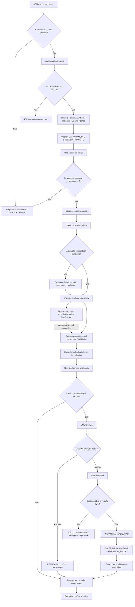
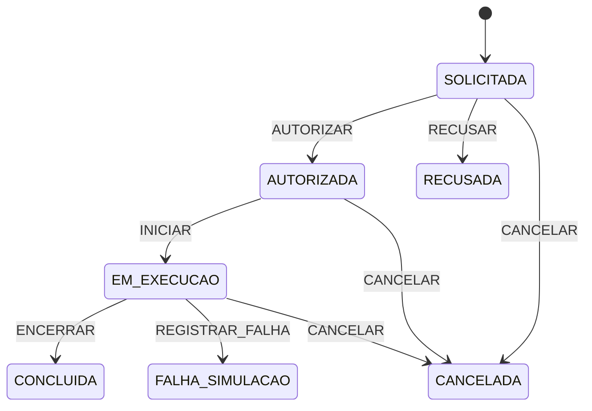

# Fluxos operacionais

Auditoria de 23/11/2026 · `main` · `c9785fa6b4656c73e3e35ac5db310c48e65d2fe5`.

[Índice](00-INDICE-GERAL.md) · [Pendências](09-PENDENCIAS-E-INCONSISTENCIAS.md)

## Fluxo integrado e pré-requisitos reais

As rotas de leitura não fazem aquisição automática. Sincronização não calcula etileno; análise não gera risco/alerta; avaliação ambiental pode usar análise apenas como contexto. Alerta não solicita simulação. São comandos explícitos e separados.

## Transições

| Entidade | Origem | Ação/destino | Exceção ou guarda |
|---|---|---|---|
| Viagem | PLANEJADA | EM_ANDAMENTO ou CANCELADA | Frota/empresa válidas; horários coerentes |
| Viagem | EM_ANDAMENTO | CONCLUIDA | Chegada não anterior ao início; estrutura congelada |
| Carga | PLANEJADA | EM_TRANSITO ou CANCELADA | Trânsito exige viagem EM_ANDAMENTO |
| Carga | EM_TRANSITO | ENTREGUE | Viagem iniciada; terminal não reabre |
| Caixa | REGISTRADA | EM_TRANSITO ou AVARIADA | Trânsito exige carga EM_TRANSITO |
| Caixa | EM_TRANSITO | ENTREGUE ou AVARIADA | Integridade da carga; terminal não reabre |
| Sessão | ATIVA | ENCERRADA ou CANCELADA | Horário/motivo explícitos; sem apagar janela |
| Alerta | ABERTO | RECONHECER→EM_ANALISE | Ator operacional, justificativa, chave |
| Alerta | ABERTO/EM_ANALISE | RESOLVER→RESOLVIDO; DESCARTAR→DESCARTADO | Não há resolução automática |
| Alerta | Qualquer | OBSERVAR, mesmo estado | Nota auditada, inclusive terminal |
| Intervenção | SOLICITADA | AUTORIZAR→AUTORIZADA; RECUSAR→RECUSADA; CANCELAR→CANCELADA | Por perfil/solicitante |
| Intervenção | AUTORIZADA | INICIAR→EM_EXECUCAO; CANCELAR→CANCELADA | Sessão/logística ativas, veículo livre |
| Intervenção | EM_EXECUCAO | ENCERRAR→CONCLUIDA; CANCELAR→CANCELADA; REGISTRAR_FALHA→FALHA_SIMULACAO | Encerramento administrativo preservado |

Estado de cálculo não é ciclo operacional: ENTRADA_INVALIDA, CONFIGURACAO_INCOMPLETA, SEM_ESTIMATIVA, PARCIAL, COMPLETO_NO_MODELO são resultados científicos computacionais. Estado ambiental AVALIADO/INCONCLUSIVO/CONFIGURACAO_INSUFICIENTE é outra dimensão. Aquisição EM_EXECUCAO/CONCLUIDA/PARCIAL/FALHA/INTERROMPIDA também não altera esses conceitos automaticamente.

## Erros e recuperação

401: novo login; 403: conferir identidade/vínculo, sem tentar IDs de outra empresa; 404: conferir recurso/pertencimento à sessão; 409: consultar estado/revisão/payload da chave; 422: corrigir dados, sem converter null em zero; 503: consultar antes de retry idempotente. Uma FALHA/PARCIAL de sincronização pode vir em 200: examinar estado, resumo e ocorrências.

Mesma chave e payload recuperam resultado anterior quando autorizado. Nova aquisição não modifica snapshot de análise anterior; nova análise é comando com nova chave. Complemento de sessão ENCERRADA requer flag/perfil/justificativa; CANCELADA preserva consultas e bloqueia novas análises/avaliações. Depois de iniciar simulação, prazo excedido exige ação humana; GET não altera estado.

Fontes: `app/modules/logistica/service.py` (transitions); `monitoramento/service.py` (sessão); `preventivo_service.py:decidir`; `exaustao_service.py:TRANSICOES,agir`. Todos estão vinculados nos documentos de arquitetura/RN/catálogo; testes específicos constam na matriz.
